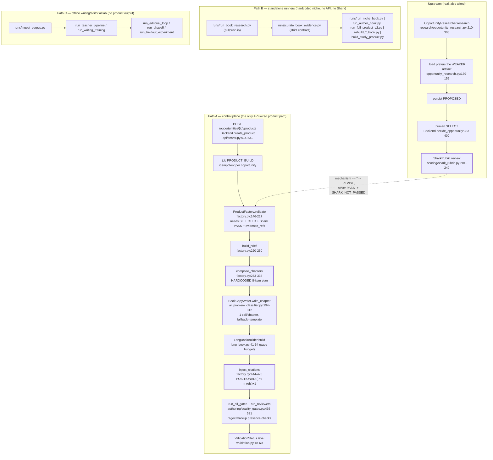

# Deliverable 5 — Factory gap analysis (code-backed)

**Compiled:** 2026-10-11 · **Repo:** `C:/Users/DELL/ipf-factory` · **HEAD:** `0b2848f` (working tree dirty)
**Mode:** read-only. Nothing in the application was modified.

**Evidence base.** Every claim below is drawn from
`raw/factory_ebook_pipeline_audit.md` (+ `_evidence.csv`, 100+ file:line rows) and
`raw/factory_infra_audit.md` (+ `_evidence.csv`, 78 rows), both produced by
read-only audits that opened the cited files, and from the lead researcher's own
reads. Line numbers refer to the working tree at capture time — **a concurrent
editor changed `ipf/api/server.py` and `ipf/database/migrations.py` during the
audits**, so re-verify a line before acting on it.

> **Post-audit update (same day).** The concurrent work was committed as
> **`03bf3b5` "Item 1 (MODEL authoring) + item 2 (real opportunity research)"**
> (1,890 insertions across 14 files: `ipf/research/opportunity_research.py`,
> `runs/{run_book_research,curate_book_evidence,fetch_thread_comments}.py`,
> `tests/test_opportunity_research.py`, plus edits to `factory.py`,
> `ai_problem_classifier.py`, `api/server.py`, `openapi.yaml`).
> **The P0 defects below were re-verified at that commit**: `inject_citations`
> still contains `(idx % n_refs) + 1` (now `ipf/products/factory.py:475`, file is
> 553 lines) and `check_value_mechanism` is still a keyword test (now
> `ipf/authoring/quality_gates.py:376`). The audit's content therefore describes
> the committed state, with line numbers drifted by the commit.

---

## 1. What the factory actually is

**Three disjoint paths, of which only one is wired to the API.**

**Health of each path**

| Path | Works? | Notes |
|---|---|---|
| **A — control plane** | **Partially.** 44 routes + SSE, runnable, idempotent jobs; but **no real opportunity can traverse it end-to-end** (Shark can never PASS on real data) and there is **no endpoint that creates a creator**, so it cannot bootstrap its own inputs. | `factory_infra_audit.md` F01–F05, F09–F10; `factory_ebook_pipeline_audit.md` 7–10 |
| **B — runners** | **Works and produces real artefacts** (the book_run archive is real Reddit data, 3.7 MB raw / 1.7 MB curated, `fetched_at 2026-10-11T16:21:35Z`). But each runner is hardcoded to one niche with hand-written chapter briefs and evidence lists *inside the runner*. | pipeline audit 12, 14–15 |
| **C — writing/editorial lab** | **Works, and is the most sophisticated code in the repo** — corpus → principle extraction → validation with negative controls → writing memory → blind/holdout evaluation. **Produces no product.** | pipeline audit 30 |

---

## 2. Capability comparison matrix

`S/M evidence` = what Synthesise AI / Monetise demonstrably do (evidence ids
`E*/T*/S*/M*/V*` resolve in `source_ledger.csv`). `Factory` = file:line state.

| Capability | Synthesise/Monetise evidence | Current factory implementation | Gap | Recommended change | Priority |
|---|---|---|---|---|---|
| **Niche discovery** | Scored "profitable pockets", 10–20 candidates, forced choice `[S19,S20,S23]` | `runs/run_book_research.py::NICHE_SPECS` — **3 hardcoded niches** with hand-written keyword clusters; `ipf/research/opportunity_research.py` derives candidates from a curated archive | Niche selection is code, not data; new niche = new Python | `NicheDescriptor` as data + the existing strict curation contract (Deliverable 6 R1/R2) | **P0** |
| **Audience definition** | Creator-audience mode ingests IG/YT and returns audience profile `[E10c,T06,S23]` | `opp.target_audience` field exists and is **required** by `validate()`; no code produces it besides the researcher's text | No audience *model* (constraints, objections, reading context); a free-text string only | `ReaderModeler` → `ReaderProfile` (Deliverable 6 R3) | **P0** |
| **Customer-problem discovery** | Problem clusters mined from real comments `[S19]` | **Real** and good: `runs/run_book_research.py` + `runs/curate_book_evidence.py` (≥90 chars, core term + pain phrase, per-cluster counts) | The *strict* contract is excellent; the **preferred artifact is the weaker one** (`_load` prefers `_threads.json`, whose clusters have `distinct_commenters` 1/0/1/0/0 vs 12/12/9/8/6) and evidence is mismatched (r/options comments under a money problem) | Fix the loader preference; add an evidence-relevance assertion to the curation contract | **P0** |
| **Market validation** | "Demand"/saturation claimed, never shown `[S23,S27]` | `DemandValidator` (`scoring/demand_scorer.py`) with 8 weighted factors and `evidence_complete` gate — **real and strong** — but its verdict is **not enforced**: `decide_opportunity` accepts `SELECT` on a `PROBLEM_REJECTED` opportunity (verified live, HTTP 200) | Gate exists but is bypassable | Enforce `demand_verdict` in `decide_opportunity`; make `PolicyEngine` (currently imported by zero modules) the single enforcement point | **P0** |
| **Competition analysis** | Claimed step, no observed UI `[S34]` | `opportunity.competition_summary` exists but **nothing ever writes it** (`opportunity_research.py` sets `""` with the comment *"not derivable from comments alone"*) | Field is dead; Shark's `competing_solutions` criterion can never be MET | Produce it from a grounded competitor scan with named artefacts, or drop the criterion and record the decision | **P0** |
| **Evidence collection + source citations** | Ingestion + reference library; "150+ sources" claimed, list never shown `[T06,S23]` | Real fetch + storage (`evidence_refs[]`, `data/editorial_*`, `artifacts/book_run/raw/*.json`); **citation linking is positional** (`(idx % n_refs)+1`) | Citations are decorative; no URL resolution check; evidence truncated to 6 items (`[:6]`) | Claim-level binding + entailment adjudication (R7); remove the modulo; resolve URLs | **P0** |
| **Product-opportunity scoring** | Visible 4-dimension 0–10 score, ranked `[S20,S23]` — the mechanic users praise | `OpportunityGraph.evaluate` (`scoring/opportunity_scorer.py`) is a **near-constant formula** with literals (`0.35*10 + … + 0.25*6`) and is **not on the API path**; `CreatorScorer` is dead code returning `quality_score*100` | Nothing scores a real opportunity on the wired path | Adopt the independent UVZ rubric in `synthesise_monetise_dossier.md` §II.2; require `evidence_ids` per sub-score, `null`≠0 | **P0** |
| **Customer transformation planning** | Transformation map with **prices**, 4-stage journey with milestones `[S19,S20]` | **Absent as a stage.** The 8-chapter plan is a literal; worksheets are injected at fixed indices | No before/after, no milestones, no failure modes | `ReaderModeler` → `TransformationSpec`; then `OutlineArchitect` + `OutlineGate` (R3/R4) | **P0** |
| **Product charter generation** | `charter.get`, the "DNA of your offer", handed to Ghostwriter OS `[T06,S19,S20]` | `brief.json` (`factory.py::build_brief`) has topic/audience/evidence/price_ceiling/max_pages — a *brief*, not a charter | No offer, positioning, USP, objections, prior attempts | Add the offer stage (R9) — it is the missing artefact | **P1** |
| **Detailed outline generation** | Outline/TOC mapped to journey stages `[S19]` | **Hardcoded 8-item `plan`** (`factory.py:268-292`); chapters are fixed regardless of topic | Structure is not derived from anything | The P0-1 change; `OutlineGate` validates before authoring | **P0** |
| **Long-form content coherence** | Wave generation "maintains context continuity" `[S19]` | 1 call/chapter; only the previous paragraph is passed implicitly (actually **nothing is passed** — each `write_chapter` is independent) | No cross-chapter continuity mechanism at all; a 2.7-page output against a 35-page budget went unnoticed by the gates | Pass the outline + previous chapter tail + a milestone statement; add a cross-chapter coherence check to the critic | **P0** |
| **Chapter dependencies & context management** | one `flow_id` threads all artefacts; reference library per flow `[E10b,T06]` | Brief → chapters → HTML, each written once; `execute()` writes artefacts at the end | No resumability at chapter granularity; a mid-authoring failure loses the chapters | Stage-level artefact writes + `sha1(brief_version+stage)` idempotency (R6 in Deliverable 6 §6) | **P1** |
| **Worksheets / companion tools** | Checklist + worksheets appended into the PDF; quality reported as poor `[V33,V36,V22]` | `if i in (5,7)` appends a `worksheet` block with `lines: 6/5` — fixed, content-free | No tool model, no scoring rule, no field schema | `ToolDesigner` → `Tool` with deterministic validation (R6) | **P1** |
| **Asset generation** | AI cover with Regenerate; Unsplash imagery; spelling errors reported `[T05,T06,S19]` | `_png_gradient` writes a real gradient PNG with stdlib zlib — **deterministic and dependency-free**, but gradient-only; Openverse/Unsplash fetching exists in `runs/` | No real cover design; no in-product imagery | Keep the stdlib PNG writer as the *fallback*; add an adapter-based image source with `UNAVAILABLE` honesty | **P1** |
| **Fact-checking / editorial review** | **Not evidenced anywhere** `[T·B.2]`; Terms push review to the user | **No fact-check, no URL resolution, no plagiarism/originality check, no reading-level check, no cross-chapter coherence check.** The gates are presence heuristics (`check_value_mechanism` tests `"mechanism" in text`) | The repo *owns* a semantic evaluator it does not use | Wire `ipf/writing/editorial/*` + `ipf/writing/evaluators.py` into `execute()` (R8) | **P0** |
| **Document formatting / export** | **PDF only**, margins configurable; formatting called the weakest point `[S19,S21,V22]` | **HTML only** — no PDF/EPUB/DOCX/MOBI writer exists (`grep` returns only citation URLs) | No shippable e-book format | Exporter adapter: HTML (exists) → PDF via WeasyPrint (BSD-3) → in-house EPUB3 (AGPL avoided); gate with epubcheck + ace | **P1** |
| **Product differentiation** | Method + ingestion + Whop integration; not technical `[dossier §VI.3]` | `check_chatgpt_substitution` passes on the words worksheet/route/fails — i.e. the differentiation gate is lexical | No measurement of differentiation | Evidence-bound citations + a specificity criterion from `ipf/writing/editorial/specificity.py` | **P0** |
| **Product packaging / offer creation** | Transformation options carry **suggested prices**; charter feeds the sales tool `[S19,S20]` | `ipf/products/promotions.py` (33 lines) tracks reels promised vs published; `config.MAX_CUSTOMER_PRICE` exists; **no offer artefact** | Nothing prices or positions a product in this pipeline | `OfferComposer` + `OfferGate` (R9) | **P1** |
| **Sales page / marketing content** | Charter → Ghostwriter OS; Whop store page generated + publish `[S23]` | `ipf/outreach/message_generator.py` (free-help-first, banned-language enforced) — for *creator outreach*, not for the product | No sales asset for the product itself | `OfferComposer.sales_page_blocks[]` with per-claim chapter provenance | **P1** |
| **Project history & resumability** | `flow/@all|@shared|@deleted`, `/trash`, dashboard, per-section status `[E10b,S19]` | SQLite `products` table + `job_id`; jobs are idempotent and restart-safe (`jobs.py`, idempotency verified live) | Product authoring is **not** stage-resumable; the state machine is **in-memory per key** and only `CampaignWorkflow` uses it | Stage artefacts + persisted job lifecycle keys (already strong in `jobs.py`) | **P1** |
| **Evaluation, testing, output quality** | Human regeneration only; no automated QA `[T·B.2]` | **1,436 tests by unittest discovery** (1,421 collected by pytest; **3–4 fail, non-deterministically**; ~40/118 files assert on *source text*); 25 gates + 2 reviewers are structural | Green ≠ good; no product-level evaluation | Golden-set harness (R11) + critic wiring; replace source-text assertions with behaviour | **P0** |
| **Cost & latency management** | Unknown (single chat call per chapter observed indirectly) | **No token/cost accounting anywhere**; model scraped from `~/.hermes/profiles/automate-man/config.yaml`; `timeout=90`, 2 retries, no budget | Cost per accepted product is unmeasurable | Usage rows per call + cost-per-accepted-product in the harness; model tiering (R·§5) | **P1** |
| **Downstream publishing / delivery** | Whop store page + publish button **from inside the product** `[S23]`; Whop OAuth identity | `ipf/tools/adapters/whop.py` exists but `whop.api` is **UNAVAILABLE**; no publish path | No delivery integration | Keep capability-honest; add Whop sandbox publish behind the existing capability gate | **P2** |
| **Metrics honesty** | n/a | `NO_DATA` real (10 modules); **`ZERO_ACTIVITY` / `LOW_ACTIVITY` / `MEASURED_ACTIVITY` appear nowhere** in `ipf/` or `tests/` although the README claims them | README overstates | Fix the README, or implement the vocabulary; either way, do not let docs drift from code | **P1** |

**Capabilities in the competitor that this factory should NOT copy:** the
locked-format gating (a paywall artifact), the uneditable intermediate stages, the
documentation that contradicts the deployment, and the absence of any fact-checking.

---

## 3. Honesty violations found in code (these outrank features)

The repository's culture is unusually honest, which makes the exceptions
significant. Two are outright fabrications of state:

| # | Violation | Evidence |
|---|---|---|
| 1 | **`POST /products/demo/random` writes a fabricated `COMPLETED` product** — `status='COMPLETED'`, `validation_level='SYSTEM_VALIDATED'`, `artifacts_json={"note":"random unrelated demo"}`, `opportunity_id=NULL`, `creator_id=NULL`, no QA. Verified live: the row appeared in `GET /products`. | `factory_infra_audit.md` F03 |
| 2 | **`CREATOR_ANALYSIS` fabricates an analysis** — sets `creators.status='ANALYZED'`, stamps `last_analyzed_at`, emits `CREATOR_ANALYZED`, returns success. No research is performed. | F06 |
| 3 | **`SharkRubric` marks the BLOCKING demand criterion `MET` on a `PROBLEM_REJECTED` verdict** — `if refs and demand:` accepts any non-empty string. Verified live. **A second instance of the same defect was found at the committed state: a `"NO_DATA (…)"` verdict string is also truthy and likewise promotes `demand_severity_evidence` to `MET`** (`shark_rubric.py:116-122`). | F10; pipeline audit correction note |
| 4 | **The demand/red-team gate is unenforced on the only decision endpoint** — `SELECT` accepted with `demand_verdict=PROBLEM_REJECTED`. | F09 |
| 5 | `ipf/research/audience_archive.py` is titled *"REAL-scale research dataset"* but fills comments from a seeded RNG over a hardcoded pool (`text = rng.choice(pool[niche_i])`), and `runs/run_full_product_v2.py` calls it under the banner `"RESEARCH: 100 creator archive"`. | pipeline audit 11 |
| 6 | `openapi.yaml` / `API_CONTRACT.md` state *"No HTTP server exists in the repository today"* while a 44-route server runs; `PATCH /campaigns/{id}` is documented and 404s. | F18 |

Each of these is a small change to fix and a large one to leave: they are exactly
the class of defect the repo's own `ARCHITECTURE_AUDIT.md` and upgrade-loop commit
messages were written to eliminate.

---

## 4. Infrastructure findings that change the plan

| Severity | Finding | Evidence |
|---|---|---|
| **Critical (if ever exposed)** | Auth is loopback-only plus an *optional* bearer token; with `IPF_API_TOKEN` unset (the default) **any local process can drive the factory**, and every response sends `Access-Control-Allow-Origin: *` with **no Origin/CSRF check** — a web page in the operator's browser can reach the API cross-origin. | F02 |
| **Critical for end-to-end** | No endpoint creates a creator; `CREATOR_DISCOVERY` raises `RuntimeError: slice indices must be integers` (signature mismatch); so **there is no API-only path from zero to a product**. | F04, F05 |
| **High** | The entire policy layer is orphaned: `ipf/domain/policies.py` is imported by **zero** modules; `PolicyEngine`, `Recovery`, `Supervisor`, `DealLock`, `LearningStore`, and `database/repositories.py` are exercised only by tests. The 2/4/6→40/50/60 rule lives only in unwired modules + `config.ALLOWED_OFFERS`. | F08 |
| **High** | One shared SQLite connection with `check_same_thread=False` is used by request threads **and** job daemon threads with no lock and no explicit transactions. | F13 |
| **Medium** | `migrations.connect` swallows every exception from `ipf.state.init_db` (`except Exception: pass`), so a schema failure is silent; `ipf/state.py` still uses bare `CREATE TABLE IF NOT EXISTS`. | F13 |
| **Medium** | The UI's SSE client cannot work in the secured configuration: `web/api.js` expects a query-token fallback the backend does not have, so with a token set it retries every 3 s forever. | F20 |
| **Medium** | `CAMPAIGN_SEND` is a hardcoded `raise RuntimeError("INTEGRATION_UNAVAILABLE")` and no endpoint enqueues it — sending is **absent rather than simulated**, which is safety-positive and capability-negative. | F07 |

**What is genuinely strong, and must be preserved:** capability honesty
(unrecognised head → `UNAVAILABLE`; no adapter fakes a live action; Instagram
messaging returns `STAGED` and never POSTs); JSON/JSONL no-silent-reset and
skip-and-count semantics; the job lifecycle (persisted before execution,
whitelisted transitions, idempotent retry, restart recovery — idempotency verified
live); and the migration ledger with 17 indexes and `foreign_keys=ON`.

---

## 5. Structural findings in the product path

1. **The persisted product is a fixture, not a product.**
   `artifacts/products/PROD-op1/product.html` is 15,709 bytes / **1,030 words / 8
   chapters / 2.7 projected pages against a 35-page budget**, `gates_are_real=true`,
   `failed=[]` — and its `brief.json` evidence rows are literally named
   `"student survey"`, `"comment archive A"`, `"comment archive B"` from
   `tests/test_product_factory.py`.
2. **The gates cannot see the failure.** A 2.7-page book passes all 25 gates and
   both reviewers, because every gate is a presence/format check.
3. **`check_diagnostic_integrity()` validates a doomscrolling diagnostic for every
   product** — it imports `QUESTIONNAIRE`/`INTERVENTIONS` from
   `ipf/authoring/diagnostic.py` (a screen-time domain model), so for a money or
   study product the gate measures an unrelated domain.
4. **The evidence library is 7 hand-written facts with URLs** (`evidence_library.py`),
   nothing verifies those URLs resolve, and `_science_for_brief` only fires for
   money keywords — so **non-money products get no science block at all**.
5. **Dead code that looks alive** (each referenced only by tests or not at all):
   `CreatorScorer`, `EvidenceStore`, `PrototypeBuilder`,
   `OpportunityGraph.evaluate` (a near-constant formula with hardcoded literals),
   `ProductPreflight`/`TargetReader`/`ValueMechanism`/`FullLoop`
   (`ipf/authoring/reader_persona.py`), `DpfBridge` (permanently `DpfUnavailable`),
   `PromotionTracker.status()`'s `"LATE"` branch (**unreachable by construction**: it
   is guarded by `remaining > 0` and then tests `len(published) >= reels`, which
   cannot both hold — no test asserts `LATE`).
6. **`PromotionTracker`** is used only by an integration test and two unit tests;
   the money path it guards has no live caller.
7. **The writing/editorial subsystem is an unconnected lab.** `ipf/writing/**` is
   imported by **no module under `ipf/products/` or `ipf/authoring/`** — only by
   `runs/*` and by `ipf/scoring/ai_problem_classifier.py` (for `active_model` only).

---

## 6. Technical debt and limitations, ranked by consequence

| Rank | Item | Consequence |
|---|---|---|
| 1 | Structure not derived from the reader's transformation | Every product is the same book with different prose |
| 2 | Citations not bound to claims | The "evidence-backed" claim is unverifiable |
| 3 | Semantic quality instruments unwired | Green gates on 1,030-word output |
| 4 | Control plane cannot reach production on real data | Nothing end-to-end is testable |
| 5 | Two fabrication paths in the API + an unenforced demand gate | The honesty doctrine is not enforced by code |
| 6 | Non-deterministic test suite; ~40/118 files assert source text | CI signal is unreliable; refactors look like breakage |
| 7 | No cost accounting | Cannot state cost per accepted product |
| 8 | HTML-only export | Output is not a shippable e-book |
| 9 | Single shared SQLite connection across threads | Latent corruption/blocking under concurrency |
| 10 | README/OpenAPI drift from code | New contributors and future-you are misled |

---

## 7. What this means, in one paragraph

The factory's **engineering substrate is better than the product it produces.**
The research chain, the curation contract, the evidence rubric, the validation
ladder, the job lifecycle and the writing/editorial lab are all real, tested and
honest — and almost none of them are connected to the act of producing a book.
Meanwhile the competitor's software is *less* disciplined but *better structured*:
it forces a scored choice, derives a transformation map, packages per format, and
puts a publish button at the end. The gap is therefore **not** "build more agents";
it is **wire the instruments you already own into a structure derived from the
reader's transformation, and bind every claim to the evidence that supports it.**
