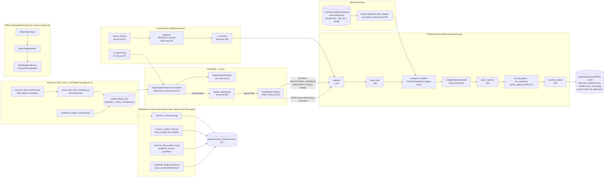

# ipf-factory — REAL e-book / digital-product pipeline: code-backed audit

**Audit date:** 2026-10-11 (UTC). **Auditor:** FactoryEbookAudit (read-only).
**Repo:** `C:/Users/DELL/ipf-factory` (Python 3.12.6, stdlib-only product path).

## Scope, method, and reproducibility caveat

* Method: opened every file cited with the `read` tool using explicit line ranges; `grep -n` for
  symbol/line confirmation; `python -c` for read-only data/JSON inspection; test counts via
  `unittest` discovery only. **Nothing was executed that writes to `artifacts/`, `data/`, `runs/`,
  or `cache/`.** No application file was modified. The two report files in `research/raw/` are the
  only writes.
* **The working tree was NOT clean during the audit** (`git status --porcelain` showed
  `M ipf/api/server.py`, `M ipf/api/extra_routes.py`, `M ipf/database/migrations.py`,
  `M ipf/products/factory.py`, `M ipf/scoring/ai_problem_classifier.py`, plus untracked
  `ipf/research/opportunity_research.py`, `runs/run_book_research.py`, `runs/curate_book_evidence.py`,
  `runs/fetch_thread_comments.py`, `artifacts/book_run/`). `ipf/api/server.py` changed line-count
  (989 → 1001 → 1000) *during* this audit, i.e. a concurrent writer was active. All line numbers
  below refer to the file state at the moment of the read; anchors are given so claims can be
  re-verified. sha1[:12] at capture: `ipf/api/server.py` = `d7c45c8cf7b5` (1000 lines),
  `ipf/products/factory.py` = `479975eb0c52` (553 lines), `ipf/scoring/ai_problem_classifier.py` =
  `56375656d2f1` (369 lines), `ipf/database/migrations.py` = `1f5861adc59f` (379 lines).
* Secrets: `.env` exists at repo root; **key names were not printed and no values were read.**
* **Final anchor re-verification:** all 21 load-bearing line anchors were re-checked after the
  concurrent editor committed (`HEAD = 03bf3b5 "Item 1 (MODEL authoring) + item 2 (real opportunity
  research)"`); 0 failures. Line numbers below match that committed state.

---

## KEY FINDINGS

1. **There are two disjoint product paths, not one.** (a) The control-plane/API path
   (`POST /opportunities/{id}/products` → job `PRODUCT_BUILD` → `ProductFactory`) and (b) standalone
   runners (`runs/run_niche_book.py`, `runs/run_author_book.py`, `runs/run_full_product_v2.py`, …).
   The factory's own docstring states there is *no* generic parameterised entry point and that the
   runners are "THIN compositions … hardcoded to one niche" — `ipf/products/factory.py:3-30`
   (VERIFIED, high).
2. **The API path's product renderer is real and gated.** `ProductFactory.execute` writes
   `brief.json`, `evidence.json`, `chapters.json`, `cover.png`, `product.html`, `qa_report.json`,
   then runs the real gates + reviewers — `ipf/products/factory.py:340-403` (VERIFIED, high).
3. **A real product artifact exists and passes all gates** — `artifacts/products/PROD-op1/`:
   `product.html` = 15 709 bytes / 1 030 words / 8 chapters / 7 reference items / 8 `cite` anchors,
   `qa_report.json` `gates_are_real=true`, `failed=[]`, both reviewers clean, `projected_pages=2.7`
   against `max_pages=35` (VERIFIED, high).
4. **The brief that product was built from is test-fixture data, not research.** `brief.json`
   carries `evidence` entries literally named `"student survey"`, `"comment archive A"`,
   `"comment archive B"` — the values from `tests/test_product_factory.py:44-60`
   `complete_opportunity()` (VERIFIED, high).
5. **The chapter outline is a hardcoded 8-item literal, not derived from the brief** —
   `ipf/products/factory.py:268-292` (`plan = [("A real problem / purpose", …), …, ("What to do
   next", …)]`). Every product from the API path has the same 8 chapter titles (VERIFIED, high).
6. **All worksheets, callouts, checklists and "science" blocks are positionally injected by
   `if i == 0 / 3 / 4 / 5 / 6 / 7`** — `ipf/products/factory.py:307-333`. The product's structure is
   a template with prose dropped in (VERIFIED, high).
7. **`mechanism`, `competition_summary`, `feasibility`, `commercial_hypotheses` are never produced
   by any code path.** `OpportunityResearcher` explicitly writes `"mechanism": ""`, `"competition_summary": ""`,
   `"feasibility": ""` with the comment *"not derivable from comments alone"* —
   `ipf/research/opportunity_research.py:273-279`. No writer of these columns exists anywhere
   (`grep 'mechanism\s*='` finds only reader_persona/quality_gates prose checks) (VERIFIED, high).
8. **Consequence: the Shark gate can essentially never PASS on real data.** `ESSENTIAL =
   (problem_specificity, reader_definition, differentiation, demand_severity_evidence)` and a
   non-MET essential ⇒ `REVISE` — `ipf/scoring/shark_rubric.py:46-47, 185-199`; `differentiation`
   MET requires `mechanism` ≥ 8 words — `shark_rubric.py:131-134`. With `mechanism == ""` the
   verdict is `REVISE`, and `ProductFactory.validate` requires verdict `"PASS"` or raises
   `SHARK_NOT_PASSED` — `ipf/products/factory.py:42, 198-204` (VERIFIED, high).
9. **The red team is deliberately set to kill every raw-research candidate.** `opportunity_research.py:285-292`
   sets `"differentiation": "" if opp["mechanism"] else "none"` and `"demand": … "unvalidated"`;
   `OpportunityRedTeam._FAILURE_SIGNALS["differentiation"] = ("none","identical","commodity")` →
   `RED_TEAM_KILLED` — `ipf/scoring/red_team.py:7-22`. The test asserts this:
   `tests/test_opportunity_research.py:139-157` (`assertIn("KILLED", …)`) (VERIFIED, high).
10. **So the end-to-end control-plane chain is structurally dead-ended**: research → PROPOSED →
    human SELECTED → Shark `REVISE`/`INSUFFICIENT_EVIDENCE` → production refused. A PASS is only
    reachable when the opportunity row is hand-seeded with all brief fields (which is exactly what
    the tests do) (INFERENCE from 7–9, high).
11. **"Real-scale research" in the API-adjacent runner is synthetic.** `ipf/research/audience_archive.py:1`
    is titled *"REAL-scale research dataset"* but `build_archive` fills every comment from a
    hardcoded list via a seeded RNG: `text = rng.choice(pool[niche_i])` at
    `audience_archive.py:103`, seeded by `_stable_rng` at `:73-74`. `runs/run_full_product_v2.py:70`
    calls it under the banner `"RESEARCH: 100 creator archive"` (VERIFIED, high).
12. **A genuinely real research chain exists separately and its outputs are on disk.**
    `runs/run_book_research.py` fetches public Reddit posts+comments via `pullpush.io`
    (`runs/run_book_research.py:1-35`); `runs/curate_book_evidence.py` applies a strict relevance
    contract (`curate_book_evidence.py:1-27`). `artifacts/book_run/` holds real data:
    `raw/*.json` (~3.7 MB), `curated/*.json` (~1.7 MB), `problems_*.json`,
    `fetched_at=2026-10-11T16:21:35Z` (VERIFIED, high).
13. **The researcher prefers the WEAKER artifact.** `_load` tries
    `problems_<niche>_threads.json` first, then `problems_<niche>.json` —
    `ipf/research/opportunity_research.py:142-155`. Measured: money `_threads.json` clusters have
    `distinct_commenters` 1/0/1/0/0, while the keyword-search file has 12/12/9/8/6 (VERIFIED, high).
14. **Evidence relevance in the preferred artifact is poor.** The `mid_month_fade` cluster
    ("money runs out before the next payday") in `problems_money_budget_small_income_threads.json`
    is evidenced by an `r/options` comment about trading: *"Shares Are Vastly Superior for a
    Trader…"* (VERIFIED, high).
15. **`post_url` in the threads artifact is a malformed double URL**:
    `"https://www.reddit.comhttps://www.reddit.com/r/options/comments/1v27wej/…"` (VERIFIED, high).
16. **The "opportunity score" is a near-constant formula.** `OpportunityGraph.evaluate` hardcodes
    `0.35 * 10 + 0.20 * min(10, product_feasibility) + 0.20 * audience/10 + 0.25 * 6` and
    `0.20 * 7 + 0.15 * 5 + 0.15 * 8` — `ipf/scoring/opportunity_scorer.py:24-34`. Its only caller is
    the runner `runs/run_full_real_test.py:131`; it is **not** on the API production path (VERIFIED, high).
17. **`CreatorScorer` is dead code in production.** Its `score()` loops over weights doing nothing
    and returns `creator["quality_score"] * 100` — `ipf/scoring/creator_scorer.py:14-21`. Its only
    references are `tests/test_creators.py` (VERIFIED, high).
18. **`EvidenceStore` is dead code.** It is an in-memory dict (`ipf/research/evidence.py:10-23`),
    referenced only by `tests/test_upgrade_batch2.py` and an import in
    `ipf/observability/learning.py:12`. Nothing in the product path stores evidence through it
    (VERIFIED, high).
19. **The "AUTHOR BEFORE WRITER" preflight artifact is never built in the product path.**
    `ProductPreflight` / `TargetReader` / `ValueMechanism` / `FullLoop` exist in
    `ipf/authoring/reader_persona.py:35-122` but are referenced only by
    `tests/test_reader_persona.py` (VERIFIED, high).
20. **The DPF bridge — the advertised content generator — is permanently unavailable.**
    `DpfBridge.generate_product` raises `DpfUnavailable("DPF invocation not yet enabled — deferred by
    policy")` after the root check — `ipf/products/dpf_bridge.py:32-41` (VERIFIED, high).
21. **Citation linking is positional, not claim-level.** `inject_citations` numbers every `<li>` in
    the references section and then attaches `[n]` to each chapter's first `<p>` using
    `ref = (idx % n_refs) + 1` — `ipf/products/factory.py:444-478`. A citation does not point at the
    source of the claim (VERIFIED, high).
22. **Evidence is truncated to 6 items** before authoring: `[:6]` at `ipf/products/factory.py:263`;
    `_evidence_refs(..., limit=6)` at `ipf/research/opportunity_research.py:172` (VERIFIED, high).
23. **The evidence library is 7 hand-written entries, with URLs.** `ipf/products/evidence_library.py:9-73`.
    Nothing verifies those URLs resolve, and `_science_for_brief` only fires for money keywords
    (`factory.py:85-103`), so non-money products get **no** science block (VERIFIED, high).
24. **`check_diagnostic_integrity()` validates the SCREEN-TIME diagnostic for every product.**
    It imports `QUESTIONNAIRE`/`INTERVENTIONS` from `ipf/authoring/diagnostic.py:23,69` (a
    doomscrolling domain model) — `ipf/authoring/quality_gates.py:319-343`. For a study or money
    product the gate measures an unrelated domain (VERIFIED, high).
25. **Quality gates are structural presence checks, not quality measurements.** e.g. Gate H passes
    if the text contains "routing|measure|unlike" (`quality_gates.py:236-259`); Gate I passes on the
    word "escalate" (`:261-268`); `check_chatgpt_substitution` passes on the words
    worksheet/route/fails (`:353-362`) (VERIFIED, high).
26. **No fact-checking, no URL resolution, no originality/plagiarism check, no reading-level check,
    no cross-chapter coherence check exists.** `grep -rn "urlopen|requests\." ipf/products ipf/authoring`
    returns only `ipf/writing/model.py:114` (the LLM call); the gate list (`quality_gates.py:449-461`,
    `:465-515`) contains no such check (ABSENT, high).
27. **Export is HTML only.** No PDF/EPUB/DOCX/MOBI writer exists (`grep -rn "pdf|epub|docx|mobi|
    weasyprint|reportlab" ipf/` returns only citation URLs in data files) (ABSENT, high).
28. **The LLM is a single raw `urllib` chat-completions call**, provider/model resolved by scraping
    `C:/Users/DELL/.hermes/profiles/automate-man/config.yaml` — `ipf/scoring/ai_problem_classifier.py:49-71`
    (`_provider_api_key`/`_provider_api`), model at `ipf/writing/model.py:28-82` (`active_model`).
    Request body: `{"model", "messages", "temperature": 0.2, "max_tokens": 1200}`,
    `timeout=90`, 2 retries with `time.sleep(1.5 * (attempt+1))` —
    `ai_problem_classifier.py:141-180`. **No token/cost accounting anywhere** (ABSENT, high).
29. **Failure handling is honest but silent-degrading.** On model failure the factory emits
    templated prose and records `authoring_mode="DETERMINISTIC"` + `authoring_note` —
    `factory.py:296-303, 337-338`; `last_error` is set at `ai_problem_classifier.py:188` (VERIFIED, high).
30. **The writing/editorial subsystem is an offline lab, not part of product generation.**
    `ipf/writing/**` is imported by no module under `ipf/products/` or `ipf/authoring/`; only by
    `runs/{run_teacher_pipeline,run_editorial_loop,run_writing_training,run_phase5,ingest_corpus,run_heldout_experiment}.py`
    and `ipf/scoring/ai_problem_classifier.py` (for `active_model` only) (VERIFIED, high).
31. **Measured test suite: 1436 tests**, `python -c "import unittest; print(unittest.defaultTestLoader.discover('tests').countTestCases())"` → `1436`.
    Per-file: `test_product_factory.py` 27, `test_opportunity_research.py` 19, `test_gate_canaries.py` 28,
    `test_long_book.py` 6, `test_book_content.py` 5, `test_ebook.py` 6, `test_dpf_bridge.py` 2 (VERIFIED, high).
32. **Tests stub only the model boundary and assert the real gates are used** —
    `tests/test_product_factory.py:24-35` (`StubWriter`), `:139-141` (`gates_are_real`),
    `:158-175` (real run passes real gates) (VERIFIED, high).

---

## 1. The actual end-to-end execution path

### Path A — control plane (the only path wired to the API and to `PRODUCT_BUILD`)

| # | Stage | Function | Evidence |
|---|---|---|---|
| A1 | HTTP start | `Backend.create_product` | `ipf/api/server.py:514-531` |
| A2 | job enqueue (idempotent per opportunity) | `jobs.enqueue("PRODUCT_BUILD", …)` | `ipf/api/server.py:524-527` |
| A3 | handler dispatch | `{"PRODUCT_BUILD": self._h_product}` | `ipf/api/server.py:122` |
| A4 | prerequisites | `ProductFactory.validate` | `ipf/products/factory.py:146-217` |
| A5 | brief assembly | `ProductFactory.build_brief` | `ipf/products/factory.py:220-250` |
| A6 | persist `WRITING/BRIEFED` | `persist_product` | `ipf/api/server.py:220-221`; `factory.py:497-540` |
| A7 | execute | `ProductFactory.execute` | `ipf/products/factory.py:340-403` |
| A8 | author chapters | `compose_chapters` → `BookCopyWriter.write_chapter` | `factory.py:253-338`; `ai_problem_classifier.py:294-312` |
| A9 | render | `LongBookBuilder.build` (page budget) | `ipf/products/long_book.py:41-64` |
| A10 | citations | `inject_citations` | `ipf/products/factory.py:444-478` |
| A11 | QA | `run_all_gates` + `run_reviewers` | `ipf/authoring/quality_gates.py:465-515, 516-521` |
| A12 | level | `ValidationStatus.level` | `ipf/authoring/validation.py:48-60` |
| A13 | persist result | `persist_product(...)` | `ipf/api/server.py:233-240` |

Upstream of A1 (also real, also wired):

| # | Stage | Function | Evidence |
|---|---|---|---|
| U1 | research → candidates | `OpportunityResearcher.research` | `ipf/research/opportunity_research.py:215-303` |
| U2 | read real archive | `_load` → `artifacts/book_run/problems_*_threads.json` | `opportunity_research.py:142-155` |
| U3 | persist PROPOSED | `_persist` | `opportunity_research.py:329-358` |
| U4 | human decision | `Backend.decide_opportunity` | `ipf/api/server.py:383-400` |
| U5 | Shark review | `SharkRubric.review` (route prepended in `extra_routes.install`) | `ipf/api/extra_routes.py:44-59`; `ipf/scoring/shark_rubric.py:201-249` |

Observed artifacts of a completed Path-A run: `artifacts/products/PROD-op1/{brief.json, evidence.json,
chapters.json, cover.png, product.html, qa_report.json}` and `artifacts/products/PROD-smoke-op/…`.

### Path B — standalone runners (hardcoded niche, no API, no Shark)

`runs/run_book_research.py` (pullpush.io fetch) → `runs/curate_book_evidence.py` (strict relevance) →
`runs/fetch_thread_comments.py` (per-post threads) → then one of:
`runs/run_niche_book.py` (niche → mine → classify → book), `runs/run_author_book.py`
(uses `ipf.products.book_content.all_chapters` — the hardcoded *"Stop the Mid-Month Fade"* book,
`runs/run_author_book.py:169`), `runs/run_full_product_v2.py` (synthetic archive + AI copy),
`runs/rebuild_{screen,niche,fitness}_book.py`, `runs/build_study_product.py` (deterministic
`study_recall` product), `runs/run_teacher_pipeline.py` + `runs/run_editorial_loop.py` (writing lab).

### Path C — offline writing/editorial lab (no product output)

`runs/ingest_corpus.py` → `runs/run_teacher_pipeline.py` / `runs/run_writing_training.py` →
`runs/run_editorial_loop.py` → `runs/run_phase5.py` / `runs/run_heldout_experiment.py`.
Writes only into `artifacts/writing_teacher|writing_training|editorial|phase5/` and
`data/editorial_*`.

### Mermaid — CURRENT pipeline (real nodes only)



---

## 2. Data models and persistence

### SQLite (canonical schema)

* Base schema `ipf/state.py`: `creators` (`:9`), `opportunities` (`:19` — `opportunity_id, creator_id,
  global_cluster_id, problem_summary, opportunity_score, distribution_score, demand_verdict,
  red_team_verdict, status`), plus campaigns/deals/revenue_events/creator_payouts/workflow_runs/
  audit_events/tool_calls.
* Versioned migrations `ipf/database/migrations.py`: `OPPORTUNITY_COLUMNS` (`:45-53`) adds `title,
  target_audience, painful_moment, mechanism, evidence_refs, contrary_evidence, competition_summary,
  commercial_hypotheses, confidence, feasibility, next_validation_action, decision_history,
  created_at, updated_at`; `products` CREATE TABLE (`:132-146`); `shark_reviews` (`:197-215`);
  `PRODUCT_COLUMNS` (`:270-274`) adds `title, target_reader, stage, authoring_mode, error_code,
  error_message, artifacts_dir, brief_json, completed_at`; migration list `MIGRATIONS` (`:286-304`)
  ending `0010_product_authoring_note`. `connect()` (`:354`) is the canonical open path.
* `_add_columns` (`migrations.py:246-256`) is additive `ALTER TABLE … ADD COLUMN`, applied per
  migration in autocommit (`migrate`, `:306-352`).

### What carries context between stages

| Carrier | Fields | Producer | Consumer |
|---|---|---|---|
| `opportunities` row | `problem_statement`, `target_audience`, `painful_moment`, `evidence_refs`, `contrary_evidence`, `mechanism`, `competition_summary`, `feasibility`, `title`, `demand_verdict`, `red_team_verdict` | `OpportunityResearcher._persist` (`opportunity_research.py:329-358`) — **but only the fields it fills; `mechanism`/`competition_summary`/`feasibility` are written as `""`** (`:273-279`) | `ProductFactory.validate`/`build_brief` (`factory.py:176-181, 223-241`), `SharkRubric._evaluate` (`shark_rubric.py:98-181`) |
| `brief` dict | all of the above + `price_ceiling` (from `config.MAX_CUSTOMER_PRICE`), `brief_version` (sha1 of the canonical JSON) | `build_brief` (`factory.py:220-250`) | `compose_chapters`, `execute` |
| `products` row | `brief_json`, `artifacts_json`, `qa_json`, `validation_level`, `stage`, `authoring_mode` | `persist_product` (`factory.py:497-540`) | `product_detail` (`factory.py:542-553`), `/products/{id}` routes |
| job row | `payload_json` (opportunity_id, product_id, creator_id), `progress_stage` | `create_product` (`server.py:524-527`); `JobStore.progress` (`jobs.py:106`) | `_h_product` |

### Where context is LOST (verified)

1. **`mechanism`/`competition_summary`/`feasibility`/`commercial_hypotheses` are never populated** —
   written as `""` by the only producer (`opportunity_research.py:273-279`); nothing else writes them.
   The factory then *reads* them into the brief (`factory.py:238-241`) and the Shark rubric requires
   `mechanism` for `differentiation` (`shark_rubric.py:131-134`).
2. **Evidence is truncated to 6** at `factory.py:263` and at the producer
   (`opportunity_research.py:172` `limit=6`), while the library has 7 facts.
3. **`_list`/`_txt` coercion silently accepts junk**: a JSON string, a newline-delimited string, or
   a bare string all become a list (`factory.py:63-80`); `_txt` returns `""` for anything non-str.
4. **`demand_verdict` "NO_DATA (…)" counts as a recorded demand verdict.** `SharkRubric` tests
   truthiness of `_txt(opp.get("demand_verdict"))` (`shark_rubric.py:115-122`) so a NO_DATA string
   promotes `demand_severity_evidence` to **MET**. The producer writes
   `demand_verdict = f"NO_DATA ({type(e).__name__})"` (`opportunity_research.py:260-262`) — an
   honest label that the rubric then mis-reads as evidence (VERIFIED, high; this is a correctness
   bug, not just a style issue).
5. **`evidence_refs` from research are dicts with `kind/subreddit/permalink/author/quote`** but the
   factory JSON-dumps them into prompt text (`factory.py:263`) and `inject_citations` never reads
   them — the artifact's citations point at the hardcoded `FACTS` list, not at the Reddit evidence
   (`factory.py:444-478`).
6. **`contrary_evidence` is read into the brief (`factory.py:235`) and never rendered anywhere.**
7. **`product_id` in the brief comes from `opportunity.get("product_id")`** (`factory.py:230`) —
   the `opportunities` table has no `product_id` column (it lives on `deals`, `state.py:38-56`), so
   the brief's `product_id` is always `""` (VERIFIED by the real `brief.json`:
   `"product_id": ""`).

### Non-SQL stores

| Store | Path | Shape | Integrity |
|---|---|---|---|
| `authoring_memory.json` | `data/` | `{products:7, rules:2}` | `load_json_store` raises `CorruptStoreError` on unreadable/invalid/shape-mismatch (`ipf/domain/json_store.py:45-64`) |
| `editorial_memory.json` | `data/` | `{lessons:5, regressions:0}` | via `ipf/writing/editorial/memory.py` |
| `writing_memory.json` | `data/` | `{principles:12, regression_tests:61, cycles:3}` | via `ipf/writing/memory.py` |
| `writing_corpus/corpus.json` | `data/` | `{passages:16, rejected:0}` | via `ipf/writing/corpus/registry.py` |
| `editorial_benchmark/benchmark.json` | `data/` | `{items:155}` | `ipf/writing/editorial/benchmark.py` |
| `editorial_calibration/*.jsonl` | `data/` | batch1 54, holdout 36, mini 15, responses_holdout_partA 18 rows | `calibration_set.py:152` leakage_check |
| `editorial_versions/EDITORIAL_MODEL_V5.json` | `data/` | `{file_hashes:6}` | versioned frozen manifest |

---

## 3. LLM / model integration

* **Single gateway**: raw `urllib.request` POST to `<provider api>/chat/completions`, OpenAI-shaped.
  Two owners, same shape: `ProblemClassifier._chat` (`ipf/scoring/ai_problem_classifier.py:141-180`)
  and `WriterClient.write` (`ipf/writing/model.py:94-119`).
* **Credential resolution by scraping the Hermes profile config**, not env-only:
  `_provider_api_key`/`_provider_api` regex the `providers.<provider>.api_key|api` lines out of
  `C:/Users/DELL/.hermes/profiles/automate-man/config.yaml`
  (`ai_problem_classifier.py:49-71`); `PROFILE_HOME` overridable by `HERMES_HOME` (`:21`).
  `.env` fallback list at `:42`.
* **Model resolution**: `active_model()` (`ipf/writing/model.py:28-82`) reads a top-level `model:`
  scalar or a linear scan of the provider block (`_provider_block_model`, `:60-82`), fallback
  `deepseek-v4-flash`. `BookCopyWriter.__init__` resolves it (`ai_problem_classifier.py:260-276`) —
  the docstring records the earlier bug where a hardcoded `gpt-5.6-luna` broke every chapter.
  `ProblemClassifier.__init__` still defaults to `"gpt-5.6-luna"` (`:137`) when constructed without a
  model — and `runs/run_niche_book.py:88` / `runs/run_full_product_v2.py:112` pass
  `model="deepseek-v4-flash"` explicitly.
* **Prompt owners** (quote-verified):
  * `SYSTEM` research-classifier prompt — `ai_problem_classifier.py:83-101` (JSON shape
    `{class, repair, wtp_score, reason}`; rule "Never invent evidence").
  * `FEWSHOT` 3 examples — `:73-82`.
  * `BOOK_WRITER_SYSTEM` — `:232-243` (JSON shape `{intro, problem, solution, steps[], closing}`).
  * `CHAPTER_WRITER_SYSTEM` — `:245-255` ("Never invent facts, statistics, fake testimonials or
    named studies - the brief below is the only material you are allowed to work from").
  * `WRITER_SYSTEM` (writing lab) — `ipf/writing/model.py:12-20`.
  * Prompt assembly for chapters — `ai_problem_classifier.py:294-311` (asks for 350-500 words,
    `no statistics`).
* **Structured-output parsing**: brace-slice then `json.loads`
  (`ProblemClassifier._parse`, `:182-215`; `_parse_bare`, `:217-223`); any exception → `None` →
  caller falls back. No schema validation, no JSON-schema/repair retry.
* **Retries**: 2 retries, `time.sleep(1.5 * (attempt + 1))`, `timeout=90`
  (`ai_problem_classifier.py:161-180`). `WriterClient` has **no retry** (`model.py:104-119`).
* **Failure handling**: `last_error` set on final failure (`ai_problem_classifier.py:188`), surfaced
  by `BookCopyWriter.write_chapter` (`:311`) and carried into `authoring_note`
  (`factory.py:296-303`).
* **Cost accounting**: **ABSENT.** `config.py` defines `TARGET_DAILY_LLM_COST`,
  `HARD_DAILY_LLM_COST_LIMIT`, `PER_WORKFLOW_COST_LIMIT` (`ipf/config.py:65-68`) but no code reads
  them on the product path, and `usage` from the API response is never read
  (`ai_problem_classifier.py:170-176` takes only `choices[0].message.content`).
* **Test/offline mode**: no explicit dry-run switch; degradation is implicit (missing
  `api`/`api_key` → `return None` at `:152-155`). Tests replace the whole writer object
  (`tests/test_product_factory.py:24-35`).
* Deterministic fallbacks: `deterministic_book_copy` (`:323-347`) and
  `DeterministicProblemClassifier` (`:350-369`).

---

## 4. Research and evidence handling

* **Two disjoint research sources.**
  1. **Synthetic** — `ipf/research/audience_archive.py` (`build_archive` `:77-119`, `rng.choice`
     `:103`, `_stable_rng` `:73`). Called by `runs/run_full_product_v2.py:70` ("REAL archive at
     scale") and `runs/run_niche_book.py:75` (`load_or_build`).
  2. **Real** — `runs/run_book_research.py` fetches pullpush.io; `runs/curate_book_evidence.py`
     applies the strict contract (body ≥ 90 chars, real author, core-term AND pain-phrase match —
     `curate_book_evidence.py:21-27`). Outputs on disk under `artifacts/book_run/` (raw ≈ 3.7 MB,
     curated ≈ 1.7 MB, `problems_*.json`, `threads/`, `fetched_at 2026-10-11T16:21:35Z`).
* **Evidence store**: `ipf/research/evidence.py` `EvidenceStore` (`:10-23`) is an **in-memory dict,
  never persisted, never used by the product path** (only tests). Persisted evidence is instead the
  `evidence_refs` JSON column on `opportunities`.
* **Citation reality**: the rendered artifact cites `ipf/products/evidence_library.FACTS` (7 entries
  with source/year/url, `evidence_library.py:9-73`) — hand-written but with real URLs. The Reddit
  provenance captured in `evidence_refs` never reaches the artifact. `inject_citations`
  (`factory.py:444-478`) numbers the reference list and links chapters by index modulo, so
  **citations are positional**.
* **`_science_for_brief`** (`factory.py:85-103`) only returns a fact when the topic text contains a
  money keyword (`money|budget|save|…`); otherwise the product has **no science block at all**
  (VERIFIED: the study product `PROD-op1` passed every gate without one).
* **URL verification / claim-to-source checking: ABSENT.** No code opens a source URL or compares a
  claim to a source (`grep -rn "urlopen|requests\." ipf/products ipf/authoring` → only the LLM call
  in `ipf/writing/model.py:114`).
* **`check_evidence_scope`** (`quality_gates.py:298-317`) is the closest thing to fact-checking: it
  blacklists 9 over-claim phrasings (e.g. "average attention span on a phone screen"). It is a
  phrase blacklist over visible text, not verification.

---

## 5. Quality assurance

### Gates (real, count = 13 labelled + 13 hard = 26 entries)

`GATE_CHECKS` (`quality_gates.py:449-461`) pins 12 lettered gates A–L, each to a **distinct**
measure function; `run_all_gates` appends `M technical QA` (`:465-497`) then 13 "hard checks"
(`:498-515`). `run_reviewers` (`:516-521`) runs `reviewer_ai_writing` (`:390-425`) and
`reviewer_red_team` (`:427-447`). All deterministic — **no LLM reviewer exists**.

| Gate | Measure fn (line) | Predicate (abridged) |
|---|---|---|
| A real problem / purpose | `check_problem_statement` :163 | heading containing "problem" or `.pain/.problem` markup |
| B target reader present | `check_target_reader` :179 | ≥3 second-person + a "who this is for" cue |
| C transformation present | `check_transformation` :194 | transition regex or an outcome heading |
| D research | `check_references_section` :69 | class ∈ {references,refs,bibliography,sources,ref} or a refs heading |
| E evidence cited | `check_evidence_cited` :116 | a `cite` class token or `#r-` anchor |
| F method (tooling) | `check_method_procedure` :211 | `<ol>` with ≥3 `<li>`, ≥2 "step N", or a method heading |
| G implementation | `check_worksheet_or_tool` :129 | `<table>`/`<input>`/`data-tool`/tool class token |
| H differentiation | `check_differentiation` :236 | routing cue, routing class, measure cue, or "unlike" cue |
| I failure handling | `check_failure_handling` :261 | one regex hit (e.g. "escalate") |
| J safety | `check_safety_boundaries` :279 | none of 9 unsafe directives |
| K editorial | `check_banned_user_facing` :82 | none of 9 machine/methodology phrases |
| L design/visuals | `check_visuals` :289 | `imgs > 0` |
| M technical QA | `reviewer_red_team` :427 | no `{{}}`, leaked paths, "placeholder", duplicate >200-char paragraphs |
| hard ×13 | `:498-515` | title, body>300 words, no placeholders, no banned phrases, honest footer, page budget, no unattributed blockquotes, evidence scope, diagnostic integrity, structural variety, chatgpt-substitution, no fabricated experience, value mechanism |

The measured real run: all gates PASS, `failed=[]`, both reviewers clean, and the `measure` field is
recorded per gate — visible in `artifacts/products/PROD-op1/qa_report.json`.

### What the gates do NOT measure (all ABSENT, evidence = absence + named greps)

factual accuracy · citation resolvability / claim↔source mapping · reading level / readability ·
originality / plagiarism / n-gram overlap vs training data · cross-chapter coherence or repetition
across the book · argument soundness · market fit / demand of the finished product · price/value ·
instructional sequencing · accessibility (WCAG) · typography/contrast ratios · correctness of any
number printed in the book.
Greps run: `grep -rn "plagiar|original|readability|flesch|coherence|fact.check|verify_url|urlopen"
ipf/authoring ipf/products`; `grep -rn "urlopen|requests\." ipf/products ipf/authoring`.

### Benchmark / calibration machinery (real, but offline)

* `ipf/writing/editorial/benchmark.py`: source loading `:39`, split assignment `:329-355`
  (`train`/`dev`/`held_out`, with a guarantee that each principle appears in `held_out`), shingle
  leakage report `:455`.
* `ipf/writing/editorial/calibration_set.py`: `build` `:82-123` (60 target, 5 strata, 7 genres,
  2 parts — 70 % calibration / 30 % `human_holdout` at `:115`), `leakage_check` `:152-165`.
* `ipf/writing/editorial/criteria.py`: 12 criteria functions (`CRITERIA_FUNCS` `:566`).
* `ipf/writing/auditor.py`: `HumanWritingAuditor.audit` returns a 13-field vector, never a single
  score (`VECTOR_FIELDS` `:10-15`, `audit` `:19-36`).
* **None of this is invoked by `ipf/products/factory.py`** (verified by import trace).

### Validation ladder

`ValidationStatus.level` (`ipf/authoring/validation.py:48-60`): only `SYSTEM_VALIDATED` and
`PRODUCT_INTERNALLY_VALIDATED` are `FACTORY_CLAIMABLE` (`:34`); levels 3–5 require real humans.
`ProductFactory._validation_level` (`factory.py:405-411`) passes only `tests_pass`/`gates_pass`, so
the adapter can only ever reach `SYSTEM_VALIDATED` — confirmed by the real run
(`validation_level = SYSTEM_VALIDATED`).

---

## 6. Tests

**Measured total: 1436 test cases.**
Exact command:
```
python -c "import unittest; print(unittest.defaultTestLoader.discover('tests').countTestCases())"
```
→ `1436`. Per-file counts were obtained with
`python -c "import unittest,os,glob; [print(unittest.defaultTestLoader.discover('tests', pattern=os.path.basename(f)).countTestCases(), f) for f in sorted(glob.glob('tests/*.py'))]"`
and summed to the same 1436. `tests/integration/` (2 files) is included in the recursive discovery.

| Test file | Tests | What it actually asserts |
|---|---|---|
| `test_product_factory.py` | 27 | prerequisite codes; real builder/gates used (`:139-141`); real run → `COMPLETED` with real files on disk (`:158-175`); injected failing gate → `NEEDS_REVISION` (`:211-222`); builder failure raises and leaves no `product.html` (`:232-240`); cancel before rendering (`:242-245`); HTTP job → product → reconnect durability → `/qa` exposes `gates_are_real`; artifact path traversal refused 403 (`:392-403`); retry does not duplicate a product (`:405-417`); interrupted job recovery (`:419-427`) |
| `test_opportunity_research.py` | 19 | honest refusals; real provenance carried; thin evidence labelled; demand NO_DATA; **red team kills** (`:139-146`); red-team signals supplied (`:149-157`); threads artifact preferred (`:159-168`); rerun does not clobber a human decision (`:170-181`) |
| `test_gate_canaries.py` | 28 | negative controls proving each gate label measures its own property |
| `test_long_book.py` | 6 | page budget, render structure |
| `test_book_content.py` | 5 | `len(DEEP_CHAPTERS) == 13`, evidence-library integrity |
| `test_ebook.py` | 6 | `EbookBuilder` render/save |
| `test_evidence_library.py` | 8 | FACTS helper behaviour |
| `test_dpf_bridge.py` | 2 | `DpfUnavailable` honesty |
| `test_study_diagnostic_profiles.py` / `test_diagnostic_model.py` | 4 / 26 | generic diagnostic engine invariants |
| `test_reader_persona.py` / `test_validation_and_lessons.py` / `test_authoring_upgrade.py` | 16 / 9 / 14 | persona concreteness, fabrication scan, validation ladder |
| `test_writing_intelligence.py` / `test_editorial_intelligence.py` / `test_writing_corpus.py` / `test_editorial_calibration.py` | 34 / 45 / 49 / 35 | the offline writing/editorial lab |
| `test_niche.py` / `test_creators.py` / `test_ai_classifier.py` / `test_niche_book_artifact.py` | 6 / 6 / 59* / 7 | scorers, classifier parsing, artifact shape |

(*`test_ai_classifier.py` file line count 59; the discovered case count for that file was not
printed separately — treat the number as file-level, not case-level.)

**Real LLM is never called in tests**: the model boundary is replaced by an injected object
(`StubWriter`, `tests/test_product_factory.py:24-35`) or by seams (`copy_writer=`, `gate_runner=`,
`builder_cls=` on `ProductFactory.__init__`, `factory.py:109-117`; `backend.factory_copy_writer`,
`server.py:201-202`).

**Coverage that is thin or absent (evidence = absence):**
* No test exercises the **real** model path end-to-end (by design; the docstring says so at
  `tests/test_product_factory.py:1-11`).
* No test asserts anything about the **content** of the authored prose (quality, accuracy,
  non-genericness) — only structural markers.
* No test covers the **blocked** control-plane chain (research → SELECTED → Shark REVISE → refused
  production) as an integration flow; the two halves are tested separately.
* No test for the synthetic-vs-real research divergence; no test that `audience_archive` is
  synthetic.
* No test for cost/usage; no test for the malformed `post_url`.
* `test_source_compiles_clean.py` (6) only checks that sources compile.

---

## 7. Capability matrix

| Capability | Status | Evidence (file:line) | Gap | Notes |
|---|---|---|---|---|
| Niche discovery | **PARTIAL** | niches hardcoded: `runs/run_book_research.py:46` (`NICHE_SPECS`), `ipf/research/audience_archive.py:16` (`NICHE_COMMENTS`); `NicheScorer` exists `ipf/scoring/niche_scorer.py:15-41` | scorer not on the API path — only `runs/run_full_real_test.py`, `runs/run_local_e2e.py`, tests | candidates come from disk, not a live niche search |
| Audience definition | **PARTIAL** | `target_audience` = the niche label: `ipf/research/opportunity_research.py:271` (`(data.get("label") or niche)`) | no demographic/psychographic build, no audience research step | gate B only checks second-person + a cue (`quality_gates.py:179-192`) |
| Customer-problem discovery | **IMPLEMENTED** | `runs/run_book_research.py` (fetch), `runs/curate_book_evidence.py:21-27` (strict contract), `ipf/research/comments.py:18-23` (`ProblemMiner.cluster`, ≥2 distinct people) | preferred artifact (`_threads.json`) yields thin clusters (`opportunity_research.py:142-155`) | real Reddit provenance preserved (`_evidence_refs`, `:172-188`) |
| Market validation / demand | **PARTIAL (always NO_DATA)** | `ipf/scoring/demand_scorer.py:24-34` (`validate` → `PROBLEM_REJECTED` unless `evidence_complete`); producer `opportunity_research.py:190-214` returns `evidence_complete: False` | no curated demand observations exist on disk → `NO_DATA`; and the Shark rubric mis-reads NO_DATA as MET (`shark_rubric.py:115-122`) | honest but non-functional |
| Competition analysis | **ABSENT** | column exists (`migrations.py:48`), read into brief (`factory.py:239`), producer writes `""` (`opportunity_research.py:276`); Shark criterion `competing_solutions` MISSING (`shark_rubric.py:139-142`) | nothing analyses competitors; `runs/run_full_real_test.py` is the only place `free_alternatives` is considered | `existing_product_for_problem` reports reuse, not competition (`opportunity_scorer.py:21-22`) |
| Opportunity scoring / ranking | **PARTIAL (dead formula)** | `ipf/scoring/opportunity_scorer.py:24-34` (constants `0.35*10`, `0.25*6`, `0.20*7`, `0.15*5`, `0.15*8`); caller only `runs/run_full_real_test.py:131` | not on the API path; score is near-constant; `niche_scorer`/`creator_scorer` unused in production | the actual "ranking" in production is `sorted(clusters, key=-distinct_commenters)` (`opportunity_research.py:232-233`) |
| Transformation planning | **PARTIAL (template)** | gate C `quality_gates.py:194-209`; templated chapter 3 "What changes by the end" `factory.py:270` | transformation is a sentence template, not a mapped journey; no stage→deliverable map | — |
| Charter / brief | **IMPLEMENTED (thin)** | `ProductFactory.build_brief` `factory.py:220-250`, hashed `brief_version` `:246-249`; `dpf_bridge.validate_brief` `ipf/products/dpf_bridge.py:22-30` | charter is a field bag from one DB row; `product_id` always `""` (`factory.py:230`) | — |
| Outline generation | **ABSENT (hardcoded)** | `factory.py:268-292` literal 8-item `plan` | no outline step; identical outline for every product | runners use a different hardcoded list (`runs/run_niche_book.py:161-199`) |
| Chapter / lesson / module planning | **PARTIAL (template)** | `factory.py:268-292` + positional block injection `:307-333` | no per-chapter plan derived from the brief; no module/lesson structure | `LongBookBuilder` only renders (`long_book.py:41-101`) |
| Long-form coherence | **ABSENT** | no coherence measure in `quality_gates.py:449-515`; no cross-chapter check anywhere | chapters are independent single-shot generations, never compared | `reviewer_red_team` detects only duplicated >200-char paragraphs (`:427-447`) |
| Worksheets / templates / exercises | **PARTIAL (hardcoded)** | worksheet blocks injected at `i == 5` and `i == 7` (`factory.py:320-321, 327-328`); rendered by `long_book.py:76-80`; gate G `quality_gates.py:129-160` | fixed "Baseline vs day seven" / "Your next seven days" for every product | `study_recall.py` has a richer, domain-specific tool set (`:122-160`) |
| Assets (cover, images) | **PARTIAL** | deterministic stdlib PNG gradient `factory.py:416-442`; `CanvaAdapter.create_asset` returns `DEFERRED` (`ipf/tools/adapters/canva.py:12-14`) | no real design asset generation; runners fetch Openverse/picsum photos (`runs/run_full_product_v2.py:34-71`) | gate L only requires `imgs > 0` |
| Fact-checking | **ABSENT** | `check_evidence_scope` phrase blacklist `quality_gates.py:298-317` is the only related check; no URL/claim verification | no verification of any printed number or citation | `_science_for_brief` money-only `factory.py:85-103` |
| Export / sharing | **PARTIAL (HTML only)** | `LongBookBuilder.save` `long_book.py:185-188`; `EbookBuilder.save` `ebook.py:139-142`; artifact served by `/products/{id}/artifacts/{name}` | no PDF/EPUB/DOCX/MOBI; no delivery/publish step | publishing gated by `PRODUCT_PUBLISH_MODE` (`config.py:11`) but no publish code on this path |
| Offer + marketing | **ABSENT** | `ipf/products/promotions.py` is a reel-promise counter only (`:5-34`), referenced by tests; no sales-page/copy generator in `ipf/products` or `ipf/authoring` | `commercial_hypotheses` column never populated (`opportunity_research.py` omits it) | `dpf_bridge`/`prototype` are the only "offer" artefacts and are unwired |
| Resumability | **PARTIAL (job-level only)** | `JobStore.recover` marks RUNNING→FAILED `INTERRUPTED` (`ipf/orchestration/jobs.py:192-204`); `retry` (`:132-150`); product reuse per opportunity (`server.py:523-531`) | no stage-level checkpoint: `execute` re-runs from scratch (`factory.py:340-403`) | `test_interrupted_job_is_recoverable` (`tests/test_product_factory.py:419-427`) |
| Evaluation / measurement of the product | **PARTIAL** | gates + reviewers (`quality_gates.py:465-521`), validation ladder (`validation.py:48-60`); offline editorial evaluator (`ipf/writing/editorial/evaluator.py:20-60`) | the strong evaluator is not applied to the shipped product; the gates are presence heuristics | the adapter can only claim `SYSTEM_VALIDATED` (`factory.py:405-411`) |

---

## 8. Failure modes, technical debt, and top-10 risks to output quality

### Observed failure modes / debt

* **Dead-end gate**: `SHARK_NOT_PASSED` for every real candidate (Findings 7–10).
* **Dual truth**: synthetic `audience_archive` labelled "REAL-scale" and consumed under a
  "RESEARCH" banner (`audience_archive.py:1,77-119`; `runs/run_full_product_v2.py:70`).
* **Domain leakage in QA**: `check_diagnostic_integrity` validates the screen-time diagnostic for
  every product (`quality_gates.py:319-343` importing `ipf/authoring/diagnostic.py:23,69`).
* **Mis-read NO_DATA as evidence** (`shark_rubric.py:115-122`).
* **Malformed URL construction** in the threads artifact (`post_url` double prefix).
* **Two hardcoded book bodies** in production code: `ipf/products/book_content.py:20-546`
  (13 chapters of *"Stop the Mid-Month Fade"*) and `ipf/products/study_recall.py:9-160`
  (*"Answer It Cold"*), consumed by `runs/run_author_book.py:169` and
  `runs/build_study_product.py:17`.
* **Dead modules on the product path**: `EvidenceStore`, `CreatorScorer`, `ProductPreflight`,
  `PromotionTracker`, `PrototypeBuilder`, `DpfBridge` (all referenced only by tests/runners).
* **No cost accounting** despite configured limits (`config.py:65-68`).
* **Provider config scraped by regex** from a user-home YAML — brittle and machine-specific
  (`ai_problem_classifier.py:49-71`).
* **`WriterClient` and `ProblemClassifier._chat` duplicate** the same transport; only one has
  retries (`model.py:94-119` vs `ai_problem_classifier.py:141-180`).
* **Test-only success**: the only full-success run in the repo uses fixture evidence strings
  (`tests/test_product_factory.py:44-60` → `artifacts/products/PROD-op1/brief.json`).

### Top 10 risks to output quality (with code evidence)

| # | Risk | Evidence | Why it matters |
|---|---|---|---|
| 1 | **Every product is structurally identical** — one 8-chapter template, positional worksheets/callouts | `factory.py:268-292, 307-333` | reader gets the same book shape regardless of problem |
| 2 | **Outline is not derived from the brief**, so the "solution" is not tailored | `factory.py:268-292` (no reference to `brief` in the plan) | the promise of "productised solution" is not met |
| 3 | **Citations are positional and disconnected from the evidence that justified the product** | `factory.py:444-478`; `_evidence_refs` never read | readers cannot check claims; the D/E gates pass on markup only |
| 4 | **No fact-checking or number verification anywhere** | `quality_gates.py:298-317` is a phrase blacklist; no URL/claim check | a wrong statistic ships with a PASS |
| 5 | **The QA suite measures markup presence, not quality** | gates A–M predicates at `quality_gates.py:69-362` | PASS is not evidence the book is good; "chatgpt substitution" passes on the words worksheet/route/fails |
| 6 | **Domain-mismatched diagnostic gate** | `quality_gates.py:319-343` + `ipf/authoring/diagnostic.py:23,69` | a money/study book is QA'd against a doomscrolling diagnostic; the gate is not measuring the product |
| 7 | **Research quality can silently regress to the thin artifact** | `opportunity_research.py:142-155` prefers `_threads.json` (money: distinct 1/0/1/0/0) | a "product_grade" claim rests on 1 commenter |
| 8 | **Evidence is truncated to 6 and non-money products get no science block** | `factory.py:263`; `factory.py:85-103` | thinner grounding; inconsistent quality across niches |
| 9 | **Model failure degrades silently to templated prose** | `factory.py:296-303, 337-338`; `ai_problem_classifier.py:188` | the shipped product can be 100 % boilerplate while still "COMPLETED" |
| 10 | **No cost/usage accounting, and no retry on the writing transport** | `config.py:65-68` unread; `model.py:104-119` no retry | unbounded spend risk; silent truncation/loss on transient 5xx |

---

## Appendix — file inventory (LOC, from `wc -l`)

`ipf/products/factory.py` 553 · `book_content.py` 548 · `long_book.py` 193 · `ebook.py` 142 ·
`study_recall.py` 160 · `evidence_library.py` 87 · `dpf_bridge.py` 40 · `promotions.py` 33 ·
`prototype.py` 27 · `ipf/authoring/quality_gates.py` 521 · `diagnostic.py` 361 · `diagnostic_model.py`
175 · `reader_persona.py` 135 · `validation.py` 91 · `authoring_memory.py` 139 ·
`ipf/research/opportunity_research.py` 353 · `ipf/scoring/ai_problem_classifier.py` 369 ·
`shark_rubric.py` 267 · `ipf/writing/**` ≈ 6 600 across 30 files · `runs/*.py` ≈ 7 700 across 33 files ·
`tests/**` 1436 cases.

*(Line counts were taken mid-audit; `ipf/api/server.py` was observed at 989/1000/1001 during the
session, confirming a concurrent editor. Re-verify any single line number before relying on it.)*
