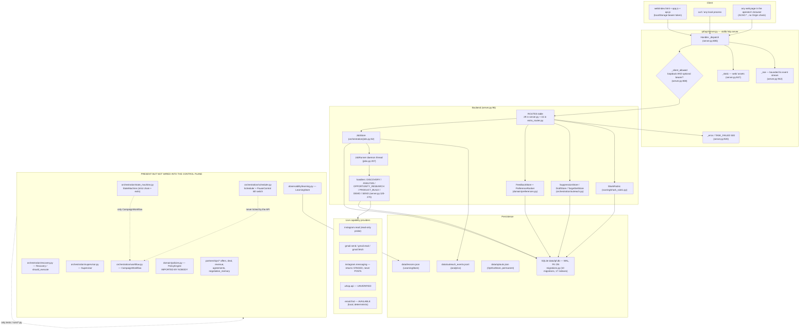

# IPF Factory — Control-Plane / Orchestration / Safety Infrastructure Audit

**Audit date:** 2026-10-11 (live probes 19:58–20:12 local, UTC+1)
**Repository:** `C:/Users/DELL/ipf-factory`
**Git HEAD:** `0b2848f899325eb6f2f0ce641251bb724dbe8306` (working tree DIRTY — see §0)
**Python:** 3.12.6 · SQLite 3.45.3 · pytest 9.0.3 · stdlib-only runtime (no third-party deps)
**Mode:** READ-ONLY on the repository. The only writes were the two report files in `research/raw/` plus a probe SQLite DB and WAL/SHM files under the OS temp dir (`%TEMP%/ipf_audit_probe.db`), which are outside the repository.

---

## 0. Snapshot warning (read this before trusting any file:line below)

A sibling agent was **actively editing the repository during this audit**. Observed:

| Evidence | Observation |
|---|---|
| `git status --porcelain` | 12 entries: 5 modified tracked files + 7 untracked new files |
| `ipf/api/server.py` mtime | `2026-10-11 19:49:58` — changed after my first read of it (which was 988 lines; it is now 1000 lines) |
| `ipf/database/migrations.py` | migration `0010_product_authoring_note` did **not** exist at first read; it exists now (`ipf/database/migrations.py:301`) |
| `ipf/research/opportunity_research.py` | did not exist at first read (15,226 bytes now, mtime 19:47:38) |
| New untracked files | `ipf/research/opportunity_research.py`, `runs/run_book_research.py`, `runs/curate_book_evidence.py`, `runs/fetch_thread_comments.py`, `tests/test_opportunity_research.py`, `artifacts/book_run/`, `research/` |

Every `file:line` in this report was re-verified against the working tree **after** the edits, at the snapshot hashes below. `ipf/api/server.py` content hash: `1ee755a9ae694eec67483afbe0b9185cc513f31cc6c4a269ac0ce4f4c78b3b93`. `ipf/api/extra_routes.py`: `2343d510a2f800d3ce3e3c21c5822227327a21c013c6bbafc9c6f21450d11e72`. `ipf/database/migrations.py`: `7142390b99e76e3d5a9af9c5bfa0e04b86bc715e48139f49688e6411568cc818`. Line numbers may drift if the sibling keeps editing.

---

## KEY FINDINGS

1. **The HTTP API is real, complete and runnable.** stdlib `http.server` only; **44 distinct route patterns + an SSE endpoint**; started successfully on `127.0.0.1:18099` and answered live requests. [VERIFIED][high][F01]
2. **Auth is loopback-only plus an *optional* bearer token.** With `IPF_API_TOKEN` unset (the default) **any process on the machine can drive the factory**, and every response carries `Access-Control-Allow-Origin: *` with **no `Origin`/CSRF check**, so a web page in the operator's browser can reach `http://127.0.0.1:8080/api/v1/*` cross-origin. [VERIFIED][high][F02]
3. **`POST /products/demo/random` writes a fabricated `COMPLETED` product.** It INSERTs `status='COMPLETED'`, `validation_level='SYSTEM_VALIDATED'`, `artifacts_json={"note":"random unrelated demo"}`, `opportunity_id=NULL`, `creator_id=NULL`, no QA. Observed in `GET /products` immediately after the call. [VERIFIED][high][F03]
4. **`CREATOR_DISCOVERY` can never succeed.** The handler calls `CreatorScout.fetch(query, min_followers=…, max_followers=…)`, but the only implementation is `CreatorScout.fetch(self, target=None)`; the fallback call passes a *string* into a slice. Live job result: `FAILED / RuntimeError / "INTEGRATION_UNAVAILABLE: discovery failed: slice indices must be integers or None or have an __index__ method"`. [VERIFIED][high][F04]
5. **There is no API-only path from zero to a product.** No endpoint creates a `creators` row (`POST /creators` does not exist), discovery is broken (F04), and `PRODUCT_BUILD` requires a `SELECTED` opportunity belonging to an existing creator. The control plane cannot bootstrap its own inputs; the DB must be seeded out-of-band. [VERIFIED][high][F05]
6. **`CREATOR_ANALYSIS` fabricates an analysis.** It performs no research or analysis: it sets `creators.status='ANALYZED'`, stamps `last_analyzed_at`, emits `CREATOR_ANALYZED` and returns success. [VERIFIED][high][F06]
7. **`CAMPAIGN_SEND` has no live path.** The handler is a hardcoded `raise RuntimeError("INTEGRATION_UNAVAILABLE: no email provider configured (gmail 401)")` and **no endpoint ever enqueues it**. Sending is absent rather than simulated (safety-positive, capability-negative). [VERIFIED][high][F07]
8. **The entire policy layer is orphaned.** `ipf/domain/policies.py` is imported by **zero** modules (grep for `from ipf.domain.policies` = 0 hits). `PolicyEngine`, `Recovery`, `Supervisor`, `DealLock`, `LearningStore` are instantiated **only in tests**. The 2/4/6 → 40/50/60 rule is enforced only in unwired modules (`partnerships/offers.py`, `revenue.py`, `agreements.py`, `products/promotions.py`) and in `config.ALLOWED_OFFERS`. [VERIFIED][high][F08]
9. **The demand/red-team gate is not enforced anywhere live.** `decide_opportunity` maps `SELECT → SELECTED` with no check on `demand_verdict`; I verified live that an opportunity whose own `demand_verdict = PROBLEM_REJECTED` was accepted as `SELECTED` (HTTP 200). `PolicyEngine.check_opportunity` has zero call sites outside its own definition and one unit test. [VERIFIED][high][F09]
10. **The Shark rubric treats a REJECTED demand verdict as satisfying the demand criterion.** `if refs and demand:` marks `demand_severity_evidence = MET` for any non-empty `demand_verdict` string. Verified live: criterion reported `MET | 2 evidence reference(s) plus a recorded demand verdict` while the stored verdict was `PROBLEM_REJECTED`. Mitigated in practice only because `ProductFactory.validate()` requires Shark verdict `PASS`. [VERIFIED][high][F10]
11. **The state machine is a strict canonical chain with explicit exits and a recovery floor.** 29 canonical states, single-next-state transitions, 6 documented exits, `reset_for_recovery` refuses any re-entry at/after `DEAL_LOCKED`. It is **in-memory per key** (not persisted) and only `CampaignWorkflow` uses it. [VERIFIED][high][F11]
12. **Job lifecycle is the strongest part of the system.** Persisted before execution, whitelisted transitions, idempotent retry (a `SUCCEEDED` job is never re-run), cancel is idempotent, restart recovery marks `RUNNING → FAILED/INTERRUPTED`. Idempotency verified live: the same `Idempotency-Key` returned the same `job_id` with `reused: true`. [VERIFIED][high][F12]
13. **Persistence is disciplined but has three real holes.** 10 ordered migrations each in explicit `BEGIN`/`COMMIT` with a `schema_migrations` ledger, 17 `idx_*` indexes, `PRAGMA foreign_keys=ON`, `foreign_key_check` clean, WAL mode. Holes: (a) `migrations.connect` swallows every exception from `ipf.state.init_db` with `except Exception: pass`; (b) `ipf/state.py` still uses bare `CREATE TABLE IF NOT EXISTS` (no indexes, no FKs); (c) **one shared connection with `check_same_thread=False` is used by request threads and job daemon threads with no lock and no explicit transactions**. [VERIFIED][high][F13]
14. **JSON/JSONL honesty guarantees hold.** `load_json_store` raises `CorruptStoreError` for an existing-but-unreadable store instead of silently returning the default (this is the documented fix for the permanent opt-out store being erased); `read_rows` skips **and counts** torn/unshaped lines and never fabricates a row. [VERIFIED][high][F14]
15. **Capability honesty is genuinely strong and self-consistent.** Readiness is parsed from the head token (`AVAILABLE`/`UNVERIFIED`/`UNAVAILABLE`), unrecognised heads degrade to `UNAVAILABLE`, unwired capabilities are reported with **their own owner's verdict**, and `PLANNED_CAPABILITIES` are labelled as TODO markers. No adapter fabricates a live action: the Instagram messaging adapter returns `status: "STAGED"` and never POSTs. [VERIFIED][high][F15]
16. **The metric vocabulary in the brief does not exist.** `NO_DATA` is real (10 modules) and `UNMEASURED` exists (2 sites). **`ZERO_ACTIVITY`, `LOW_ACTIVITY` and `MEASURED_ACTIVITY` appear nowhere in `ipf/` or `tests/`.** The honest-zero discipline is implemented via `None`/`NO_DATA` instead. [VERIFIED][high][F16]
17. **Measured test count: 1421 collected.** `python -m pytest tests -q -p no:cacheprovider` → run 1: `3 failed, 1417 passed, 1 skipped, 226 subtests passed in 185.47s`; run 2: `4 failed, 1416 passed, 1 skipped, 226 subtests passed in 200.91s`. **The failure set is non-deterministic.** ~40 of the 118 test files assert on **source text** rather than behaviour. [VERIFIED][high][F17]
18. **The API documentation contradicts the code.** Both `API_CONTRACT.md:5` and `openapi.yaml:5-6` state *"No HTTP server exists in the repository today"* / *"No HTTP server exists yet"*; `openapi.yaml` documents `PATCH /campaigns/{campaign_id}` which returns `404`; and it omits `GET /research/sources` and `GET /opportunities/{id}/shark-reviews`, which do exist. [CONTRADICTED][high][F18]
19. **Research artifacts are real but the evidence is mismatched.** `/research/sources` reports real fetches (`155`, `155`, `65` Reddit comments, `fetched_at 2026-10-11T16:40:15Z`). But the `money_budget_small_income` artifact's evidence permalinks point to **`r/options` ("ruined my life from trading…")** and **`r/steammachine` ("I just got my email…")** — semantically unrelated to "money runs out before payday". 3 of 3 sampled refs are off-topic. [VERIFIED][high] that the refs are unrelated; [INFERENCE][medium] that this is a fetch/thread-mapping defect. [F19]
20. **The UI's SSE transport cannot work in the secured configuration.** `web/api.js:171-179` opens an `EventSource` and its comment claims "the backend accepts the token as a query fallback only when explicitly enabled" — **the backend has no query-token path at all**; with a token set, `GET /api/v1/events/stream` returns `401` (verified with `?token=` and `?access_token=`), so the UI retries every 3 s forever. Without a token, SSE works (verified: events streamed). [VERIFIED][high][F20]

---

## A. The real control plane



**Reading the diagram:** everything inside `HTTP`/`Backend`/`Persist` is reachable from a live request. Everything in `Unwired` is real, tested code that **no live request can reach**.

---

## B. HTTP API — is it implemented and runnable?

### B.1 Observed run

```
$ IPF_DB_PATH="$TEMP/ipf_audit_probe.db" IPF_API_TOKEN="<probe-token-REDACTED-before-publishing>" \
    python -m ipf.api.server --host 127.0.0.1 --port 18099
IPF API on http://127.0.0.1:18099/api/v1  db=C:/Users/DELL/AppData/Local/Temp/ipf_audit_probe.db
migrations: ['0001_creator_columns', … '0009_product_columns', '0010_product_authoring_note']
recovered jobs: {'interrupted': [], 'count': 0}
```

Status: **IMPLEMENTED and RUNNABLE.** Live observations:

| Probe | Result |
|---|---|
| `GET /health` (with token) | `200`, `{"status":"ok","api_version":"1.0.0-m2","database":{"migrations_applied":10,"pending":[],"foreign_key_violations":0,"indexes":17},"dependencies":{…}}` |
| `GET /health` (no token) | `401 UNAUTHORIZED` |
| `GET /nope` | `404 NOT_FOUND` |
| `POST /creators/discover` `{}` | `400 INVALID_REQUEST "'query' is required"` |
| `POST /creators/discover` malformed JSON | `400 INVALID_REQUEST "body is not valid JSON"` |
| `PATCH /campaigns/camp-1` | `404` — documented in `openapi.yaml:325`, not implemented |
| `POST /creators/discover` + `Idempotency-Key: probe-1` ×2 | first `202 reused:false`, second `202 reused:true` (same `job_id`) |
| `POST /products/demo/random` | `202`, then a `COMPLETED` product row appears |
| `POST /campaigns` → `/approve` → `/start` | `201 DRAFT` → `200 APPROVED` → `503 INTEGRATION_UNAVAILABLE` (provider down — correct) |
| `POST /campaigns/{id}/pause|resume|close` | `200`; `close` twice is idempotent |
| `GET /events/stream` (no token) | `401` |
| `GET /events/stream` (with token, 3 s) | `200 text/event-stream`, real `JOB_QUEUED`/`JOB_STARTED` frames |
| `OPTIONS /health` | `200 {"data":{"ok":true}}` |
| `GET /` | `200 text/html` (static UI) |
| `GET /../.env` and `--path-as-is /../.env` | `404` / `403 FORBIDDEN "path outside the UI root"` |
| `make_server(b,'0.0.0.0',…)` / `'192.168.1.5'` | `ValueError: refusing to bind a non-loopback address (§11)` |
| `integration_status(None)` | `{"_note":"readiness not measured (no capability registry wired); no capability is claimed available"}` |

### B.2 Architecture facts

* Single file, stdlib only: `ipf/api/server.py` (1000 lines) + `ipf/api/extra_routes.py` (278 lines). [IMPLEMENTED]
* `Backend` (server.py:96) holds the connection, `JobStore`, `FeedbackStore`, `PreferenceRanker`, `JobRunner`, the optional capability registry, and runs `self.jobs.recover()` at construction (server.py:106) — **restart recovery happens at import/startup**.
* Route dispatch: a list of `(method, compiled-regex, fn)` tuples matched in order (server.py:888-919). `extra_routes.install()` appends 15 routes and **prepends** the real Shark route so it wins over the placeholder (extra_routes.py:59).
* Errors: `ApiError(status, code, message, details)`; any other exception becomes `500 TASK_FAILED` with **only the exception type name** (`server.py:920`) — the message is not leaked. Good.
* **No rate limiting, no body-size cap** (`_body` reads `Content-Length` bytes into memory, server.py:872-879), and `ThreadingHTTPServer` spawns an unbounded thread per connection.
* SSE is deliberately **bounded to 5 s** (`deadline = time.time() + 5.0`, server.py:953) — a polling fallback, not a long-lived push.
* Static serving resolves under `web/`, refuses traversal, and is the only unauthenticated surface (server.py:847-871). Note `web/` is served from the repo, and `IPF_WEB_DIR` can repoint it.

### B.3 API route table

Legend — **Implemented?**: `YES` = route exists and was exercised or read; `PLACEHOLDER` = exists but superseded/replaced; `DOC-ONLY` = in `openapi.yaml` but not routed. Auth = all `/api/v1/*` routes pass through `_client_allowed` (loopback + optional bearer); static UI is unauthenticated.

| Method | Path | Implemented? | Auth | Delegates to | Evidence |
|---|---|---|---|---|---|
| GET | `/health` | YES | loopback + token | `migrations.health`, `integration_status`, `jobs.recover` result | server.py:562-570 |
| GET | `/dashboard/summary` | YES | ″ | `Backend._dashboard` COUNTs | server.py:572-574, 336-358 |
| GET | `/integrations` | YES | ″ | `integration_report` + `capability_catalog.unwired_capabilities` | server.py:577-579, 78-95 |
| GET | `/creators` | YES | ″ | `_list_creators` + `PreferenceRanker.rank` | server.py:582-585, 314-335 |
| POST | `/creators/discover` | YES (handler broken) | ″ | `JobStore.enqueue` → `_h_discovery` → `CreatorScout` | server.py:588-591, 359-367, 127-154 |
| GET | `/creators/{id}` | YES | ″ | `get_creator` + `ranker.score` + feedback | server.py:594-600 |
| PATCH | `/creators/{id}` | YES | ″ | whitelisted `UPDATE creators` | server.py:603-621 |
| POST | `/creators/{id}/analyze` | YES (no-op analysis) | ″ | `_h_analyze` | server.py:623-631, 156-167 |
| POST | `/creators/{id}/feedback` | YES | ″ | `FeedbackStore.record` | server.py:634-636, 369-381 |
| GET | `/niches` | YES | ″ | `SELECT * FROM niches` | server.py:639-641 |
| GET | `/opportunities` | YES | ″ | `SELECT * FROM opportunities` | server.py:645-655 |
| GET | `/opportunities/{id}` | YES | ″ | `SELECT` by id | server.py:657-663 |
| POST | `/creators/{id}/opportunities/research` | YES | ″ | `_h_opportunity` → `OpportunityResearcher` | server.py:666-674, 169-197 |
| POST | `/opportunities/{id}/decision` | YES | ″ | `decide_opportunity` (no policy gate) | server.py:677-679, 383-400 |
| POST | `/opportunities/{id}/shark-review` | PLACEHOLDER | ″ | `Backend.shark_review` (import-check only) | server.py:682-684, 402-435 |
| POST | `/opportunities/{id}/shark-review` | YES (overrides) | ″ | `SharkRubric.review` | extra_routes.py:59, 45-59 |
| GET | `/opportunities/{id}/shark-reviews` | YES | ″ | `SharkRubric.history/latest` | extra_routes.py:61-66 |
| GET | `/products` | YES | ″ | `SELECT * FROM products` | server.py:687-690 |
| GET | `/products/{id}` | YES | ″ | `products.factory.product_detail` | server.py:693-706 |
| POST | `/opportunities/{id}/products` | YES | ″ | `create_product` → `PRODUCT_BUILD` → `ProductFactory` | server.py:708-710, 514-531, 199-254 |
| POST | `/products/demo/random` | YES (fabricates) | ″ | `demo_product` → `_h_demo` | server.py:713-715, 533-537, 256-266 |
| GET | `/products/{id}/qa` | YES | ″ | `product_detail` QA block | extra_routes.py:178-197 |
| GET | `/products/{id}/artifacts/{name}` | YES | ″ | file read confined to artifacts root | extra_routes.py:199-223 |
| GET | `/campaigns` | YES | ″ | `SELECT * FROM campaigns` | server.py:718-721 |
| POST | `/campaigns` | YES | ″ | `campaign_create` | server.py:724-726, 437-450 |
| GET | `/campaigns/{id}` | YES | ″ | `SELECT` by id | server.py:729-734 |
| PATCH | `/campaigns/{id}` | **DOC-ONLY** | — | — | `openapi.yaml:325`; live probe → `404` |
| POST | `/campaigns/{id}/{approve\|start\|pause\|resume\|close}` | YES | ″ | `campaign_action` (+ capability gate on `start`) | server.py:737-739, 452-495 |
| GET | `/campaigns/{id}/recipients` | YES | ″ | `SELECT campaign_recipients` | server.py:742-746 |
| POST | `/campaigns/{id}/recipients/{rid}/review` | YES | ″ | `recipient_review` | server.py:749-751, 497-512 |
| POST | `/campaigns/{id}/target-set` | YES | ″ | `TargetSetStore.freeze` | extra_routes.py:69-80 |
| GET | `/campaigns/{id}/target-sets` | YES | ″ | `TargetSetStore.versions/members` | extra_routes.py:82-89 |
| GET | `/target-sets/{v}/members` | YES | ″ | `TargetSetStore.members` | extra_routes.py:91-93 |
| GET | `/outreach/send-check` | YES | ″ | `TargetSetStore.can_send_to` | extra_routes.py:96-104 |
| POST | `/campaigns/{id}/drafts` | YES | ″ | `DraftStore.create` (+ `validate`) | extra_routes.py:107-127 |
| GET | `/campaigns/{id}/drafts` | YES | ″ | `DraftStore.list` | extra_routes.py:129-139 |
| GET | `/drafts/{id}` | YES | ″ | `DraftStore.get` | extra_routes.py:141-147 |
| GET | `/suppressions` | YES | ″ | `SuppressionStore.counts/list` | extra_routes.py:150-153 |
| POST | `/suppressions` | YES | ″ | `SuppressionStore.add` | extra_routes.py:156-166 |
| POST | `/suppressions/import` | YES | ″ | `SuppressionStore.import_jsonl` (read-only source) | extra_routes.py:169-175 |
| GET | `/research/sources` | YES (undocumented) | ″ | `OpportunityResearcher.available_niches` | extra_routes.py:226-236 |
| GET | `/outreach/readiness` | YES | ″ | `integration_status` + `is_available` | extra_routes.py:238-278 |
| GET | `/jobs` | YES | ″ | `JobStore.list` | server.py:754-758 |
| GET | `/jobs/{id}` | YES | ″ | `JobStore.get` + filtered events | server.py:761-767 |
| POST | `/jobs/{id}/cancel` | YES | ″ | `JobStore.cancel` | server.py:770-775 |
| POST | `/jobs/{id}/retry` | YES | ″ | `JobStore.retry` (+ resubmit) | server.py:778-786 |
| GET | `/events/stream` | YES | ″ | `JobStore.events` → SSE, 5 s bound | server.py:896-897, 942-966 |

Counts: **29 `@route` in `server.py` + 15 in `extra_routes.py` = 44 distinct patterns** (one, `POST /opportunities/{id}/shark-review`, is defined twice), **+ 1 SSE** handled outside the table. `openapi.yaml` documents 43 paths / 48 operations.

### B.4 Contract drift

* `openapi.yaml:5-6` — *"DESIGN SPECIFICATION (Milestone 1). No HTTP server exists yet in the repository"* and `info.version: 1.0.0-m1`, while `/health` reports `api_version: 1.0.0-m2` and the server exists. [CONTRADICTED]
* `API_CONTRACT.md:5` — *"STATUS: DESIGN, NOT A RUNNING SERVER. No HTTP server exists in the repository today (§2 audit)."* [CONTRADICTED]
* `API_CONTRACT.md:131-141` §4 says `/opportunities/{id}/shark-review` **"must not be implemented"** until the mapping decision is made; it is implemented twice. [CONTRADICTED]
* Error-code vocabulary drift: `API_CONTRACT.md:44-50` defines `DUPLICATE_SUBMISSION`, `RATE_LIMITED`, `PROVIDER_TRANSIENT`; none is produced by any handler. Job failures store the **Python exception type name** as `error_code` (observed `error_code: "RuntimeError"`), not the canonical code embedded in the message. [PARTIAL]
* `web/api.js:36-45` advertises hints for codes the backend never returns (`DUPLICATE_SUBMISSION`, `RATE_LIMITED`). [PARTIAL]

---

## C. Orchestration

### C.1 State machine — `ipf/orchestration/state_machine.py`

* `CANONICAL_CHAIN` = 29 states, `TREND_DISCOVERY` → … → `NEXT_CYCLE` (state_machine.py:14-43).
* `TRANSITIONS` is built so each canonical state has **exactly one** legal next state (state_machine.py:46-48). No skips.
* `EXITS` = 6 documented off-chain transitions: `NICHE_SELECTION→NICHE_FAILED`, `PROBLEM_VALIDATION→PROBLEM_REJECTED`, `RED_TEAM→RED_TEAM_KILLED`, `CREATOR_REVIEW→PROTOTYPE_REJECTED`, `PARTNERSHIP_OFFER→PARTNERSHIP_REJECTED`, `DEAL_CONFIRMATION→DEAL_FAILED` (state_machine.py:51-58).
* `NICHE_FAILED → TREND_DISCOVERY` is the only loop (state_machine.py:61, 72).
* All other exits and `EXCEPTION`/`ABANDON_CAMPAIGN`/`NEXT_CYCLE` are absorbing (state_machine.py:66-72).
* `transition()` raises `StateTransitionError` on anything illegal (state_machine.py:107-116).
* `reset_for_recovery()` is a policy-gated hook that **hard-refuses re-entry at or after `DEAL_LOCKED`** (state_machine.py:118-129) — the "never build/publish/sell before the deal is locked" invariant, enforced structurally.
* **Authority:** `StateMachine` is the sole transition authority, but the API does **not** call it. The API mutates `opportunities.status` and `campaigns.status` directly with its own local maps (`decide_opportunity` server.py:387-390; `campaign_action` server.py:452-495). So there are **two parallel state vocabularies**: `WorkflowStatus` (29 states, unused by the API) and the API's ad-hoc strings (`PROPOSED`, `SELECTED`, `REJECTED`, `ARCHIVED`, `NEEDS_REVISION`, `DRAFT`, `APPROVED`, `RUNNING`, `PAUSED`, `CLOSED`). [VERIFIED — architectural divergence]
* `StateMachine._states` is a plain dict (state_machine.py:88) → **per-process, not persisted**; a restart loses all workflow positions.

### C.2 Scheduler / kill switch — `ipf/orchestration/scheduler.py`

* `PauseControl` = `PAUSE_ALL`, `PAUSE_OUTREACH`, `PAUSE_PUBLISHING`, `PAUSE_FINANCE`, `PAUSE_PRODUCT_FACTORY`, `RESUME_ALL` (scheduler.py:15-22).
* `pause()`/`resume()` mutate a set; `RESUME_ALL` clears it (scheduler.py:39-51).
* `abandon_campaign()` adds `PAUSE_ALL` and sets status `ABANDONED` (scheduler.py:53-57).
* `_blocked(domain)` maps domain → control and treats `CAMPAIGN` as following the global pause (scheduler.py:60-70).
* `tick()` skips blocked jobs (scheduler.py:73-76). `EmergencyPause` is declared (scheduler.py:25-26) but **never raised anywhere**.
* **Wiring:** `Scheduler` is instantiated only inside `CampaignWorkflow.__init__` (workflow.py:24) and `runs/run_supervisor.py:28`. `CampaignWorkflow` itself is used only by `ipf/main.py:25` (status read) and `runs/run_digest.py:149`. **No HTTP route can pause anything.** The API's pause is a *campaign row status*, not the kill switch. [VERIFIED — the kill switch is not reachable from the control plane]

### C.3 Recovery / idempotency — `ipf/orchestration/recovery.py`

* `should_execute()` releases exactly one external attempt per claim/re-arm; `COMPLETED` is terminal and `mark_retrying()` raises `RecoveryError` on a completed key (recovery.py:79-94).
* **Call sites: 0 outside tests.** `Recovery()` appears only in `tests/test_autonomy.py:46,52`. [VERIFIED — tested library, unwired]

### C.4 Supervisor — `ipf/orchestration/supervisor.py`

* `Supervisor.run_all()` retries up to `max_retries+1`, then raises `DeadJobError` (supervisor.py:22-33).
* **Call sites: tests only** (`tests/test_autonomy.py:17,23`). The API's retry lives in `JobStore.retry` instead. [VERIFIED — parallel implementation, unwired]

### C.5 Job lifecycle — `ipf/orchestration/jobs.py` (the real one)

* States: `QUEUED, RUNNING, WAITING_FOR_APPROVAL, RETRYING, SUCCEEDED, FAILED, CANCELED`; terminal = last three (jobs.py:29-31).
* `JOB_TRANSITIONS` whitelist (jobs.py:34-42). `_transition()` raises `InvalidJobTransition` for anything else (jobs.py:83-95).
* `enqueue()` checks the idempotency key first and returns `reused: True` (jobs.py:60-81). Persisted **before** execution, then `JOB_QUEUED` event appended.
* `retry()` never re-runs a `SUCCEEDED` job; refuses to implicitly retry a `CANCELED` job; honours an idempotency replay (jobs.py:132-151).
* `cancel()` is idempotent on terminal jobs (jobs.py:123-130).
* `recover()` maps any `RUNNING` job left by a crash to `FAILED/INTERRUPTED` and appends `JOB_INTERRUPTED` (jobs.py:192-205).
* `JobRunner` runs handlers in a **daemon thread**; a missing handler → `FAILED/NO_HANDLER`; any exception → `FAILED` with the exception type as code (jobs.py:207-247). The API never blocks on work (server.py header contract).
* Events: `job_events` rows carry `rowid AS seq`; `events(since)` drives SSE; `message` is truncated to 200 chars (jobs.py:186). The header claims "no secrets or full payloads are written into the event log" — payloads go to `jobs.payload_json` (a full JSON body, e.g. a discovery query) and messages are truncated, so this holds in spirit but `payload_json` does persist request bodies. [PARTIAL]

### C.6 Where transitions are authoritative

| Layer | Authority | Reached from a request? |
|---|---|---|
| `WorkflowStatus` chain | `state_machine.StateMachine` | **No** |
| Job lifecycle | `JobStore.JOB_TRANSITIONS` | Yes |
| Opportunity status | `Backend.decide_opportunity` local map | Yes |
| Campaign status | `Backend.campaign_action` local branches | Yes |
| Product status | `ProductFactory` + `persist_product` | Yes |

Four of five transition authorities are ad-hoc; only the job one is a declared table.

---

## D. Persistence

### D.1 SQLite

* **Canonical opener:** `migrations.connect()` (migrations.py:354-370) → `sqlite3.connect(path, check_same_thread=False)`, `row_factory=Row`, `PRAGMA foreign_keys=ON`, `PRAGMA journal_mode=WAL`, then `init_db(conn)` inside `try/except Exception: pass`, then `migrate(conn)`.
* **Migrations:** `MIGRATIONS` = 10 ordered versions (migrations.py:288-302). `migrate()` drives its own `BEGIN`/`COMMIT`/`ROLLBACK` per version while temporarily setting `conn.isolation_level = None` (migrations.py:306-352), records each version in `schema_migrations`, and **breaks on first failure** leaving later versions unapplied.
* **Integrity:** `health()` runs `PRAGMA foreign_key_check` and counts `idx_*` indexes (migrations.py:372-379). Live `/health`: `pending: []`, `foreign_key_violations: 0`, `indexes: 17`.
* **Indexes:** 13 in `NEW_INDEXES` + 4 in `NEW_INDEXES_2` (migrations.py:203-216, 281-286).
* **Foreign keys:** `creator_feedback→creators`, `job_events→jobs`, `campaign_recipients→campaigns,creators`, `campaign_target_sets→campaigns`, `campaign_target_members→campaign_target_sets`. Note `products`, `message_drafts`, `shark_reviews` and `suppressions` have **no FKs** (migrations.py:120-176).
* **Transactions:** migrations use them; **`repositories.py`, `jobs.py`, `orchestration/outreach.py` and `preferences.py` do not** — each does bare `execute` + `commit()`.

Holes:

1. `migrations.connect` swallows every failure of `ipf.state.init_db` (migrations.py:364-366) — a broken base schema is invisible.
2. `ipf/state.py` still declares the legacy schema with bare `CREATE TABLE IF NOT EXISTS` (state.py:9-111) — no indexes, no FKs — and `init_db` is what actually creates `creators`/`opportunities`/`campaigns` on a fresh DB; the richer definition only arrives via the later `ALTER TABLE`/`CREATE TABLE IF NOT EXISTS` migrations.
3. **One connection, many threads.** `check_same_thread=False` (migrations.py:359) with `ThreadingHTTPServer` request threads **plus** `JobRunner` daemon threads sharing `self.conn`. There is no lock, no per-thread connection and no explicit transaction. SQLite's default 5 s busy timeout avoids most `database is locked` errors, but interleaved `execute`/`commit` sequences from two threads can produce **lost updates or torn multi-statement state** (e.g. `_h_product` writes the product row and then a job event as two separate commits).
4. `repositories.Repository` (133 lines) is **not used by the API**; the API talks to SQL directly (`server.py` `_h_*`/`_dashboard`). So "the repositories are the persistence layer" is DOCUMENTED-BUT-NOT-BUILT for the control plane. `Repository`'s deal-immutability guard (`_IMMUTABLE_DEAL_FIELDS`, repositories.py:15-18, 95-101) therefore protects nothing live.

### D.2 JSON / JSONL learning stores — honesty guarantees

* `ipf/domain/json_store.py` — **one reader**. A missing file → a deep copy of the default. A file that exists but is unreadable, invalid JSON, or of the wrong shape → raises `CorruptStoreError` (deliberately *not* a `ValueError`/`OSError` subclass so it cannot be caught accidentally as "empty"), and the bytes are left untouched. This is the documented fix for the permanent opt-out store being silently erased. [VERIFIED by reading + `tests/test_json_store_no_silent_reset.py`]
* `ipf/domain/jsonl_store.py` — `read_rows(path, is_row)` returns `(rows, skipped)`; blank lines are neither; invalid JSON and **valid JSON that is not a shaped row** are skipped *and counted*; a missing file is an empty store; read failures propagate. `is_record` requires a dict carrying every required key. [VERIFIED]
* `ipf/observability/outreach_analytics.py` — `_malformed_lines` is initialised before any early return, so the accessor always exists; a load failure yields zero events and a counted anomaly rather than a fabricated clean funnel. [VERIFIED]
* `ipf/outreach/reporter.py` — `_malformed_lines = None` means **UNMEASURED**; `facts()` maps `None → "NO_DATA"` and a measured `0 → 0`. `accepted_count()` reads the verdict's canonical `.name` so an enum vs string mismatch cannot fabricate a zero (reporter.py:20-25, 66-70). [VERIFIED]
* `LearningStore` (observability/learning.py) — lessons are immutable, `record()` raises `EvidenceMissing` without evidence, the path is resolved from the repo root at call time (never TMPDIR/CWD), and `_load` uses the one JSON-store reader. **But it is never constructed in live code** (tests only). [VERIFIED — IMPLEMENTED, UNWIRED]

---

## E. Safety / policy — verified against code

| Rule | Where it lives | Enforced in a live path? | Evidence |
|---|---|---|---|
| Offers are exactly 2/4/6 Reels → 40/50/60 % | `config.py:41` (`ALLOWED_OFFERS = {2:0.40, 4:0.50, 6:0.60}`) + `config.py:42-46` `PROMOTION_OFFERS` | **Data only.** Enforcement code lives in `partnerships/offers.py:23`, `revenue.py:22`, `agreements.py:31`, `products/promotions.py:11` — all unwired | config.py:41-46 |
| No 1-Reel offer; invented % → EXCEPTION_REQUEST | `policies.py:34-50`, `offers.py:31-35` | **No** — `policies.py` imported by nobody; `OfferPresenter` used only by `runs/run_local_e2e.py:81` | F08 |
| Banned language in outgoing messages | `outreach/message_generator.py:13-20` (`BANNED_WORDS`), `:21-25` (`FABRICATED_PERSONAL_CLAIMS`), `_validate` at `:44-58` | **Yes, at the send boundary** — `gmail.py:283-297` folds via `fold_text` then substring-matches both lexicons; `orchestration/outreach.py:203-216` re-uses them for draft validation | message_generator.py:13-58; gmail.py:283-297 |
| Fabricated personal claims | same | **Yes** (same gate) | gmail.py:296-297 |
| Opt-out / suppression is permanent | `outreach/optout_store.py` (JSON, permanent, human-only removal at `:143-152`) **and** `orchestration/outreach.py:45-159` `SuppressionStore` (SQLite, NFKC-normalised, idempotent, auditable) | **Yes** — `/suppressions`, `/suppressions/import`, `TargetSetStore.freeze` exclusion, `can_send_to`, `QualificationFunnel.next_batch`, `FollowUpPlanner.stopped` all consult it | optout_store.py:104-140; orchestration/outreach.py:75-92, 288-316; queue.py:38-51; followups.py:33-42 |
| Opt-out on a real reply is recorded, never forgotten | `outreach/reply_capture.py:47-58` raises `MissingOptOutStore` rather than silently dropping | **Yes** (when wired) | reply_capture.py:25-31, 53-58 |
| Send boundaries | `/outreach/send-check` (`extra_routes.py:96`), `TargetSetStore.can_send_to` (`orchestration/outreach.py:288-316`), `campaign_action start` capability gate (`server.py:466-472`) | **Yes** | verified live: `send-check` → `{"allowed": false, "reason": "NOT_IN_FROZEN_TARGET_SET"}`; `start` → `503` |
| Human approval gate before sending | `campaign_action`: `start` requires status `APPROVED`/`PAUSED` else `428 APPROVAL_REQUIRED` (`server.py:464-466`) | **Yes** | server.py:464-472 |
| Live sends impossible while the provider is UNAVAILABLE | `server.py:466-472` uses `capability_state(...) == "READY"` | **Yes** | live: `start` → `503 INTEGRATION_UNAVAILABLE` |
| Payout / commission basis | `config.py:88` `COMMISSION_BASIS = "NET_AFTER_REFUNDS_CHARGEBACKS"`; `partnerships/revenue.py:14-28` `commissionable()`/`split()` | **No** — `revenue.split` has no caller outside its own definition | revenue.py:14-28 |
| Automated payout safety (`MAX_AUTOMATED_PAYOUT_TRANSACTION_USD`) | `policies.py:83-92` `check_payout` | **No** — 0 call sites | F08 |
| Publish gate (DEAL_LOCKED + FINAL_QA + price band) | `policies.py:68-80` `check_publish` | **No** — 0 call sites | F08 |
| Deal lock requires explicit confirmation + message id | `partnerships/deal.py:44-60`, `policies.py:107-116` | **No** — `DealLock` constructed only in tests | deal.py:44-60 |
| Human-only actions (`change_commission_basis`, `set_payout_schedule`) | `policies.py:17`, `:119-126` | **No** — 0 call sites | policies.py:119-126 |
| Opportunity gate (demand PASS, not RED_TEAM_KILLED) | `policies.py:123-128` | **No** — 0 call sites; **and** `decide_opportunity` does not replicate it | F09, verified live |
| Deal rows immutable once locked | `database/repositories.py:15-18, 95-101` | **No** — `Repository` unused by the API | repositories.py:95-101 |
| Prompt-injection / manipulation classification | `partnerships/negotiation_memory.py:30-70, 148-158` | **No** — only drills/tests | negotiation_memory.py:148-158 |

**Conclusion for §E:** the *outreach* safety surface (banned language, opt-out/suppression, approval gate, provider-readiness gate, frozen target set) is **IMPLEMENTED and live**. The *money/partnership* safety surface (offers, payout, publish, deal lock, commission basis, opportunity gate) is **IMPLEMENTED as tested library code but entirely UNWIRED** — `ipf/domain/policies.py` is imported by zero modules, and every `PolicyEngine` method has zero live call sites.

---

## F. Capability registry + adapter honesty

* `ToolRegistry` stores `{fn, status}`; `invoke()` refuses anything not READY with `ToolUnavailable` (registry.py:93-115).
* **Readiness is parsed, not string-compared.** `capability_state()` takes the head token before `(`, maps `AVAILABLE→READY`, `UNVERIFIED→UNVERIFIED`, everything else → `UNAVAILABLE` (registry.py:73-90). Verified: `'AVAILABLE (send scope granted; send NOT tested)'→READY`, `'UNVERIFIED (…)→UNVERIFIED'`, `'READY'→UNAVAILABLE` (conservative), `'AVAILABLE-but-not-really'→UNAVAILABLE`.
* `LIVE_PROBE_FACT = "live-probe=verified"` is the only accepted probe evidence; `capability_gauge()` counts `live_verified` only for tools that are also READY, and explicitly avoids the "not verified" substring trap (metrics.py:84-101).
* `EXPIRY_FACT_KEY = "expires-in-days"` is parsed as a **number**, not prose; `capability_expiring_names()` names READY capabilities inside the warn window (registry.py:34-59; metrics.py:126-165).
* `build_live_registry()` performs **one** probe per adapter and shares the status string across call sites (registry_bootstrap.py:29-59): `instagram.read`, `instagram.media`, `gmail.send`, `gmail.read`, `gmail.fetch`, `email.find`. Live result: all network capabilities `UNAVAILABLE (token rejected: HTTP Error 400: Bad Request)`, `email.find` `AVAILABLE`.
* **Unwired capabilities are reported from their owner's own verdict**, discovered by scanning the adapters package for a `capability` class attribute — never a hand-written list (capability_catalog.py:40-64, 87-107). Live output: `canva.asset → "UNAVAILABLE (not wired: CanvaAdapter is not registered live)"`, `whop.api`, `web.search`, `instagram.messaging.read_write`, plus three `PLANNED_CAPABILITIES` (`assets.generate`, `browser.control`, `instagram.send_dm`) labelled *"planned: no adapter declares this capability and nothing registers it"*.
* **Can an adapter fabricate success when a provider is down?** Verified per adapter:
  * `InstagramApiAdapter.status()` returns `UNAVAILABLE (token rejected: …)` on any exception (instagram_api.py:49-55). ✔
  * `GmailAdapter.send_status()` reports `UNAVAILABLE (SEND SCOPE MISSING …)` when the send scope is absent, and `AVAILABLE (… send NOT tested …)` when granted — it never claims a tested send (gmail.py:180-205). ✔
  * `WhopApiAdapter.status()` deliberately returns `UNVERIFIED` for any key starting `sk_` — the code documents that the previous version derived readiness from a string prefix (whop.py:35-48). ✔
  * `InstagramMessagingAdapter.send_free_help_message()` gates on `capability_state(self.status()) != "READY"`, and even then returns `{"status": "STAGED"}` **without making an HTTP call** (instagram_messaging.py:48-73). ✔ No fabricated send.
  * `CanvaAdapter.create_asset()` returns `{"status": "DEFERRED", "note": "canva unavailable -> generated assets used"}` (canva.py:12-15) — an explicit non-success marker. ✔
  * `GmailAdapter._validate` is a **hard raise** before `_send_raw` (gmail.py:283-297). ✔
* **One latent secret-exposure path:** `InstagramApiAdapter._get` puts the access token in the **query string** (instagram_api.py:31-33), and `status()` interpolates the raw exception into a string that `/health` and `/integrations` return verbatim (instagram_api.py:53; server.py:562-579). Today the observed exception text was `HTTP Error 400: Bad Request` (no URL), so nothing leaked; but any exception whose `str()` includes the URL would publish the token. [VERIFIED risk, latent]

---

## G. Observability

* `FunnelReport.conversion()` returns `None` (not `0.0`) when a numerator/denominator was never measured or the denominator is zero — the module documents that returning `0.0` "FABRICATED a measured zero-activity claim" (metrics.py:22-31).
* `FunnelReport.summarize()` **names** the unmeasured inputs instead of printing a zero (metrics.py:33-50).
* `FunnelReporter.facts()` emits `malformed_lines` as an exact int when measured and `"NO_DATA"` when not (reporter.py:99-115); `digest_5h()`/`summary()` append ` malformed_lines=N` only when non-zero (reporter.py:44-48).
* `OutreachAnalytics.reply_rate/acceptance_rate/opt_out_rate` all return `None` on a zero denominator and print `NO_DATA` (outreach_analytics.py:139-165).
* **Can any metric be fabricated?** No fabricated value was found: every ratio is derived from recorded events, every missing input surfaces as `NO_DATA`/`None`/`UNMEASURED`, and the anomaly counter has a single owner. The one *structural* fabrication risk is elsewhere: `POST /products/demo/random` injects a `COMPLETED` row into the same table the dashboard/products surfaces read (F03), which inflates `jobs_by_state`/`GET /products` without a QA pass.
* **Vocabulary gap:** `ZERO_ACTIVITY`, `LOW_ACTIVITY`, `MEASURED_ACTIVITY` do not exist anywhere in `ipf/` or `tests/` (grep = 0). The implemented vocabulary is `NO_DATA` (10 modules) + `UNMEASURED` (2 sites: `extra_routes.py:257`, `reporter.py:109`) + `UNREADABLE` (1 site, `optout_store.py:82-90`). [ABSENT for the three named tokens]

---

## H. Tests

**Measured count: 1421 tests collected** across **118 files** (116 `tests/test_*.py` + 2 `tests/integration/*.py`), 355 `TestCase` classes, 16,832 lines.

**Exact command and results:**

```
cd C:/Users/DELL/ipf-factory
PYTHONDONTWRITEBYTECODE=1 python -m pytest tests -q -p no:cacheprovider
```
* Run 1 (`--tb=no -rN`): `3 failed, 1417 passed, 1 skipped, 226 subtests passed in 185.47s`
* Run 2 (`--tb=no -rf`): `4 failed, 1416 passed, 1 skipped, 226 subtests passed in 200.91s`

Failing tests observed in run 2:

| Test | Failure |
|---|---|
| `tests/test_api_backend.py::ApiTestCase::test_opportunity_research_job_fails_honestly_instead_of_inventing` | `AssertionError: 'INSUFFICIENT_EVIDENCE' not found in "NO_RESEARCH_ARTIFACT: no research artifact for niche 'money' under 'artifacts\\book_run'…"` — the test pins a **superseded error string** after the sibling's rewire of `_h_opportunity` |
| `tests/test_json_store_no_silent_reset.py::TestTheRepoIsCleanAndTheScanIsNotBlind::test_no_module_silently_resets_a_store` | static scan flags `ipf/research/opportunity_research.py:98,190` (`json.load(fh)` without closing) |
| `tests/test_no_leaked_file_handles.py::TestNoLeakedFileHandles::test_no_source_module_leaks_a_file_handle` | static scan flags `runs/fetch_thread_comments.py:112` |
| `tests/test_upgrade_loop_audit.py::TestAuditMain::test_green_suite_still_reports_ok` | `AssertionError: 1 != 0` |

The **count and identity of failures changed between two identical runs**, and two of the four are caused by files the sibling agent added mid-audit. [VERIFIED — the suite is not deterministic across the concurrent edit window]

**What the suite covers well (behavioural):** the honesty invariants (no fabricated zero, no silent store reset, torn-line counting), the compliance path (opt-out propagation through queue/planner/send boundary/reply capture), capability parsing and gauge honesty, job/recovery idempotency, state-machine legality, scheduler pause matrix, banned-language folding, deal/offer arithmetic, analytics folds.

**What it does not cover:** end-to-end control-plane behaviour through HTTP in a secured configuration (no test drives `Handler._dispatch` with a bearer token and SSE together); the `_h_discovery` signature bug (F04) — a *job-level* test would have caught it, and `test_api_backend.py` exercises the backend but evidently not that handler with a real `CreatorScout`; concurrency on the shared SQLite connection; the unwired-module gap (tests assert `PolicyEngine` behaviour in isolation, which is exactly why its zero call sites went unnoticed).

**Tests asserting implementation detail rather than behaviour:** ~40 of 118 files read source text (`pathlib.Path(__file__).parent.parent` + `read_text()`/`ast.parse`/regex) — e.g. `test_no_leaked_file_handles.py`, `test_json_store_no_silent_reset.py`, `test_source_compiles_clean.py`, `test_capability_catalog.py`, `test_optout_store_one_path.py`, `test_status_surface_consistency.py`. These are *lint-as-test* checks: they fail on refactors and on any sibling file added with a `json.load(open(...))` pattern (as happened during this audit) while proving nothing about runtime behaviour.

---

## I. `runs/` script inventory (34 scripts)

Classified by first-line docstring and network/send greps:

* **Read-only research / fetch (network, no send):** `fetch_thread_comments.py`, `mine_screen_comments.py`, `mine_screen_threads.py`, `run_book_research.py`, `run_ig_research.py`, `ingest_corpus.py`, `curate_book_evidence.py`, `run_live_probes.py`.
* **Product authoring (LLM + file writes):** `run_author_book.py`, `run_niche_book.py`, `run_full_product_v2.py`, `run_phase5.py`, `run_editorial_loop.py`, `run_teacher_pipeline.py`, `run_writing_training.py`, `run_heldout_experiment.py`, `run_authoring_qa.py`, `rebuild_*.py`, `build_*.py`.
* **Outreach:** `run_email_outreach.py` (default `--dry-run`; `--send` requires a READY `gmail.send`; uses a **hardcoded sample queue with invented addresses** like `sara@fithome.com`), `run_email_campaign.py` (send → read → classify), `run_full_real_test.py` (sends only to `…@example.invalid`).
* **Ops / reporting:** `run_digest.py` (runs `python -m unittest discover -s tests` in a subprocess and reports `GREEN/FAILED`), `run_report.py`, `run_upgrade_loop.py`, `run_upgrade_meter.py`, `run_supervisor.py`, `run_local_e2e.py` (dry-run on fake providers), `run_negotiation_drills.py`, `gmail_oauth.py` (one-time consent), `run_api_product_smoke.py`.

`run_email_outreach.py` documents the correct gate ("if the tool's own status is not READY, NOTHING is sent and the honest status is printed (exit 2)") — consistent with §F.

---

## J. Top 10 infrastructure risks

| # | Risk | Evidence (file:line) | Severity | Blocker for a public-facing product? |
|---|---|---|---|---|
| R1 | **Local-process / cross-origin control of the factory.** With `IPF_API_TOKEN` unset (default) any local process drives every mutating route; every response sets `Access-Control-Allow-Origin: *` and there is **no `Origin`/CSRF check**, so a web page in the operator's browser can POST cross-origin. | `server.py:96-101` (token default), `:808-817` (`_client_allowed`), `:823`, `:837`, `:949` (ACAO `*`) | Critical | **YES** |
| R2 | **Fabricated `COMPLETED` product.** `/products/demo/random` INSERTs `status='COMPLETED'`, `validation_level='SYSTEM_VALIDATED'`, NULL creator/opportunity, no QA; it appears in `GET /products`. | `server.py:713-715`, `:256-266`; observed live | High | **YES** |
| R3 | **`CREATOR_DISCOVERY` is broken** — signature mismatch makes every discovery job fail. | `server.py:127-154` vs `research/creators.py:11-16`; live `FAILED … slice indices must be integers` | High | **YES** |
| R4 | **No way to create a creator via the API**, so the control plane cannot bootstrap (discovery broken + no `POST /creators`). | route table §B.3; `server.py:582-591` | High | **YES** |
| R5 | **`CREATOR_ANALYSIS` fabricates an analysis** (flips `status='ANALYZED'`, emits `CREATOR_ANALYZED`, runs nothing). | `server.py:156-167` | High | **YES** |
| R6 | **The policy layer is orphaned.** `ipf/domain/policies.py` imported by zero modules; `PolicyEngine`, `Recovery`, `Supervisor`, `DealLock`, `LearningStore` constructed only in tests. All offer/payout/publish/deal-lock/human-only gates are unreachable. | `policies.py:1-128` (no importers); `tests/test_autonomy.py:46`; `tests/test_policies.py:23` | High | **YES** (safety claims are unenforced) |
| R7 | **Demand/red-team gate unenforced + Shark mis-scores a REJECTED demand verdict as MET.** Verified: `SELECT` accepted on a `PROBLEM_REJECTED` opportunity; criterion `demand_severity_evidence = MET` while `demand_verdict = PROBLEM_REJECTED`. | `server.py:383-400`; `scoring/shark_rubric.py:114-123`; `policies.py:123-128` | High | **YES** |
| R8 | **Shared SQLite connection across request + job threads**, no lock, no explicit transactions in the write paths → lost updates / torn multi-statement state. | `migrations.py:359`; `jobs.py:60-81, 83-95`; `server.py:199-254` (product row then event, two commits) | High | **YES** (under concurrent load) |
| R9 | **Documentation contradicts the code** — `openapi.yaml`/`API_CONTRACT.md` say no server exists; `PATCH /campaigns/{id}` documented but 404s; two live routes undocumented. | `openapi.yaml:5-6, 325`; `API_CONTRACT.md:5, 131-141`; live probes | Medium | **YES** (blocks integrators) |
| R10 | **Non-deterministic test suite + implementation-detail assertions.** Same command, two runs, different failures (3 vs 4); ~40/118 files assert on source text. | §H | Medium | **YES** (a red suite cannot gate a release) |

**Secondary observations (not in the top 10):** `CAMPAIGN_SEND` is dead code with a hardcoded failure (`server.py:124, 268-269`); the UI's SSE can never authenticate when a token is set (`web/api.js:171-179` vs `server.py:808-817`); no rate limiting and no body-size cap, with an unbounded thread per connection (`server.py:872-879`, `:967-970`); `migrations.connect` swallows `init_db` failures (`migrations.py:364-366`); `repositories.Repository` and its deal-immutability guard are unused by the API; `EmergencyPause` is declared but never raised (`scheduler.py:25-26`); the Instagram token is placed in a query string and adapter status strings are returned verbatim by `/health` (`instagram_api.py:31-33, 53`; `server.py:562-579`); research evidence permalinks are off-topic for their niche (`artifacts/book_run/problems_money_budget_small_income_threads.json`).

---

## K. Method, commands run, and what could not be verified

**Verification performed (all read-only on the repo):**

1. Static read of every file in scope (API, orchestration, database, domain, tools, observability, partnerships, outreach, research, config, web, tests, runs).
2. `git status --porcelain`, `git diff` on the 5 modified files, `sha256sum`, mtimes, `git rev-parse HEAD`.
3. Live server run on `127.0.0.1:18099` with a temp DB and a probe token, then ~40 HTTP probes covering auth, 404s, malformed bodies, idempotency, campaign lifecycle, products/demo, Shark review, target sets, suppressions, send-check, SSE, OPTIONS, static traversal, and non-loopback bind refusal.
4. In-process checks: `integration_status(None)`, `integration_report(None)`, `make_server` bind refusal, `capability_state()` on 8 synthetic status strings, `adapter_declared_owners()`, `unwired_capabilities()`.
5. Seeded one `creators` row **into the temp DB only** to exercise `OPPORTUNITY_RESEARCH` end-to-end → job `SUCCEEDED`, 2 opportunities persisted with real Reddit `evidence_refs`; then `decision SELECT` + `shark-review` to evidence F09/F10.
6. Test suite run twice with `python -m pytest tests -q -p no:cacheprovider`; collection counted with `--co -q`.
7. Wiring greps for every policy/orchestration symbol to distinguish IMPLEMENTED from WIRED.

**Deliberately NOT done:** no live outreach was sent; no product build was triggered through the API (it would have written into `artifacts/products/` inside the repo); no `.env` secret values were printed (only key names were listed).

**Not verified / open:**

* Whether the `_h_discovery` signature mismatch is *intended* to be fixed by the sibling's in-flight work (the sibling was editing `server.py` during the audit).
* Whether `r/options` / `r/steammachine` evidence refs are a fetch-mapping bug or a deliberate broad search — I read the artifact and confirmed the mismatch, but not the fetch code path that produced it.
* Real-provider behaviour of `gmail.send`/`instagram.read`: the tokens in `.env` are rejected (HTTP 400), so only the UNAVAILABLE branches were exercised.
* Whether any deployment ever sets `IPF_API_TOKEN`; with the token unset the whole surface is open to local processes.
* The `1.0.0-m2` ↔ `1.0.0-m1` version drift's intent.
* Nothing in this audit exercised a live `PRODUCT_BUILD` success path, because no `SELECTED` opportunity with a `PASS` Shark verdict existed and creating one would have written artifacts into the repo.
