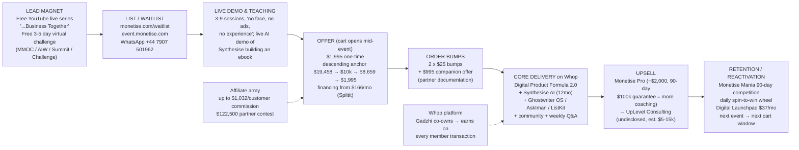

# The Iman Gadzhi / Monetise Business Ecosystem — Evidence Dossier

**Compiled:** 2026-10-11 (all prices, offers and claims are date-stamped; the commercial picture moves in ~quarterly launch cycles)
**Scope:** Iman Gadzhi (person/brand), Monetise, Business Together, Flozy/Flozy Pro, Ghostwriter OS, Personal Brand Blueprint, Digital Product Formula, Agency Incubator (+ Navigator/Accelerator), GrowYourAgency, IAG Media, IAG Services FZCO, Educate, Consulting.com, Whop stake, and adjacent products discovered en route.
**Method:** ≥34 distinct searches + direct opening of vendor pages, vendor terms, Companies House filings, official product docs, and independent reviews. Trustpilot and Reddit were **not openable** (403 / JS challenge) — see Limitations.

**Classification legend:** `VERIFIED` (primary document or first-hand artefact) · `OFFICIAL CLAIM` (vendor assertion, no independent check) · `USER-REPORTED` (member/buyer statement) · `INFERENCE` (my reasoning from evidence) · `CONTRADICTED` (sources disagree) · `UNKNOWN`.
**Confidence:** high / medium / low.

---

## KEY FINDINGS

- The entire software layer under Gadzhi's education brands is operated by **one Dubai entity: IAG Services FZCO**, DSO-IFZA-20424, IFZA Properties, Dubai Silicon Oasis — named as operator on the Synthesise AI, Ghostwriter OS, Educate.io, Monetise and Consulting.com terms pages. `[VERIFIED][high][M02,M05,M08,M09,M13]`
- **Synthesise AI is priced three different ways simultaneously:** $2,999 one-time on its own landing page, "$97/month" as a standalone Whop product, and "monthly subscription basis" in its own Terms. This is an unresolved `CONTRADICTED` pricing state, not a tier ladder. `[CONTRADICTED][high][M01,M02,M18,M19]`
- **Monetise is the flagship and the only thing most of this ecosystem funnels into.** Current price **$1,995 one-time**, unchanged since 29 Sep 2025; version 1.0 (Jan 2025) was **$999 for 12 months** and is why most online write-ups quote the wrong number. `[USER-REPORTED+VERIFIED][high][M04,M27,M29,M30]`
- Monetise 1.0 bundled **Personal Brand Blueprint + Synthesise AI + Flozy Pro**; Monetise 2.0 **dropped Flozy Pro and added Ghostwriter OS**. The Jan-2026 AI Income Workshop stack put **Flozy CRM back in** at a stated $1,068/yr. The bundle is restated every launch. `[VERIFIED][high][M06,M27,M28]`
- **Gadzhi's stake in Flozy is now proven at Companies House level:** AGENCIFLOW LTD (13809253) had two directors — **Iman GADZHIMAGOMEDOV** (b. Jan 2000, British, resident UAE) and **Pierre-Antoine DE PREUX** (b. Apr 1991, Swiss) — both appointed 20 Dec 2021. The company was **dissolved 6 Oct 2026** while flozy.com remains live. `[VERIFIED][high][M20,M26]`
- **"Business Together" has no evidenced entity relationship to Iman Gadzhi.** Companies House has no Gadzhi-linked company of that name; the one live "BUSINESS TOGETHER LIMITED" (09593738, Watford) is directed by JADAV/PARMAR and is unrelated. Every Gadzhi usage found is an **episode title** for a live webinar/training series ("Let's Start a $373/Day Business Together"). `[VERIFIED for the negative; relationship UNKNOWN][medium][M21,M24; searches 2,10,18,26]`
- **Business Together ≠ Monetise ≠ Synthesise AI.** There is no evidence any of the three is the same product or company. Treating them as one is unsupported. `[INFERENCE][high][M21,M24]`
- **Gadzhi is a co-owner and investor in Whop** (announced 2 Apr 2025) — the marketplace where Monetise is sold, delivered and where the Monetise Mania leaderboard is measured. Vertical integration, disclosed by the vendor but rarely weighted. `[VERIFIED][high][M06,M29,M32]`
- **Consulting.com was acquired from Sam Ovens in 2025** and now runs under IAG Services FZCO, with Gadzhi's Synthesise AI and Ghostwriter OS embedded as its proprietary tooling (UpLevel Consulting). SAM OVENS' Consulting Accelerator is bundled as a Monetise bonus. `[VERIFIED operator change; acquisition date OFFICIAL CLAIM][high][M09,M35]`
- **Refund reality:** only **7 days** is money back. The "10x guarantee", "Perfect Product Insurance" (60 days to first sale) and "Monetise Pro $100k/90 days" guarantees are **coaching renewals in the vendor's own written terms**, explicitly "not a money-back guarantee". `[VERIFIED][high][M05,M09,M29]`
- **"Lifetime access" = program content only.** Software (Synthesise AI, Ghostwriter OS, AskIman), mentorship, support and community are **typically 12 months**. Roughly $6,000 of the claimed stack value is time-limited software. `[VERIFIED][high][M05,M09,M29]`
- **AskIman AI is structurally ephemeral:** terms state AskIman access in the Challenge/Summit Fast-Track Kits expires at the end of the event, and is "permanently removed from the product suite" afterwards — yet it was priced at $1,495 "live-only" in Sept 2026. `[VERIFIED][high][M09,M34]`
- **Revenue claims carry no methodology and no published income disclosure.** Sitewide tracked-sales figures ($8.9M / $15M / $31M / $55.6M), a named Mania 2 total of $15,064,202, an average member figure of $7,584 and an average Monetise-client figure of $60,003 all lack a denominator; `monetise.com/disclaimer` returns 404. `[OFFICIAL CLAIM][high][M04,M06,M31]`
- **Every revenue figure in the marketing is company-side or tool-attributed, not customer-verified.** $15,064,202 is Monetise Mania member sales on Whop; $2,355,373,816 is *all Whop creators, all products, all time*; the $370,000/30-day ebook is Gadzhi's own product. None is independently audited. `[INFERENCE][high][M06,M29,M31]`
- **The stack value is arithmetic the seller controls and restates:** $15,293 (Jul 2026) → $19,458 (8 Sep 2026) → $8,659 "fair price" → $1,995, with no change in price or (mostly) contents. Classic descending anchor. `[VERIFIED via receipt-holding reviewers][high][M27,M29,M34]`
- **A national money-desk investigation (This is Money, published 9 Jan 2026, updated 12 Jan 2026) challenged the rags-to-riches origin story** (wealthy Chelsea upbringing, ~£15,000/term private school paid by a stepfather), noted IAG Media's dissolution and quoted regulated financial advisers criticising his money advice. It stated explicitly there is **no suggestion he has behaved unlawfully**. `[VERIFIED reporting][high][M36]`
- **Gadzhi's UK company footprint is mostly dissolved:** IAG Asset Holdings Ltd (12603066) dissolved, IAG Online Services Ltd (11178977) dissolved, Iman Gadzhi Consultants Ltd (16281113) dissolved 13 Oct 2026, AgenciFlow Ltd (13809253) dissolved 6 Oct 2026. Active operations sit in the UAE FZCO. `[VERIFIED][high][M20,M22,M23]`
- **The recurring engine is a free multi-day live event → $1,995 cart → Whop delivery → competition → next event.** Naming changes (MMOC 1.0/2.0/3.0 → AI Income Workshop → Side Hustle Summit → Side Hustle Challenge → AI Income Challenge Nov 2026) but the mechanism is stable. `[VERIFIED][high][M07,M09,M30]`
- **Almost none of the value is software-independent.** The model requires (a) an existing creator's audience, or (b) paid traffic and outreach skill, plus (c) Gadzhi's brand trust built on ~6M YouTube subscribers. The AI does the *after-the-yes* work only. `[INFERENCE][high][M33,M35]`
- **Independent reviewers who actually purchased ($1,995, 7 Sep 2026) rate the product 4.0/5 and the marketing lower** — "the mismatch is almost always the buyer, not the curriculum". Whop on-platform rating ≈4.8–4.9 from ~3,850–4,353 reviews; off-platform sentiment is negative but the accessible sample is tiny. `[USER-REPORTED][medium][M29,M33,M38]`

---

## A. Entity-by-entity profiles

### A1. Iman Gadzhi (person / brand)
- **What:** British online-education entrepreneur, b. 3 Jan 2000 in Dagestanskiye Ogni, Dagestan (self-reported biography). Real legal name appears in UK filings as **Iman GADZHIMAGOMEDOV**. `[VERIFIED][high][M22,M23]`
- **Own/operate:** personally controls the brand and the funnel; operating companies are UAE (IAG Services FZCO) with largely dissolved UK entities. `[VERIFIED][high][M02,M20,M22]`
- **Target segment:** 18–30 "ambitious but stuck" men wanting an online income; repeated "no experience / no face / no audience / no ad spend" framing. `[VERIFIED][high][M04,M16]`
- **Reach:** ~6M YouTube subs (Feb 2026 press), 4.1M TikTok, 2M Instagram. `[VERIFIED reporting][medium][M36]`
- **Standalone vs embedded:** he is the trust layer for every downstream product. `[INFERENCE][high]`

### A2. IAG Services FZCO (the umbrella operator) — discovered entity
- **What:** Dubai free-zone company, DSO-IFZA-20424, IFZA Properties, Dubai Silicon Oasis. Named operator of Synthesise AI, Ghostwriter OS, Educate.io, Monetise and Consulting.com. Contact `info@iman-gadzhi.com`; support routed to `support@educate.io` on challenges and `support@consulting.com` elsewhere. `[VERIFIED][high][M02,M05,M08,M09,M13]`
- **Governing law:** UAE law, binding arbitration in Dubai under DIAC rules (except where consumer law overrides). Ghostwriter OS terms state **UK law / London arbitration** instead — an internal inconsistency across sibling products. `[VERIFIED / CONTRADICTED][high][M02,M05,M13]`
- **Note:** the footer of iag-media.com additionally carries a **Brazilian entity, "RIBEIRO NEGOCIOS DIGITAIS E CONSULTORIA LTDA", CNPJ 49.587.630/0001-01**, São Bernardo do Campo, labelled "2026 Educate.io". Relationship (localisation partner? payment processor? affiliate?) is **UNKNOWN**. `[VERIFIED presence; relationship UNKNOWN][medium][M15]`

### A3. Monetise (the programme / the flagship)
- **What:** Gadzhi's digital-product business programme + bundled software + coaching + community, delivered entirely on Whop. Not a SaaS platform in its own right. `[VERIFIED][high][M04,M28]`
- **Owner/operator:** Iman Gadzhi (founder); IAG Services FZCO (terms). `[VERIFIED][high][M05]`
- **Versions:** 1.0 (Jan 2025, $999/12mo, software-first, bundled Personal Brand Blueprint + Synthesise AI + Flozy Pro) → **2.0 (29 Sep 2025, $1,995 one-time, course-first)**. `[USER-REPORTED+VERIFIED][high][M27,M28]`
- **Current contents (Sept 2026 window):** Digital Product Formula 2.0 (~31 lessons), Synthesise AI (12mo unlimited), Ghostwriter OS (evergreen stack), AskIman AI, ListKit/"The Distribution Software" (12mo), Perfect Product Insurance, Monetise Mania 90-day competition, dedicated support, bonus courses (Agency Accelerator, Ad Architect, Sam Ovens' Consulting Accelerator). `[VERIFIED][high][M04,M28,M34]`
- **Price:** $1,995 one-time; financing from **$166/mo** (Splitit BNPL); order bumps of two ×$25 and a $995 companion offer per partner documentation. `[USER-REPORTED w/ receipt][high][M27]`
- **Refund:** 7 days, no questions. `[VERIFIED][high][M05]`
- **Access path:** free multi-day event → waitlist → cart open (typically 5–9 days) → Whop checkout ($1,995) → Whop workspace. Cart closed outside launch windows. `[VERIFIED][high][M04,M07,M30]`

### A4. Synthesise AI (the product-creation tool)
- **What:** AI that scans a market or a named creator and outputs scored "profitable pockets", a transformation map, chapter plan, manuscript, cover art, worksheets/checklists and a publishable PDF/ebook; also a "creator-audience mode" that reads one Instagram handle. `[VERIFIED in live demo by receipt-holding reviewers][high][M28]`
- **Ownership:** IAG Services FZCO, dba Synthesise AI. `[VERIFIED][high][M02]`
- **Pricing (CONTRADICTED, all live simultaneously in Oct 2026):**
  - $2,999 **one-time** on synthesise.ai `[VERIFIED][high][M01]`
  - "monthly subscription basis", 7-day refund, cancel 48h pre-renewal — in its own Terms `[VERIFIED][high][M02]`
  - **$97/month** (from $121.25, "Save 20%") as a standalone Whop product "Synthesise AI — The Digital Product Generator" `[VERIFIED][high][M18,M19]`
  - Stated value "$2,999" (i.e. per year) inside Monetise `[OFFICIAL CLAIM][high][M04]`
  - A third-party YouTube review titles it "Is it Worth $1500?" `[UNKNOWN][low][search 3]`
- **Ecosystem claims:** "supported by" Microsoft Founders Hub, Monetise, Educate. `[OFFICIAL CLAIM][low-medium][M01]` Microsoft Founders Hub is a startup-credits programme, not an endorsement; no Microsoft page confirming the relationship was located. `[INFERENCE][medium]`
- **Marketed provenance:** "trained on $3 billion in real sales data from Whop". `[OFFICIAL CLAIM][low — no methodology published][M04]`

### A5. Ghostwriter OS (the copy/funnel tool)
- **What:** promptless "specialised AI agents" (50+) producing hooks, angles, CTAs, full funnels (landing/sales/emails/upsells), 14-day story launch sequences, "Monetisation Gameplans". `[OFFICIAL CLAIM + reviewed in demo][medium][M12,M35]`
- **Ownership:** IAG Services FZCO dba "GhostWriter OS". `[VERIFIED][high][M13]`
- **Pricing:** $2,999/yr shown on site; Terms again say **"monthly subscription basis"**. Same contradiction class as Synthesise. `[CONTRADICTED][high][M12,M13]`
- **Claimed licensing:** "Iman paid over $530,000+ in licensing fees just to let you keep access to this tool inside Monetise" — unverifiable, no licensor named. `[OFFICIAL CLAIM][low][M04]`
- **Standalone vs embedded:** both — sold standalone at ghostwriteros.ai/Whop and bundled in Monetise/UpLevel. `[VERIFIED][high][M12,M35]`

### A6. Flozy / Flozy Pro (agency operations SaaS)
- **What:** all-in-one agency platform — CRM, website/link-in-bio, proposals, contracts, invoices, client onboarding funnels, client portals, chat, tasks, files, AI assistant, iOS/Android apps. `[VERIFIED][high][M10]`
- **Ownership:** **AGENCIFLOW LTD (13809253)**, directors Iman GADZHIMAGOMEDOV and Pierre-Antoine DE PREUX, both appointed 20 Dec 2021; SIC 58290/62012 (software publishing/development); registered 1-2 Craven Road, London W5. **Dissolved 6 Oct 2026** (last accounts to 31 May 2026). `[VERIFIED][high][M20]`
- **Continuity gap:** flozy.com was live and marketing in Aug 2026 (cached `published` timestamps); the UK operating company is now dissolved. Which entity currently operates Flozy is **UNKNOWN** — could be an asset sale, a re-domicile, or an abandoning of the UK vehicle. `[UNKNOWN][medium]`
- **Users claim — self-contradicting:** flozy.com homepage says "**42,000+** Digital Biz, Agencies & Consultants" and "**504K** Invoices Paid"; flozy.com/educate-product says "**30,000+**" and "**378K**". Gadzhi's own Monetise page claims "**over 50,000 clients**". Three different numbers for the same metric. `[CONTRADICTED][high][M10,M11,M06]`
- **Pricing:** Educate-tied plan **$39/mo** (list $89), 30-day free trial for Educate users; +$12/extra team member. Stated comparison value inside Monetise: "$1,068/year". `[VERIFIED][high][M11,M06]`
- **Relationship to Gadzhi:** he is a **director/co-founder** (Verified). He describes it as "software I co-founded" and uses it as the CRM inside the Shadow Operating model. `[VERIFIED][high][M20,M06,M38]`
- **Flozy Pro:** the Monetise-1.0-era naming for the included Flozy tier; **no standalone "Flozy Pro" product page was found** — it appears only as a bundled inclusion in early-2025 Monetise coverage. `[UNKNOWN as standalone][medium][M27,M28]`

### A7. Personal Brand Blueprint
- **What:** the course bundled with **Monetise 1.0** (Jan–Sep 2025), per the documented version table. `[USER-REPORTED+VERIFIED][high][M27,M28]`
- **Critical disambiguation:** searches for "Personal Brand Blueprint" return **dozens of unrelated products** (Gumroad MRR/resell-rights ebooks, Brandville Group, MonHowz etc.). These have **no connection** to Gadzhi. `[VERIFIED][high][M28; search 7/34]`
- **Current status:** superseded in Monetise 2.0 by Digital Product Formula 2.0; no standalone official sales page or price located. `[UNKNOWN][medium]`

### A8. Digital Product Formula / DPF 2.0
- **What:** the **spine course** of Monetise 2.0 — ~31 lessons in four stages (foundations → product development → launch & first sales → distribution at scale). Whop's own case study describes the earlier version as "6 chapters, 33 lessons". `[VERIFIED][high][M28,M37]`
- **Stated value:** $1,495. `[OFFICIAL CLAIM][high][M04]`
- **Standalone?** No evidence of standalone sale; it is a Monetise inclusion. `[INFERENCE][medium]`

### A9. Shadow Operator Playbook / "Shadow Operating" (the business model)
- **What:** the taught model — partner with a creator who has an audience but no product; build the product with Synthesise; launch it with Ghostwriter-generated assets; take a **20–30% revenue share** (sources vary: 20–25% per ippei's Mishaal case; 30% per UpLevel VSL). `[VERIFIED model exists; share varies][medium][M33,M35,M38]`
- **Added:** "early 2026" as a second, more technical track alongside DPF 2.0. `[USER-REPORTED][medium][M28]`
- **Dependencies:** ListKit (cold outreach), Synthesise AI, Ghostwriter OS, Flozy CRM, the Handpicked-100 creator list. `[VERIFIED][high][M06,M38]`

### A10. Agency Incubator / Agency Navigator / Agency Accelerator / Six Figure SMMA (the SMMA era)
- **Agency Incubator:** 2018/19-era SMMA course. Pricing reported at **$991** (ScamRisk 2025 update) and commonly cited around **$997**; deliberately "replaced" by Agency Navigator. `[USER-REPORTED][medium][M39; search 30]`
- **Agency Navigator:** the 2021 evolution; reportedly **one of the highest-grossing SMMA courses ever (~$20M+ revenue)**; price reported ~$1,400–$1,500 (framed as "$125/month" = $1,500/yr with no true monthly option). 14-day refund per current Consulting.com terms. `[OFFICIAL CLAIM figure; USER-REPORTED price][medium][M35,M39,M09]`
- **Agency Accelerator:** later course, **7-day refund**, "thousands of people paid $995" per Gadzhi; given as a bonus in the AIW/Monetise windows. `[OFFICIAL CLAIM price; VERIFIED refund][medium][M06,M09]`
- **Six Figure SMMA:** earliest course (2018), the origin of the GrowYourAgency brand. `[USER-REPORTED][medium][M39]`
- **Status:** Incubator/Navigator retired from sale; Accelerator recycled as a bonus. `[INFERENCE][high]`

### A11. GrowYourAgency
- **What:** the e-learning brand/platform that "train[ed] novice agency owners" — Gadzhi's official bio dates the *platform* concept to the course's success. Domain `growyouragency.com` / `go.growyouragency.com`. `[VERIFIED branding][medium][M14; search 17]`
- **Status:** `growyouragency.com/terms` returns **404** as of 2026-10-11 → the brand appears retired and folded into **Educate**. `[VERIFIED 404][high]`

### A12. IAG Media
- **What:** the boutique digital-marketing agency founded 2017 — the origin of everything (his agency, his teaching credibility). `[OFFICIAL CLAIM/OFFICIAL BIO][high][M14]`
- **Status:** Gadzhi stopped running it 3+ years ago; it "was dissolved at the beginning of last year" (i.e. early 2025) per This is Money. Independent review corroborates "dissolved at the start of 2025". `[VERIFIED reporting][high][M36,M32]`
- **Note:** the iag-media.com domain now serves Gadzhi's personal "companies" biography page, not an agency site. `[VERIFIED][high][M15]`

### A13. Educate (Educate.io)
- **What:** online education platform, founded 2023 per Gadzhi's bio; the parent brand under which courses are delivered and support is run (`support@educate.io`). Hosts the **Digital Launchpad** subscription. Also the sub-brand licensing **Flozy** to its users. `[VERIFIED][high][M08,M11,M14]`
- **Operator:** IAG Services FZCO dba Educate.io. `[VERIFIED][high][M08]`
- **Digital Launchpad:** **$37/month**, 30k+ users claimed, 175+ countries claimed, gamified unlock ladder (month 1 → month 24 "Emperor"), monthly calls with Gadzhi from month 4. Refund: first payment only, within 72 hours. `[VERIFIED price/terms][high][M16,M09]`
- **Note:** content is largely *other people's* courses (Jordan Welch, Sam Crawford, Brett Malinowski, Tony Jeffries, Justin Lalonde, Luis Berger et al.) — i.e. Educate is partly a **content-licensing aggregator**, not purely first-party. `[VERIFIED][medium][M16]`

### A14. Consulting.com (+ UpLevel Consulting, Quantum)
- **What:** Sam Ovens' consulting-education property since 2016; **acquired by Gadzhi in 2025**, now operated by IAG Services FZCO. Hosts Gadzhi's high-ticket **UpLevel Consulting** (6-month done-with-you) plus **Quantum** (all sales final, no refunds), Command Centre, Boardroom, Mindset Accelerator, Alchemy of Self. `[VERIFIED operator/terms][high][M09]`
- **UpLevel price:** **not published** — application + sales call. Third-party estimate **$5,000–$15,000+**. `[UNKNOWN/OFFICIAL CLAIM][medium][M35]`
- **Includes:** Synthesise AI, Ghostwriter OS, dedicated consultant, 4 weekly calls, quarterly 8-hour mastermind, Shadow Operating Playbook. Tools are **proprietary and not available standalone** through this channel. `[VERIFIED][medium][M35]`
- **Consulting Accelerator** (Sam Ovens' flagship) is bundled as a Monetise bonus — reviewers rate it the single most valuable component. `[USER-REPORTED][medium][M29]`

### A15. Whop (platform stake — the strategic keystone)
- **What:** marketplace where digital products are sold/delivered; **Gadzhi became co-owner and investor, announced 2 Apr 2025**. `[VERIFIED][high][M06,M32,M36]`
- **Why it matters structurally:** Monetise is *sold on* Whop, *delivered on* Whop, its competition leaderboard is *measured by* Whop-tracked sales, and Gadzhi earns a platform cut of every transaction. He states this openly: "For every transaction processed through the platform, I get a tiny tiny cut… When you make money, I make money." `[VERIFIED][high][M06]`
- **Conflict-of-interest weight:** the recommended sales platform is one he profits from; the "proof" numbers come from systems he part-owns. `[INFERENCE][high][M31,M35]`

### A16. GADZHI (eyewear) and Big Day (drinks)
- **GADZHI:** UK eyewear/apparel brand established 2019 (blue-light glasses). `[OFFICIAL BIO][medium][M14]` Note: This is Money refers to it as "Hills" — an apparent error or a rename; `CONTRADICTED` at low confidence. `[CONTRADICTED][low][M36]`
- **Big Day:** electrolyte drinks/lifestyle brand. `[OFFICIAL BIO][medium][M14]`
- Both are brand-diversification, **not** part of the education funnel mechanics. `[INFERENCE][high]`

### A17. Russell Brunson / ClickFunnels (partner, not owned)
- **What:** co-host of the **Side Hustle Summit (Sept 2026)** and of the **AI Income Challenge (Nov 2026)**; co-founder of ClickFunnels. Provides a 4-day bootcamp for the first 777 Monetise buyers. `[VERIFIED][high][M30,M34,M07]`
- **Ownership:** **does not own Monetise**. Registering for the Summit does not enrol you. `[VERIFIED][high][M38]`
- **Ecosystem role:** borrowed authority + funnel expertise to raise the offer's perceived ceiling. `[INFERENCE][high]`

### A18. "Business Together" — the required determination
- **Claim being tested:** is Business Together an entity/product related to Gadzhi, Synthesise AI or Monetise?
- **Evidence found:**
  1. No Companies House company named "Business Together" is connected to Gadzhi. The only live one, **BUSINESS TOGETHER LIMITED (09593738)**, incorporated 15 May 2015, registered Oak House, Watford, SIC 46510/62020/62090, is directed by **Dipeexaben JADAV** and **Prashantkumar PARMAR** — **no Gadzhi link**. `[VERIFIED][high][M21,M24]`
  2. Every Gadzhi-side usage of the phrase is a **content title**, not a product name: "Let's Build a $10k/month Business Together (LIVE replay expires May 4)", "Let's Start a $373/Day Business Together (LIVE TRAINING)", "This Lazy AI Side Hustle Makes $373/DAY (LIVE)". `[VERIFIED][high][search 2,10,18,26; M40]`
  3. A Reddit thread exists asking whether "Iman Gadzhi's $373/Day Business Together" is legit — i.e. the public also reads it as a webinar, not a company. `[USER-REPORTED, snippet-level only — Reddit not openable][medium][search 2,26]`
  4. Other "Business Together" orgs found (LinkedIn `businesstogether-network`, `b2business-together`, "Building Businesses Together" meetups, US "Build Your Business Together") are **unrelated third parties**. `[VERIFIED][high][search 2]`
- **Determination:** **There is no evidence that "Business Together" is a company, product or platform in the Gadzhi ecosystem.** Best-supported reading: it is a **recurring naming device for his free live-training/webinar series**, used as the front end of the funnel. Its relationship to Synthesise AI and Monetise is that of **lead magnet → paid offer**, not shared ownership or codebase. Any stronger claim would be unsupported. `[INFERENCE][high]` — **Explicitly flagged as UNKNOWN whether any unregistered/foreign "Business Together" entity exists.**

### A19. Other entities discovered (not in the brief)
- **Monetise Mania** — 90-day sales competition bundled as "Bonus 1"; not a separate purchase; no published ranking rule, leaderboard or winners list for any edition. `[VERIFIED inclusion][high][M31]`
- **ListKit** — external cold-email tool, publicly ~$597/mo; included 12 months as "The Distribution Software" ($7,164 stated value). **Never demonstrated** on stage. `[VERIFIED existence; OFFICIAL CLAIM capability][medium][M28,M34]`
- **AskIman AI** — a chat assistant; "$1,495" live-only in Sept 2026; terms say it expires at challenge end. `[VERIFIED][high][M09,M34]`
- **Iman Gadzhi Consultants Ltd** (16281113) — UK, incorporated 27 Feb 2025, **dissolved 13 Oct 2026**. `[VERIFIED][high][M23]`
- **IAG Asset Holdings Ltd** (12603066) and **IAG Online Services Ltd** (11178977) — both dissolved; Gadzhimagomedov was director. `[VERIFIED][high][M22]`
- **Higgsfield** — Side Hustle Summit VIP ticket payments were processed via a partner "Higgsfield" (support `support.iman@higgsfield.ai`); their refund policy applies. Relationship otherwise **UNKNOWN**. `[VERIFIED terms reference][medium][M09]`

---

## B. Ecosystem relationship diagram

```mermaid
graph TD
  IG["Iman Gadzhi<br/>(brand / person)<br/>legal name: Iman Gadzhimagomedov"]

  FZCO["IAG Services FZCO<br/>Dubai Silicon Oasis<br/>DSO-IFZA-20424<br/>VERIFIED operator of all software"]

  IG -->|"VERIFIED identity + director"| FZCO

  subgraph Software["Software layer (IAG Services FZCO)"]
    SYN["Synthesise AI<br/>product creation"]
    GWO["Ghostwriter OS<br/>copy + funnels"]
    FLO["Flozy / Flozy Pro<br/>agency CRM"]
    ASK["AskIman AI<br/>chat assistant"]
    LK["ListKit<br/>cold outreach (3rd-party)"]
  end

  FZCO -->|"VERIFIED (terms pages)"| SYN
  FZCO -->|"VERIFIED (terms pages)"| GWO
  FZCO -->|"VERIFIED (terms pages)"| ASK
  FZCO -.->|"UNKNOWN current operator<br/>AgenciFlow Ltd dissolved 6 Oct 2026"| FLO
  LK -.->|"OFFICIAL CLAIM: bundled 12mo"| FZCO

  subgraph Programmes["Programme layer"]
    MON["Monetise 2.0<br/>$1,995 one-time"]
    UP["UpLevel Consulting<br/>price undisclosed"]
    QNT["Quantum<br/>no refunds"]
    DL["Digital Launchpad<br/>$37/mo"]
    OLD["Agency Incubator / Navigator /<br/>Accelerator / Six Figure SMMA<br/>retired, recycled as bonuses"]
  end

  IG -->|"VERIFIED founder/owner"| MON
  FZCO -->|"VERIFIED terms"| MON
  IG -->|"OFFICIAL CLAIM acquired 2025<br/>from Sam Ovens"| CS["Consulting.com"]
  CS -->|"VERIFIED"| UP
  CS -->|"VERIFIED"| QNT
  IG -->|"VERIFIED"| EDU["Educate.io"]
  EDU -->|"VERIFIED $37/mo"| DL
  IG -->|"USER-REPORTED authored"| OLD
  OLD -.->|"OFFICIAL CLAIM: bundled as bonuses"| MON
  UP -->|"VERIFIED bundled"| SYN
  UP -->|"VERIFIED bundled"| GWO
  MON -->|"VERIFIED bundled 12mo"| SYN
  MON -->|"VERIFIED bundled 12mo"| GWO
  MON -->|"OFFICIAL CLAIM (AIW Jan 2026 stack)"| FLO
  MON -->|"VERIFIED bundled"| ASK

  WH["Whop<br/>marketplace"]
  IG -->|"VERIFIED co-owner since Apr 2025"| WH
  MON -->|"VERIFIED sold + delivered on"| WH
  WH -->|"VERIFIED transactions → Gadzhi platform cut"| IG

  subgraph Funnel["Funnel / events"]
    MMOC["Free challenges:<br/>MMOC 1.0 May 2025<br/>MMOC 2.0 Sep-Oct 2025<br/>AIW Jan 2026<br/>MMOC 3.0 Apr-May 2026"]
    SHS["Side Hustle Summit<br/>Sep 2026 (w/ Brunson)"]
    AIC["AI Income Challenge<br/>Nov 7-15 2026 (w/ Tilbury)"]
    BT["'Business Together'<br/>live-training episode TITLES"]
  end
  IG -->|"VERIFIED host"| MMOC
  IG -->|"VERIFIED co-host"| SHS
  IG -->|"VERIFIED co-host"| AIC
  IG -->|"VERIFIED as content titles only"| BT
  MMOC -->|"VERIFIED cart opens → sells"| MON
  SHS -->|"VERIFIED core offer IS Monetise"| MON
  BT -->|"INFERENCE lead magnet → funnel"| MON

  subgraph Unrelated["NOT related (verified negatives)"]
    BTL["BUSINESS TOGETHER LIMITED 09593738<br/>Watford • Jadav/Parmar"]
    PBB["'Personal Brand Blueprint'<br/>dozens of MRR/resell ebooks"]
  end
  BTL -.->|"VERIFIED: no Gadzhi link"| IG
  PBB -.->|"VERIFIED: unrelated products"| IG

  classDef verified fill:#d4f4dd,stroke:#1b7f3b
  classDef unknown fill:#fff3cd,stroke:#a07800
  classDef unrelated fill:#f8d7da,stroke:#a02b32
  class FZCO,SYN,GWO,MON,WH,CS,UP,DL,EDU,MMOC,SHS,AIC verified
  class FLO,BTL,PBB,BT,LK,ASK unknown
```

**Edge-status key:** solid green = `VERIFIED` (primary document); dashed amber = `UNKNOWN`/`OFFICIAL CLAIM` only; dashed red = `VERIFIED negative` (explicitly unrelated).

---

## C. Timeline of launches, price changes and offer changes

```mermaid
timeline
    title Gadzhi ecosystem: launches & material offer changes (dated where evidence supports it)
    2015 : Gadzhi starts trading Instagram accounts (self-reported)
    2016 : Claims first agency client aged 16 (self-reported)
    2017 : IAG Media founded (official bio)
    2018 : Six Figure SMMA launched; IAG ONLINE SERVICES LTD incorporated (dissolved)
    2019 : GADZHI eyewear brand launched
    2021 ref : Agency Navigator reported (~$1,400-1,500 / "$125 per month")
    2019-2021 : Agency Incubator reported ~$991-997
    2020 ref : IAG ASSET HOLDINGS LTD incorporated (dissolved)
    2021-12-20 : AGENCIFLOW LTD incorporated — directors Gadzhimagomedov + Pierre de Preux
    2023 : Educate.io founded; 75 staff marathon for Nepal
    2024 : Digital Launchpad launched (~$37/mo subscription)
    2025-01 : Monetise 1.0 — $999 / 12 months, bundles Personal Brand Blueprint + Synthesise AI + Flozy Pro
    2025-04-02 : Gadzhi announced as Whop co-owner + investor
    2025-05 : Make Money Online Challenge 1.0 — Monetise guarantee = $15,000 or 3 years
    2025-09-29 : Monetise 2.0 — $1,995 one-time; Flozy Pro DROPPED, Ghostwriter OS ADDED
    2025-10 : MMOC 2.0 VIP tickets; Boardroom refunds close 2025-06-17 (earlier)
    2026-01-09 : This is Money publishes origin-story investigation (updated 2026-01-12)
    2026-01 : AI Income Workshop — stack = Ghostwriter OS $2,999 + Synthesise $2,999 + Flozy CRM $1,068 + Shadow Operator Playbook $1,495; total $8,561
    2026-04-05 : MMOC 3.0 — refunds to 2026-05-10
    2026-04-28 : Ghostwriter OS site snapshot ($2,999/yr or monthly per terms)
    2026-07 : Monetise offer page stack recorded at $15,293 (DPF 2.0, Synthesise, Ghostwriter OS, AskIman, PPI $7,800)
    2026-09-05 : Side Hustle Summit opens (free); 4-day Brunson bootcamp Oct 5-8 for first 777 buyers
    2026-09-07 : Cart opens at $1,995; stated stack RAISES to $19,458 (ListKit $7,164 new); financing $166/mo
    2026-09-08 : ListKit named; AskIman priced $1,495 "live-only"; Handpicked 100 added; Mania 2 total $15,064,202 shown
    2026-09-20 : Summit VIP / Fast-Track refund windows close
    2026-10-06 : AGENCIFLOW LTD (Flozy) dissolved; Monetise waitlist page re-published
    2026-11-07 : AI Income Challenge (with Mark Tilbury) runs to Nov 15 — next funnel entry
```

**Material price changes, dated:**

| Date | Product | Price | Source |
|---|---|---|---|
| ~2019 | Agency Incubator | ~$991–997 | `[USER-REPORTED][M39]` |
| ~2021 | Agency Navigator | ~$1,400–1,500/yr ("$125/mo") | `[USER-REPORTED][M35,M39]` |
| 2024→ | Digital Launchpad | $37/month | `[VERIFIED][M16]` |
| Jan 2025 | Monetise 1.0 | $999 / 12 months | `[USER-REPORTED][M27,M28]` |
| 29 Sep 2025 → | Monetise 2.0 | **$1,995 one-time** | `[VERIFIED][M04,M27]` |
| Sept 2026 | Same product, at summit | **$1,995** (unchanged) + $166/mo finance | `[USER-REPORTED w/ receipt][M27]` |
| 2026 | Synthesise AI standalone | $2,999 one-time **vs** $97/mo | `[CONTRADICTED][M01,M18]` |
| 2026 | Ghostwriter OS | $2,999/yr | `[VERIFIED][M12]` |
| 2026 | Flozy (Educate plan) | $39/mo (list $89) | `[VERIFIED][M11]` |
| 2026 | UpLevel Consulting | undisclosed; est. $5k–$15k | `[UNKNOWN][M35]` |
| 2026 | Monetise Pro upsell | ~$2,000 member-reported | `[USER-REPORTED][M27]` |

**Contradiction register:**

| # | Contradiction | Sources | Status |
|---|---|---|---|
| C1 | Monetise price $999 vs $1,995 | M27/M29 vs stale pages | **RESOLVED** — $999 was v1.0 (Jan–Sep 2025); $1,995 is v2.0 |
| C2 | Synthesise AI: one-time $2,999 vs $97/mo vs "monthly subscription" | M01 vs M18/M19 vs M02 | **UNRESOLVED — CONTRADICTED** |
| C3 | Ghostwriter OS: $2,999/yr vs "monthly subscription basis" | M12 vs M13 | **UNRESOLVED — CONTRADICTED** |
| C4 | Flozy user count: 42,000+ vs 30,000+ vs 50,000+ | M10 vs M11 vs M06 | **UNRESOLVED — CONTRADICTED** |
| C5 | Monetise Mania McLaren: a prize vs bought by a participant | Whop blog vs monetise.com | **UNRESOLVED — CONTRADICTED** (M31) |
| C6 | Flozy operator: AgenciFlow Ltd dissolved 6 Oct 2026 but product live Aug 2026 | M20 vs M10 | **UNKNOWN** |
| C7 | Stated stack total: $15,293 → $19,458 → $8,659 within weeks | M29/M34 | **EXPLAINED** — seller's own arithmetic, price unchanged |
| C8 | Ghostwriter OS governing law UK vs sibling products UAE | M13 vs M02/M05/M08 | **UNRESOLVED** (inconsistent boilerplate) |
| C9 | "GADZHI" eyewear vs "Hills" eyewear named in press | M14 vs M36 | **CONTRADICTED** (low confidence; press likely erred) |
| C10 | iag-media.com footer showing a Brazilian operating company for 2026 Educate.io | M15 | **UNKNOWN relationship** |

---

## D. The public sales funnel

**Funnel mechanics observed, with status:**

| Stage | Mechanism | Evidence |
|---|---|---|
| Front end | Free 3–5 day live virtual challenge, repeated 3–4×/year under rotating names | `[VERIFIED][M07,M09,M30]` |
| Scarcity | Cart opens mid-event, closes 5–9 days later; "no guaranteed reopen date" | `[VERIFIED][M04]` |
| Anchoring | Stated stack value descends aloud: $19,458 → $10,000 → $8,659 → **$1,995**; the same slide graphic re-labels "Total value" to "Investment" | `[VERIFIED by receipt-holder screenshots][M27,M34]` |
| Bonuses | Listed as time-limited "bonus 1/2/3", several recycled across launches | `[VERIFIED][M27,M34]` |
| Fast-action | First 777 buyers get a 4-day Brunson bootcamp (Oct 5–8, 2026) | `[VERIFIED via buyer welcome email][M29,M34]` |
| Delivery | Whop workspace; software embedded via the Whop "Website Embed" app | `[VERIFIED][M37]` |
| Upsell | Monetise Pro; then UpLevel via application/sales call | `[USER-REPORTED / OFFICIAL CLAIM][M27,M35]` |
| Recurring | Digital Launchpad $37/mo; Mania competitions; next event | `[VERIFIED][M16,M31]` |
| Affiliate leverage | Independent reviewer documented "up to $1,032 per customer" commission and a $122,500 partner contest | `[USER-REPORTED][medium][M34]` |
| Guarantees (non-refund) | "10x your investment or we keep working with you" up to 3 years; Perfect Product Insurance 60 days to first sale | `[VERIFIED terms][M05,M09]` |
| Gamification | Daily spin-to-win prize wheel with live winners feed (not on the sales page); bounty rewards ($5 first sale, $100 at $10k) | `[VERIFIED][M28,M37]` |

---

## E. Revenue / results claims audit

**Required distinction — company sales vs customer sales vs founder sales vs tool-attributed sales:**

| Claim | Figure | Scope | Date | Methodology | Independent confirmation | Classification |
|---|---|---|---|---|---|---|
| Monetise Mania tracked sales (edition 2) | **$15,064,202** | **Customer sales** on Whop by competition entrants | Shown on set 8 Sep 2026 | None published; "tracked sales" never defined (gross/net? refunds? referrals?) | None. Measured on Whop, which Gadzhi co-owns | `OFFICIAL CLAIM` `[M31]` |
| Sequential challenge totals | $8.9M → $15M → $31M | **Customer sales**, 90-day windows | Claimed for 3 runs; **none named or dated** | None | None | `OFFICIAL CLAIM` `[M04,M31]` |
| Cumulative "tracked sales" | **$55.6M+** (also $23.9M+ sitewide elsewhere) | Sum of the above | Oct 2026 waitlist page | None | None | `OFFICIAL CLAIM` `[M04,M31]` |
| Average member earnings | **$7,584** | Per-buyer average, said to include buyers who earned $0 | Said aloud 7 Sep 2026 | Stated but not published; no period/denominator | None | `OFFICIAL CLAIM` `[M29]` |
| "Average earnings from Monetise clients" | **$60,003** | Per-client average, compared to Whop's $10,270 | Jan 2026 AIW page | None; denominator unknown; likely survivorship | None | `OFFICIAL CLAIM` `[M06]` |
| Gadzhi's own ebook | $370,000 in 30 days; 14,000+ buyers at $29 | **Founder's own product** sold via his own channels/tools | 2026 | None; no sales record shown | None | `OFFICIAL CLAIM` `[M28]` |
| Ghostwriter OS results | $1.4M in 30 days from 6 story sequences | **Founder-attributed**, tool-attributed | 2026 | None | None | `OFFICIAL CLAIM` `[M06]` |
| Whop lifetime creator earnings | **$2,355,373,816+** | **Whole-platform, all sellers, all products, all time** — not Monetise | 2026 | Platform-internal | Not independent; Gadzhi co-owns Whop | `OFFICIAL CLAIM` `[M06]` |
| Whop average monthly creator earnings | **$10,270.23** | Whole platform | 2026 | Undisclosed | None | `OFFICIAL CLAIM` `[M06]` |
| Monetise Mania prize pool | **$250,000** incl. a McLaren | Prize budget | 15 Oct 2025 | **Only on Whop's blog** (a company Gadzhi co-owns). monetise.com publishes no dollar total | **Contradicted** — monetise.com says a participant *bought* a McLaren | `CONTRADICTED` `[M31]` |
| Monetise sales | "**$10M** digital product" | **Company revenue**, Whop's own case study of its own client | Oct 2025 / upd. Jul 2026 | None | Not independent (Whop is partly Gadzhi's) | `OFFICIAL CLAIM` `[M37]` |
| Migration of revenue away from teaching | Net worth "$100M+", "millionaire at 18", "$30M by 23" | **Personal net worth** | Various | None | **Press found this tenuous**; UK filings show mostly dissolved companies | `CONTRADICTED` `[M36,M39]` |

**Structural observations (INFERENCE, high confidence):**

1. **No income disclosure exists.** `monetise.com/disclaimer` returns 404. There is no typical-results statement, no earnings disclaimer and no denominator attached to any revenue figure. The FTC's published position on earnings claims is that advertisers should not present exceptional results as representative. `[M31]`
2. **Every big number is either customer-side-on-a-platform-he-owns or founder-side.** There is no example of an audited, third-party-verified outcome anywhere in the ecosystem. `[M29,M31]`
3. **Selection is visible even in the promotion.** The ~12 people named on stage all made money — expected for a promotional segment, and it says nothing about the median. The single number that bears on distribution ($7,584 average, stated to include non-earners) has no published method. `[M31]`
4. **The "proof" loop is closed:** he co-owns the platform that measures the competition that produces the testimonials that sell the programme sold on that platform. That makes the numbers *internally* consistent and *externally* unverifiable — both at once. `[M31]`
5. **Tool-attributed vs programme-attributed blur.** "$370,000 in 30 days" is attributed to Synthesise AI in one place and to Gadzhi's own product in another; reviewers flag it as "a vendor claim about a vendor product with no independent record." `[M28]`

**External scrutiny found:** a Phase-2 YouTube review titled "REVIEW of @ImanGadzhi Synthesise AI — Is it Worth $1500?" and "REVIEW of @ImanGadzhi GhostWriter OS — Is it Worth $3000?" exist but **transcripts were not retrievable in this pass**; titles alone indicate price-mismatch confusion among buyers. `[UNKNOWN][low][search 3,27]`

---

## F. What depends on audience / ads / trust rather than software

| Component | Depends on product? | Depends on audience/ads/trust? | Evidence |
|---|---|---|---|
| Getting a creator to reply at all | No | **Yes — outreach volume, cold-email deliverability, human rapport** | `[M33,M35]` — "finding and closing creators is a human sales job the AI cannot do" |
| Creator's existing audience to sell to | No | **Yes — the entire demand side is rented from the creator** | `[VERIFIED][M06,M38]` |
| Paid traffic if no creator partnership | No | **Yes — Meta/other ad spend required** | `[M33]` |
| Product *after* the yes (outline, chapters, worksheets, PDF) | **Yes — Synthesise does this** | No | `[VERIFIED in live demo][M28]` |
| Sales page, emails, 14-day launch sequence | **Yes — Ghostwriter OS** | Partially (copy still needs a real offer + audience) | `[OFFICIAL CLAIM][M35]` |
| Outreach gameplans | **Yes — Ghostwriter generates them** | Yes (sending, follow-up, closing are human) | `[M35]` |
| CRM / deal tracking | **Yes — Flozy** | No | `[VERIFIED][M20]` |
| Credibility to sell $1,995 / $5k–$15k offers | No | **Yes — built on ~6M YouTube subs and a decade of brand** | `[INFERENCE][high][M36]` |
| Refund-free 7-day window adherence | No | **Yes — relies on buyer identity/urgency, not product quality** | `[M29]` |
| Competition-driven retention (Mania, prize wheel) | Partly (gamification) | **Yes — social proof + leaderboards** | `[M28,M31]` |

**Blunt read:** the software removes *production* labour, not *demand* labour. Every independent reviewer who actually bought the product converges on the same point — the AI handles what comes after "yes", and the before-yes work is a human sales job. `[INFERENCE][high][M33,M35,M38]`

---

## G. Unresolved questions

1. **Which entity now operates Flozy?** AgenciFlow Ltd (13809253) dissolved 6 Oct 2026; flozy.com live Aug 2026. Asset sale, re-domicile to UAE, or abandonment? `[UNKNOWN]`
2. **Is Synthesise AI's real price $97/mo, $2,999 one-time, or both?** All three statements are live. Which one a buyer actually gets at checkout is unverified. `[CONTRADICTED]`
3. **Does any "Business Together" legal entity exist abroad** (UAE/FZCO, US, or elsewhere) linked to Gadzhi? Only UK Companies House was searched. `[UNKNOWN]`
4. **Was UpLevel Consulting ever sold, at what price, to how many?** Price is application-gated. `[UNKNOWN]`
5. **What is "Monetise Pro" priced at?** Only a member report of ~$2,000; not published. `[USER-REPORTED]`
6. **Who licensed Synth/WASM/Kubernetes stack claims in the GitBook docs?** The docs read as auto-generated boilerplate and contain a toy Rust snippet; treat the technical claims as unverified marketing. `[UNKNOWN]`
7. **Is the "$3 billion in Whop sales data" used to train Synthesise real?** No methodology, no partner confirmation. `[OFFICIAL CLAIM]`
8. **Microsoft Founders Hub relationship** — verified only by the vendor's own site. No Microsoft-side page located. `[OFFICIAL CLAIM]`
9. **The Brazilian entity on the iag-media.com footer** (RIBEIRO NEGOCIOS DIGITAIS, CNPJ 49.587.630/0001-01) — payment processing, licensing partner, or the local operator for a Portuguese-market launch? `[UNKNOWN]`
10. **Do Whop on-platform ratings (4.8–4.9 / ~3,850–4,353 reviews) survive independent verification?** Trustpilot's inaccessible sample was reported as ~2.9 from 3 reviews — statistically meaningless. `[UNKNOWN]`

### Searches that returned nothing useful (or only unrelated noise)

| Search intent | Result |
|---|---|
| Companies House for a Gadzhi-linked "Business Together" entity | **Nothing.** Only unrelated Watford/other companies. |
| `"GADZHI LIMITED"` Companies House | **Nothing.** No such company; the only Gadzhi-named UK vehicle is *Iman Gadzhi Consultants Ltd* (dissolved). |
| FTC / consumer-protection enforcement action against Gadzhi | **Nothing.** Only generic FTC pages and a third-party chargeback how-to blog. |
| FTC complaint record | **Nothing specific.** |
| archive.org historical monetise.com pricing snapshots | **Nothing retrievable.** Relied instead on the vendor's own `/old-site-archives/` paths (now 404) and dated third-party price tables. |
| Trustpilot `/review/monetise.com` and `/review/digital-launchpad.com` | **HTTP 403.** Not retrievable; content only available second-hand. |
| Reddit threads (several) | **Blocked** — JS challenge, then 403 on `.json` and on redlib mirrors. |
| YouTube review transcripts (Synthesise $1,500 review; Ghostwriter $3,000 review) | **No transcript retrieved.** Titles only. |
| `"Flozy Pro"` as a standalone product | **Nothing standalone** — appears only as a Monetise-1.0 bundle inclusion. |
| `"Monetise Mania 2"` / `"Monetise Mania 3"` vendor definition pages | **Nothing.** Neither edition is named or dated by the vendor. |

---

## H. Limitations (explicit)

- **Trustpilot** (403) and **Reddit** (JS challenge / 403, incl. `.json` and redlib mirrors) were not openable in this pass. All Reddit/Trustpilot content in this report is **second-hand** via ippei.com's quoted-review digest `[M33]` and independent reviewers' summaries `[M28,M29]`, and is labelled as such.
- **YouTube**: review videos exist (Synthesise AI "$1500"; Ghostwriter OS "$3000"; "How To Use Synthesise AI") but transcripts were not retrievable here.
- **Login-gated**: app.synthesise.ai, dashboard.ghostwriteros.ai, the Monetise Whop member area, and the UpLevel application flow are behind auth. Pricing for Monetise Pro and UpLevel is not publicly published.
- **Companies House is UK-only.** The principal operator (IAG Services FZCO) is a UAE free-zone company; no equivalent registry disclosure (shareholders, accounts) was obtainable. Any UAE-side corporate structure is **UNKNOWN**.
- **No affiliate-relationship neutral sourcing exists** for most secondaries: several high-quality reviewers (sidehustlesummitreviews.com, knowledgebusiness.com, aiinsideredge.com) disclose affiliate commissions, though sidehustlesummitreviews.com published a purchase receipt dated 7 Sep 2026, which materially raises its evidentiary weight.
- **Gadzhi's own influence weight:** monetise.com is a vendor source; whop.com/blog is a vendor-and-co-owned source; ippei.com and marksinsights.com are lead-gen sites with their own offers — both disclosed.

---

## I. Quick-reference: who owns what

| Entity | Type | Link to Gadzhi | Confidence | Source |
|---|---|---|---|---|
| IAG Services FZCO | UAE operator | **Legal operator of all software/programmes** | VERIFIED high | M02,M05,M08,M09,M13 |
| Monetise (1.0/2.0) | Programme | Founder/owner | VERIFIED high | M04,M05 |
| Synthesise AI | Software | Operated by his FZCO | VERIFIED high | M02 |
| Ghostwriter OS | Software | Operated by his FZCO | VERIFIED high | M13 |
| Flozy / Flozy Pro | Software | **Director + co-founder** (AgenciFlow Ltd) | VERIFIED high | M20 |
| Educate.io | Platform | Founder 2023 | VERIFIED high | M08,M14 |
| Consulting.com | Platform | Bought from Sam Ovens 2025 | VERIFIED operator; OFFICIAL CLAIM date | M09,M35 |
| Whop | Marketplace | **Co-owner + investor since Apr 2025** | VERIFIED high | M06,M32 |
| GADZHI / Big Day | Brands | Founder | OFFICIAL CLAIM medium | M14 |
| IAG Media | Agency | Founder 2017; dissolved ~2025 | VERIFIED reporting | M36,M32 |
| GrowYourAgency | Brand/domain | Founder; domain terms now 404 | VERIFIED presence | M14 |
| Agency Incubator/Navigator/Accelerator | Courses | Founder/author | VERIFIED presence | M35,M39 |
| Personal Brand Blueprint | Course | Bundled in Monetise 1.0 only | USER-REPORTED | M27,M28 |
| Digital Product Formula 2.0 | Course | Bundled in Monetise 2.0 | VERIFIED | M28 |
| Shadow Operator Playbook | Course/model | Authored | VERIFIED | M38 |
| Monetise Mania | Competition | Vendor-run, Whop-measured | VERIFIED | M31 |
| ListKit | Third-party tool | Bundled, not owned | VERIFIED | M28,M34 |
| AskIman AI | Software | Operated by his FZCO | VERIFIED | M09 |
| UpLevel Consulting / Quantum | Programmes | Consulting.com (his) | VERIFIED | M09,M35 |
| Digital Launchpad | Subscription | Educate | VERIFIED | M16 |
| Russell Brunson / ClickFunnels | Partner | Co-host only; no ownership | VERIFIED | M30,M38 |
| **"Business Together"** | **No entity found** | **Not evidenced; content title only** | VERIFIED negative / UNKNOWN | M21,M24 |
| BUSINESS TOGETHER LIMITED (09593738) | Company | **Unrelated** (Jadav/Parmar) | VERIFIED | M21 |
| Iman Gadzhi Consultants Ltd | Company | Gadzhimagomedov; dissolved 13 Oct 2026 | VERIFIED | M23 |
| IAG Asset Holdings / IAG Online Services | Companies | Gadzhimagomedov; both dissolved | VERIFIED | M22 |
| AgenciFlow Ltd | Company | Co-director; dissolved 6 Oct 2026 | VERIFIED | M20 |
| RIBEIRO NEGOCIOS DIGITAIS (BR) | Company | Appears in 2026 footer; relationship unknown | UNKNOWN | M15 |
