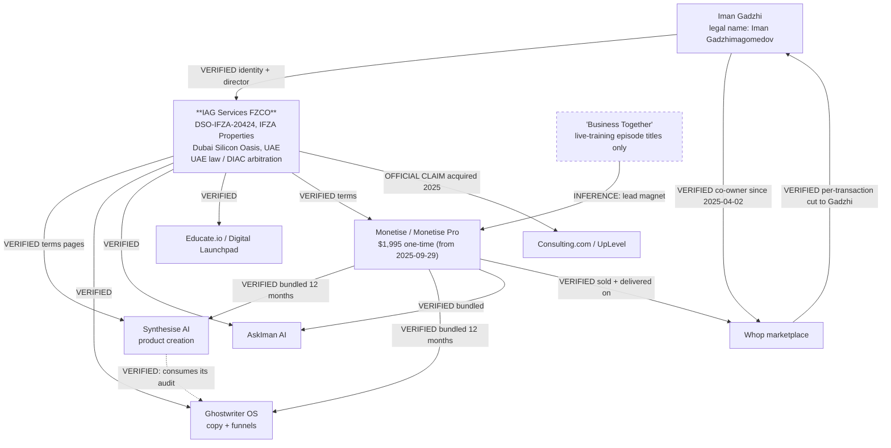

# Deliverable 1 — Synthesise AI · Monetise · the digital-product factory: evidence dossier

**Compiled:** 2026-10-11 · **Every "as of" statement is 2026-10-11 unless a snapshot date is given** ·
**Workspace audited:** `C:/Users/DELL/ipf-factory` (read-only; nothing in the application was modified)

**Raw evidence behind this dossier** (all in `research/raw/`):

| File | Contents |
|---|---|
| `lead_primary_evidence.md` | the lead researcher's first-hand artefacts `E1–E10` (HTTP headers, ToS extracts, Wayback pricing, the shipped client bundle's route table, the tRPC procedure oracle) |
| `synthesise_product_research.md` + `_sources.csv` | Synthesise AI product/commercial dossier, 50 sources `S01–S50` |
| `synthesise_tech_and_prompts.md` + `_sources.csv` | stack, prompt/agent and reverse-engineering dossier, 44 sources `T01–T44` |
| `monetise_ecosystem_research.md` + `_sources.csv` | the Iman Gadzhi / Monetise ecosystem, 42 sources `M01–M42` |
| `voice_of_customer.md` + `_sources.csv` | customer-experience evidence, 50 sources `V01–V50`, 17 themes with per-theme n |
| `oss_repository_audit.md` + `_sources.csv` | 43 repositories scored, 35 cloned and code-inspected, 46 sources `R01–R46` |
| `factory_ebook_pipeline_audit.md` + `_evidence.csv` | code-backed audit of the factory, file:line evidence |
| `factory_infra_audit.md` + `_evidence.csv` | control-plane / API / persistence audit, file:line evidence |

Classification vocabulary: **VERIFIED** · **OFFICIAL CLAIM** · **USER-REPORTED** ·
**INFERENCE** · **UNKNOWN** · **CONTRADICTED**. Confidence: high / medium / low.

---

# EXECUTIVE ASSESSMENT

## 1. What is Synthesise AI demonstrably capable of?

A web application that takes a niche, a piece of the user's own expertise, or a
named creator's public content, and emits a **structured, downloadable digital
product** — primarily a PDF e-book — preceded by a scored opportunity-selection
step and followed by a product charter and a one-click Whop storefront.

Demonstrated, reproducible capabilities:

| Capability | Status |
|---|---|
| **Ingestion-based positioning.** The creator's own Instagram and YouTube content is ingested into the project (`flow.ingestInstagram`, `flow.ingestYoutube`, `flow.listYoutubeVideos`), as is a **GhostwriterOS audit** (`flow.parseGWOSAudit`). | VERIFIED (procedure oracle) |
| **A visible, ranked opportunity score.** ~10–20 "profitable pocket" candidates, each scored out of 10 across four named dimensions: **pain, worsening, purchasing power, speed**, with a forced single selection. | USER-REPORTED (two independent screen recordings + a dated live-demo write-up) |
| **A transformation map with prices attached.** ~20–30 named transformations, each with a suggested price point, then a **4-stage customer journey** with milestones. | USER-REPORTED |
| **A staged, per-format product pipeline.** `flow → product → charter → structure → phase/module → resources → package → export`, with **separate sub-pipelines for e-book, course, coaching offer, presentation and digital asset**; the transformation map (`vtm`) is recomputed per packaged artefact. | VERIFIED (route table) |
| **Wave-based long-form generation.** ~20k-word e-books; one reviewer obtained 152 pages in ~30 minutes; another measured 2–10+ minutes for a ~20k-word book. | USER-REPORTED |
| **Block-level regeneration as the quality surface.** Presentation slides can be regenerated per block with an optional user instruction; images can be retried; slides can be reordered, grouped, skipped and shared with threaded comments. | VERIFIED (procedures + UI copy) |
| **Terminal commercial artefacts.** Product charter (explicitly handed to Ghostwriter OS), PDF export with margin settings, and a generated Whop store page with a price field and a Publish button (demo: $150). | USER-REPORTED |

Demonstrated **weaknesses** (all from independent hands-on reviewers):

* output is **plain text with only bolded titles** — no table of contents, no real formatting, no images;
* authors report **hours of manual polish** before the artefact is sellable (n=6 independent reporters);
* **no EPUB/DOCX/Notion export** — PDF only;
* **intermediate stages are not editable** (a UVZ input cannot be changed after generation; the run must be abandoned at product level);
* generated **cover art contains spelling mistakes**; generations intermittently **hang**;
* **no fact-checking, no citation UI, and no in-product quality score** is evidenced anywhere — the Terms explicitly push AI-accuracy review onto the user.

## 2. What can be established about its internal architecture?

This much is **verified** and reproducible (full detail in Deliverable 3):

* **Marketing site:** a **Framer** template site (`Server: Framer/26fa766`), last published 2026-09-09, whose unmodified Framer layer names still carry a personal-finance template's copy — and one of those leftover strings is *visible on the live page*.
* **Application:** **Next.js ≥ 16.3, App Router + Turbopack, on Vercel**, React RSC, Tailwind with shadcn-style/Radix primitives, Sentry + Microsoft Clarity + Segment + Amplitude + nprogress.
* **API:** **tRPC v11** at `/api/trpc` with **Zod** and **superjson**.
* **Auth:** **Better Auth** (`/api/auth/[...all]`, `/api/auth/ok → {"ok":true}`), with a **Whop** OAuth provider plus an email-OTP path keyed to *"the email you purchased Monetise with"*.
* **Payments/entitlement/storefront:** **Whop** — the checkout CTA is literally a `whop.com/checkout/...` link.
* **Storage:** a two-phase SAS upload flow (`files.generateSasUrl` → direct upload → `files.get`); "SAS" implies Azure Blob (**INFERENCE, medium**).
* **Imagery:** the **Unsplash** API for slide/block images.
* **Product model:** 74 client routes; the unit of work is a *flow*; typed deliverables each carry their own staged sub-pipeline terminating in package/export; soft-delete, shared-project and public `share/:token` views exist.

**What is NOT established — and must stay unstated:** the LLM provider(s), model(s),
prompt text, agent roster or agent count, orchestration topology, database, ORM,
queue, server runtime, or whether any fact-checking exists. **Zero model-provider
tokens appear in 41 client chunks.** There is **no publicly leaked prompt, no
agent count, and no prompt-injection or LLM-reconnaissance report** for this
product anywhere in the surveyed surface.

## 3. What remains unknown about its private agents, prompts and implementation?

Answered directly, because the brief asked for it:

1. **Are there multiple autonomous or specialised agents?** Not evidenceable. The
   route table shows *stages of one pipeline*, which is not the same thing. The
   honest answer is: **an unknown number of model calls behind an unknown
   orchestration.**
2. **How many distinct agents can be verified?** **Zero.** No agent is verifiable
   from any observable surface.
3. **Are there separate roles for research, audience analysis, planning, writing,
   QA?** **Structurally yes** (different stages exist as separate screens and there
   is no separate API namespace for any of them) — but whether each stage is a
   distinct *agent* with its own prompt/model, or one prompt with a stage
   parameter, is **UNKNOWN**.
4. **What tools can those agents access?** Partially verifiable at the *product*
   level: Instagram ingest, YouTube ingest, Unsplash image search, a web search
   mutation, a SAS file store, and GhostwriterOS audit parsing.
5. **Orchestration shape?** **UNKNOWN.** `flow → product → phase → module` nesting
   and per-stage screens imply sequential, user-gated progression.
6. **Is there a persistent skill system?** **UNKNOWN.**
7. **Memory / self-improvement / evaluation loops?** **No automation evidenced.**
   The only quality mechanism is **human-driven regeneration** (per block / per
   image) and human review comments on shared decks.
8. **Which of these are documented, observed, inferred, or unknown?** The stage
   *map* is **verified**; every claim about *agents and prompts* is **unknown**.
   The one document that names four agents (`synthesise-ai.gitbook.io`) is
   contradicted by the live deployment, presents toy stub "code", and advertises
   a **Solana `pump.fun` token with a 95 % liquidity allocation**; it is rejected
   as evidence (see Deliverable 3 §3).

**What the client bundle *does* expose about instruction design** is exactly one
instruction-shaped string, and it is not a system prompt:

> *"Optionally describe what you want, or leave blank to regenerate from the slide's context."*

## 4. How does the wider ecosystem turn product creation into a business?

One legal entity sells both the software and the education that teaches you to
need it, and the distribution platform is co-owned by the same person.



**The mechanics, verified:**

* **Access is bundling, not subscription.** `educate.io/policy/terms` §11 and
  `join.digital-launchpad.com/policies/terms` §11 state that access to
  **GhostwriterOS, Synthesise AI, AskIman and Alchemy of Self is for twelve (12)
  months** from purchase and "subject to fair use" — which flatly contradicts the
  "$2,999 / one-time payment" and "Unlimited Credits" wording on the product's own
  landing page.
* **The guarantees are coaching, not money.** Monetise's "10× guarantee" is, in the
  vendor's own written terms, *"continued coaching and support until you have
  generated revenue equal to at least ten (10) times the amount of your initial
  purchase price, for a period of up to three (3) years"*, explicitly *"not a
  money-back guarantee"*. Monetise Pro renews coaching for a further 90 days if
  you do not reach $50,000 in 90 days. **Only 7 days is actual money back.**
* **The funnel is a dated launch calendar.** The Educate.io refund list itself is a
  timeline: Boardroom ≤ 2025-06-17; Mindset Accelerator and MMOC 2.0 VIP in
  2025-10-07→14; AI Income Workshop VIP and Alchemy of Self ≤ 2026-01-25. Each
  launch re-signs the same promise with a new name.
* **"Business Together" is not an entity.** No company of that name is linked to
  Gadzhi at Companies House (the one live `BUSINESS TOGETHER LIMITED`, 09593738,
  Watford, is directed by Jadav/Parmar and unrelated). Every Gadzhi-side use is an
  **episode title** for a free live-training webinar ("Let's Start a $373/Day
  Business Together"). Its evidenced role is **lead magnet → paid offer** — not a
  product, not a company, and not part of the Synthesise AI codebase.
* **The proof numbers have no denominator.** `$15,064,202` is Monetise-member sales
  tracked on Whop; `$2,355,373,816` is *all Whop creators, all products, all time*;
  the "$370,000 in 30 days ebook" is the founder's own product. `monetise.com/disclaimer`
  returns **404**. **Company sales, member sales, founder sales and tool-attributed
  sales are four different quantities and the marketing blends them.**
* **Register-level facts.** `AGENCIFLOW LTD` (13809253 — the Flozy CRM) had two
  directors, **Iman GADZHIMAGOMEDOV** and Pierre-Antoine de Preux, appointed
  2021-12-20, and was **dissolved 2026-10-06**. Gadzhi's UK footprint is mostly
  dissolved; the active operator sits in a UAE free zone where no equivalent
  public registry exists.

**Consequence for anyone building in this space:** the ecosystem's moat is
**audience + bundle + platform ownership**, not software. The buyer pays $1,995
for a bundle in which the software is time-limited, and the person selling it also
takes a cut of the platform it is sold on.

## 5. Are there credible open-source projects that provide useful building blocks?

**Yes, but not where the marketing suggests.** 43 repositories were scored;
35 were cloned and code-inspected (Deliverable 4).

* **Import (small, permissive, high-leverage):** `instructor` (MIT) for the
  validate→reask→retry loop on every structured artefact; `WeasyPrint` (BSD-3) for
  deterministic PDF from the HTML the factory already renders; `markitdown` (MIT)
  for document→Markdown ingestion; optionally `dbos-transact-py` (MIT) for durable
  stage execution on SQLite.
* **Import as a gate:** `epubcheck` (BSD-3) and `daisy/ace` (MIT) — a book that
  fails conformance or accessibility must not ship.
* **Licence traps confirmed at file level:** `aerkalov/ebooklib` is **AGPL-3.0**
  (and the popular `gpt-author` reference imports it); `restate` is **BSL 1.1**;
  `n8n` is **SUL**; AutoGPT's platform is **Polyform Shield**; `dify` is a
  **modified Apache-2.0 that forbids multi-tenant operation**.
* **Dead or frozen at HEAD:** `microsoft/autogen` (maintenance-mode banner),
  `FlowiseAI/Flowise` (archived), `letta-ai/letta` (repo gutted — 12 files, no
  source), `mshumer/gpt-author` (3 notebooks, 0 `.py` files), `jsonformer` (dead
  since 2023).
* **Port patterns, not frameworks:** LangGraph's checkpoint contract + DDL; Dify's
  pause/resume + node-offload schema; STORM's `url → {snippets}` evidence index;
  Ragas' atomic-claim → entailment faithfulness metric; DeepEval's pytest-shaped
  thresholds; GPT-Researcher's uniform per-provider retriever interface.

**Reverse-engineering efforts: none credible.** Exactly **one** project in the
surveyed space targets these products — `Master-Urus/Shadow-Operator`, a
concept-level *inspired* reimplementation (Next.js 14 + Python scraper + **local
Ollama `qwen3:4b`**, 1 star, 2 commits) whose own prompts use Hormozi's Value
Equation and Cialdini/Walker frameworks and contain **zero** Synthesise concepts
(no UVZ, no charter, no VTM). It is **not** a clone and **not** a reverse-engineering
report, and its prompts must never be attributed to Synthesise AI. The closest
commercial artefact is `monetiseos.com`, which markets itself with the meta-keywords
"synthesise AI alternative, ghostwriter OS alternative" and runs a different
backend shape entirely. GitHub **code** search was login-gated — recorded as a
limitation, not a negative result.

## 6. What are the biggest gaps in my existing factory?

The audit is code-backed (Deliverable 5); the four that matter most, in order of
severity:

1. **The product's structure is a hardcoded template, not derived from anything.**
   `ipf/products/factory.py::compose_chapters` contains a literal 8-item chapter
   `plan`, and every worksheet/callout/checklist is injected by `if i == 0 / 3 / 4
   / 5 / 6 / 7`. Every product the API path produces has the same eight chapter
   titles.
2. **The evidence chain is decorative.** `inject_citations` links chapter *i* to
   reference `(i % n_refs) + 1`, and the "evidence cited" gate passes on the
   presence of a `class="cite"` token. A citation therefore does **not** point at
   the source of the claim.
3. **"Done" is a markup-presence check, not a quality judgement.** The 25 gates are
   regex/markup heuristics (`check_value_mechanism` tests `"mechanism" in text`).
   The repository **already owns** a semantic, blind-evaluated writing/editorial
   system (`ipf/writing/editorial/*`, `ipf/writing/evaluators.py`) — and it is
   imported by **no module under `ipf/products/` or `ipf/authoring/`**.
4. **The end-to-end control-plane chain is structurally dead-ended.** The Shark
   rubric's `differentiation` criterion needs `mechanism` ≥ 8 words, but nothing
   ever writes `mechanism`, `competition_summary` or `feasibility`
   (`ipf/research/opportunity_research.py` sets them to `""` with the comment
   *"not derivable from comments alone"*). With `mechanism == ""` the verdict is
   `REVISE`, and production requires `PASS`. **A real researched opportunity can
   therefore never be built end-to-end**; only hand-seeded test fixtures get
   through — and the one persisted product on disk was built from evidence rows
   literally named `"student survey"`, `"comment archive A"`, `"comment archive B"`.

Runner-up gaps worth naming: research is niche-hardcoded (`NICHE_SPECS`);
`ipf/research/audience_archive.py` is titled *"REAL-scale research dataset"* but
fills comments from a seeded RNG over a hardcoded pool; the DPF bridge is
permanently `DpfUnavailable`; export is HTML-only; and **there is no product-level
evaluation harness** comparing factory output against a baseline.

## 7. Which three to five improvements should be implemented first, and why?

| # | Change | Why first |
|---|---|---|
| **P0-1** | **Outline-first authoring.** Replace the literal 8-chapter plan with a `TransformationSpec → Outline` step validated by a deterministic `OutlineGate` *before* any prose is written. | It fixes the defect with the largest quality impact, and it fails cheaply: bad structure is caught before paying for 8–12 chapter generations. |
| **P0-2** | **Claim-level citation binding.** Delete the `(idx % n_refs) + 1` behaviour, require every `science`/claim block to declare `evidence_ids`, and adjudicate entailment (SUPPORTED / PARTIAL / OVERCLAIM / UNSUPPORTED) per claim. | Without this, the factory's core selling point — an evidence-backed product — is unverifiable, and the existing gate is worse than useless because it reports green. |
| **P0-3** | **Wire the existing semantic critic into the product path.** Call `ipf/writing/editorial/*` + `ipf/writing/evaluators.py` from `ProductFactory.execute` alongside the structural gates, and require quoted findings. | The code already exists and is good; it is simply not connected. Highest value per unit of work in the whole repository. |
| **P0-4** | **Un-dead-end the control plane.** Make `mechanism` / `competition_summary` / `feasibility` produced artefacts (from evidence + a grounded competitor scan), or explicitly relax the Shark `differentiation` criterion to what the data can support — and record which choice was made. | Today no real opportunity can reach production, so every other improvement is untestable end-to-end. |
| **P0-5** | **A golden-set evaluation harness** (≥12 frozen briefs, blind A/B, a non-self anchor, no length bias, quoted justifications). | Nothing else can be called an improvement without it. It ships no user-visible feature, and it is the cheapest way to stop optimising on vibes. |

**Explicitly not first:** multi-agent orchestration, a vector database, EPUB/PDF
export, a storefront, or an "agent marketplace". Those are P1/P2 (Deliverable 7).

---

# PART I — THE PRODUCT AND BUSINESS ECOSYSTEM

Full entity-by-entity detail is in `raw/monetise_ecosystem_research.md`. What
follows is the load-bearing summary.

## I.1 What each entity is, and what it is not

| Entity | What it is | Ownership / relationship | Evidence |
|---|---|---|---|
| **Synthesise AI** | AI product-creation app (e-book / course / coaching / slides / lead-magnet / asset) | Operated by **IAG Services FZCO** dba Synthesise AI; one SKU inside the education bundle | VERIFIED (ToS) |
| **Monetise / Monetise Pro** | The flagship programme: course + coaching + community + bundled software, delivered on Whop | Gadzhi's programme; IAG Services FZCO terms | VERIFIED |
| **"Business Together"** | **Not an entity.** A recurring title for free live-training webinars | No shared ownership or codebase with Monetise or Synthesise AI; evidenced role = lead magnet | VERIFIED negative |
| **Ghostwriter OS** | Copy/funnel AI ("specialised agents", hooks, CTAs, funnels, 14-day launches) | IAG Services FZCO; bundled; **consumed by Synthesise** (`flow.parseGWOSAudit`) | VERIFIED |
| **Flozy / Flozy Pro** | Agency CRM, websites, invoices, portals | `AGENCIFLOW LTD` (13809253), directors Gadzhimagomedov + de Preux, **dissolved 2026-10-06**; current operator UNKNOWN | VERIFIED |
| **AskIman AI** | Chat assistant | IAG Services FZCO; terms state access expires at challenge end in some kits | VERIFIED |
| **Educate.io / Digital Launchpad** | Education platform ($37/month) and the umbrella brand | IAG Services FZCO, **same registered address** as Synthesise | VERIFIED |
| **Consulting.com / UpLevel** | Sam Ovens' consulting property, **acquired 2025**; hosts high-ticket programmes | Now operated by IAG Services FZCO | VERIFIED operator change |
| **Whop** | Marketplace where Monetise is sold and delivered | **Gadzhi is a co-owner/investor since 2025-04-02** and takes a per-transaction cut | VERIFIED |
| **Personal Brand Blueprint** | Course bundled with Monetise 1.0 | Superseded; the name is also used by dozens of unrelated products | VERIFIED disambiguation |
| **Digital Product Formula (DPF 2.0)** | The spine course of Monetise 2.0 (~31 lessons) | Monetise inclusion, not sold standalone | VERIFIED |
| **GrowYourAgency / Agency Incubator / Agency Navigator / Agency Accelerator / Six Figure SMMA** | The SMMA-era course lineage | Retired from sale, recycled as bonuses; `growyouragency.com/terms` now **404s** | VERIFIED |

## I.2 The business model, stage by stage

**Acquisition** → free multi-day live events with recurring new names (MMOC 1.0/2.0/3.0,
AI Income Workshop, Side Hustle Summit with Russell Brunson, AI Income Challenge
with Mark Tilbury), plus "Business Together"-titled webinars. **Conversion** → a
cart that opens for a stated window (typically 5–9 days) at **$1,995 one-time**,
financed from **$166/month** (Splitit BNPL). **Delivery** → Whop workspace.
**Retention/upsell** → Monetise Pro, UpLevel, Command Centre, Boardroom,
Alchemy of Self, individually dated refund windows. **Proof** → Whop-tracked
leaderboards and aggregate sales figures without denominators. **Distribution of
the software** → the tools are bundled for 12 months, so the software's job is to
make the programme's promise feel fulfilled rather than to be a product in itself.

**What this model requires that software cannot supply:** an existing audience or
paid traffic, outreach skill, and trust in a personality. That is exactly what the
customer complaints in Part VI are about.

## I.3 The contradictions, resolved

| Contradiction | Resolution |
|---|---|
| Synthesise AI: "$2,999 one-time" (landing) vs "monthly subscription basis", 7-day refund (its own ToS, same domain, same day) | The ToS is inherited template text (its sibling Educate.io/Digital Launchpad terms share §11 verbatim, and the Privacy Policy still ships an unfilled placeholder `[confirm hosting locations, e.g. the United States and the European Union]`). **Operative reading: one-time payment, 12 months of access, 7-day refund window.** |
| "Unlimited Credits" vs "12 months, subject to fair use" | Not a contradiction once separated: unlimited *within* a 12-month window with a fair-use cap; suspension without refund for abuse. |
| $1,499 vs $2,999 vs $97/month vs $1,995 | Four different objects: the 2025 lower tier ($1,499/3 credits), the current Synthesise price ($2,999 one-time), an **unaffiliated-looking Whop storefront named "Synthesise AI"** in Montréal selling the same name at **$97/month**, and the Monetise bundle price that *includes* a 12-month licence. |
| Flozy user count: 42,000+ vs 30,000+ vs "over 50,000 clients" | Same metric, three vendor surfaces, three numbers. |
| GitBook stack (Rust/WASM/K8s/Postgres/Stripe) vs observed deployment | **CONTRADICTED.** The GitBook is not linked from the official site, its code samples are decorative stubs, and it advertises a pump.fun token. Rejected as evidence. |

---

# PART II — SYNTHESISE AI IN DEPTH

## II.1 The complete observable user journey

*(Full 21-step version with per-step classifications in
`raw/synthesise_product_research.md` §D.)*

1. **Access.** You must already be a Monetise customer. `app.synthesise.ai`
   redirects to `/signin`; the only path is **"Sign in using Whop"**, or an email
   OTP keyed to *"the email you purchased Monetise with"*.
2. **Create a project ("flow").** Name, language; `flow.createFlow`.
3. **Choose how to enter the UVZ.** Either *"Help me discover my UVZ"* (the
   software researches the market) or *"I have my own UVZ"* (you type the niche).
4. **Ingestion happens server-side, largely undisclosed.** Instagram content,
   YouTube videos, and optionally a GhostwriterOS audit are pulled into the flow.
5. **UVZ generation.** 1.5–10 minutes; **~10–20 micro-niche statements**, each
   scored out of 10.
6. **Selection.** You pick one candidate; the score is explained by four named
   dimensions.
7. **Optional creator-audience mode** (shown Sept 2026): paste an Instagram handle
   or YouTube link; the tool reads the back catalogue and returns a profile
   (niche, transformation, ranked content themes, audience, voice) plus **4 scored
   product concepts**.
8. **Format selection.** E-book, video course or coaching offer are live; digital
   asset, lead magnet and presentation are locked behind *"create a product to
   unlock"*; course/coaching required a Monetise Pro upgrade in the Oct-2025 build.
9. **Transformation map.** ~20–30 named transformations **each with a suggested
   price** (reviewers saw $149, $127–147); the chosen one defines before/after
   states. **Not editable at this step.**
10. **Customer journey.** The packaging becomes a **4-stage journey** (awareness &
    triage → method setup & first wins → routine & trust → scale & mastery) with
    milestones.
11. **Reference library.** Upload files, scrape a URL, add YouTube links — "powers
    everything you build in this flow".
12. **E-book summary (first fully editable screen).** Overview, audience,
    objectives, a plan header (e.g. *"22,000 words, 100 minutes reading time, 9
    chapters, 4 bonus materials"*), chapter list, bonuses.
13. **Outline → chapters.** Chapters map onto journey stages.
14. **Wave-based generation.** Multiple sections generated in waves with stated
    context continuity; slow; one run produced 152 pages.
15. **Companion tools.** A checklist and worksheets are appended into the PDF.
16. **Cover.** AI-generated, regenerable, reported spelling errors.
17. **Editor.** H1–H3, bullets, code block, table, checklist insertion. **No media.**
18. **Export.** **PDF only**, with margin settings.
19. **Product charter.** Offer, audience, prior attempts, deliverables, marketing
    angle, positioning, method foundations, USP, objection handling — explicitly to
    be taken to **Ghostwriter OS**.
20. **Publish.** A Whop store page is generated; set a price; Publish (demo $150).
21. **Dashboard.** Flows with status; reopen, trash, shared views.

**Never observed anywhere:** collaboration, version history/diffing, variant A/B
comparison, feedback loops, human-review steps, automated fact-checking, exports
other than PDF, or automatic image insertion.

## II.2 The UVZ mechanism — what it is, and what it is not

**What it collects:** free-text expertise/niche, or a creator's Instagram/YouTube
identity; uploaded/scraped reference material; language and product type.

**What it computes, observably:** candidate niche statements, each with a **visible
0–10 score decomposed into pain, worsening, purchasing power and speed**, ranked,
with a forced single selection.

**What it does NOT do, despite the marketing:**

| Marketing claim | Reality |
|---|---|
| "Use **machine learning** to identify the intersection" | **No ML component is verifiable.** No model, embedding or vector endpoint appears in the client; "machine learning", "cosine similarity" and "vectorized corpus" exist only in marketing copy and the rejected GitBook. |
| "$3 billion in real sales data from Whop" | Unverifiable by every source reviewed, **including the affiliate who repeats it**. No dataset, methodology, model card or citation is published. |
| "**150+ sources**, and the AI hands you the reference list" | The claim was made live and the source list **was never shown**; no walkthrough exposed a citation UI. |
| Competition / saturation analysis | **Not observed as a scored dimension.** It appears only as marketing copy and as a claimed step with no independently observed UI. |
| Demand evaluated separately | Only implicitly, via pain/worsening + a claimed market scan with status text such as *"processing seven web search results"*. |

**Can users compare, score, reject or revisit?** Score and select, yes. Compare
side-by-side, no. Revise the UVZ input after generation, no. Restart cleanly, no —
the run must be abandoned at product level.

**So what is the UVZ really?** *An LLM-assisted market-scan with a transparent
4-factor rubric, ranked, with a forced choice.* That is genuinely useful, it is the
mechanic users praise, and **it is cheap to build.**

### An independently designed UVZ model for this factory — `ORIGINAL DESIGN`

Not their algorithm; a proposal grounded in what the evidence shows works and what
it shows is missing.

```
OpportunityScore(idea) =
  0.20 * PainIntensity        # how bad is the moment, in the reader's words (evidence-grounded)
+ 0.15 * Trajectory           # is it worsening without intervention
+ 0.15 * PurchasingPower      # can this reader pay; observed price points, not aspiration
+ 0.10 * SpeedToFirstResult   # how fast can the reader see any change
+ 0.15 * EvidenceDensity      # INDEPENDENT reporters, distinct threads, recency  <-- NEW
+ 0.10 * SaturationInverse    # how crowded is the solution space                 <-- NEW
+ 0.10 * CreatorAdvantage     # can THIS author say something others cannot         <-- NEW
+ 0.05 * FailFastTestability  # can a 3-page prototype falsify this in a week       <-- NEW
```

Rules that make it honest, mirroring the repo's existing doctrine:

* Every sub-score carries `evidence_ids[]`; a sub-score with no evidence is
  **`null`, not 0** — and any `null` produces `INSUFFICIENT_EVIDENCE`, which
  outranks PASS (the repo already implements exactly this precedence in
  `ipf/scoring/shark_rubric.py`).
* `EvidenceDensity` counts **distinct reporters and distinct threads**, never
  comments (the current pipeline's `distinct_commenters` is the right instinct;
  the preferred artifact bug makes it read 1/0/1/0/0 — see Deliverable 5).
* `SaturationInverse` requires a **named artefact** per competitor (URL, title,
  price). No competitor list, no score.
* Displayed to the user as a **table with the evidence attached**, plus an explicit
  `unknowns[]` list. The thing the competitor does best is *show the number*; the
  thing they do worst is *show the basis*. Do both.
* **Validation experiment:** hand-score 30 opportunities against the rubric, then
  blind A/B: does the rubric's #1 pick outperform a random pick from the top 5 on
  (a) evidence density per chapter and (b) reviewer-rated actionability? If it
  cannot beat random, the rubric is decoration.

## II.3 Customer transformation and product architecture

The observed chain is: **expertise → UVZ statement → scored selection → before/after
states → 4-stage journey → packaging with a named promise → chapter plan →
manuscript → worksheets/checklist → PDF → charter → Ghostwriter OS → Whop storefront.**

The mechanism worth stealing is that **chapters are mapped onto transformation
stages**, with a per-stage deliverable. The mechanism worth *fixing* is that their
manuscript is assembled as *named sections with a per-section status* — which is
why the flow resumes but also why incomplete sections hang silently.

**Recommendation for this factory:** make the transformation spec the contract that
the outline is *validated against*, not a screen the user clicks past. Concretely:
a chapter may exist only if it serves a named milestone, and a milestone exists
only if it has an observable change and a named failure mode. This is P0-1 in the
roadmap and is specified in `proposed_agent_and_skill_architecture.md` §3 (R3/R4).

## II.4 Output artefact catalogue

| Artefact | Structure observed | Depends on | Format |
|---|---|---|---|
| UVZ / "profitable pocket" list | 10–20 statements, each /10 with four sub-scores | input or creator ingest | on-screen |
| Creator profile (creator mode) | niche, transformation, ranked themes, audience, voice + 4 scored concepts | IG handle / YT link | on-screen |
| Transformation map | 20–30 named transformations **with suggested prices**, then before/after | selected UVZ | on-screen |
| Customer journey | 4 stages with milestones | transformation map | on-screen |
| E-book summary | overview, audience, objectives, word count, reading time, chapters, bonuses | journey + references | editable metadata |
| Outline / TOC | chapters mapped to stages | summary | on-screen |
| Manuscript | per-section text, bold titles only | outline + reference library | editor |
| Worksheets / checklists | appended pages | — | inside PDF |
| Cover | single AI image | title | embedded image |
| **E-book** | 9–10 sections + checklist + worksheets | all of the above | **PDF only** |
| Product charter | offer, audience, prior attempts, deliverables, positioning, method, USP, objections | manuscript | on-screen → Ghostwriter OS |
| Course artefacts | phases + modules + scripts | same flow | text (no slides, no video) |
| Presentation | deck + presenter notes | same flow | in-app + share link |
| Whop store page | store copy + price | finished product | Whop storefront |

**Do the steps share context?** Yes — **one `flow_id` threads everything**, and
routes are nested, so downstream artefacts inherit upstream choices. The `vtm`
stage is **re-generated per packaged artefact**, not once per flow.

---

# PART III — TECHNICAL IMPLEMENTATION

**Deliverable 3 (`technical_architecture.md`) is the full report.** Summary of the
verified/unknown split:

| Verified | Method |
|---|---|
| Framer marketing site | `Server: Framer/26fa766` + Framer layer names retaining finance-template copy |
| Next.js ≥16.3 App Router + Turbopack on Vercel | response headers, RSC `Vary` keys, `/_next/static/immutable/` |
| tRPC v11 + Zod + superjson | live error envelope, bundle strings |
| Better Auth (not NextAuth) | Better Auth's own `Symbol.for("better-auth:*")` internals; `/api/auth/ok → {"ok":true}` |
| Whop OAuth + checkout + entitlement | sign-in button, checkout URL, email-OTP copy |
| 74 routes / typed staged pipelines | embedded client route manifest |
| Procedure existence/absence (e.g. no `uvz.*`, no `billing.*`) | tRPC error-code oracle |
| Unsplash imagery; SAS-based upload | procedure names + UI components |

| UNKNOWN — and must stay unknown |
|---|
| LLM provider(s), models, routing, context strategy (zero provider tokens in 41 chunks) |
| Prompts, agent roster, agent count, orchestration topology |
| Database, ORM, queue, vector store |
| Server compute/runtime; whether SSE/streaming exists (the only `text/event-stream` occurrence is Sentry's denylist) |
| What `/admin/models` and `/admin/ai` do |
| The expansion of `vtm`; any automated fact-check or quality scoring |

**The rejected documentation.** `synthesise-ai.gitbook.io` claims Rust, WASM,
PostgreSQL+Redis, Kubernetes, first-party Stripe webhooks, four named agents and a
`$SYNAI` pump.fun token with a 95 % liquidity allocation — while every code sample
is a decorative stub (`format!("Generating tags for '{}'", input)`) and the live
deployment is Next.js/Vercel/Whop. **Classified CONTRADICTED; likely AI-generated or
scam-adjacent; never citable as evidence about the implementation.**

---

# PART IV — THE PROMPT AND AGENT DOSSIER

## IV.1 The evidence table (required format)

| Agent or stage | Confirmed status | Responsibility | Inputs | Instructions | Tools | Model | Output | Dependencies | Quality checks | Evidence |
|---|---|---|---|---|---|---|---|---|---|---|
| Flow creation | **Verified** | project container | name, language | **none public** | `flow.createFlow` | UNKNOWN | `flow_id` | — | none observed | E10c/T06 |
| Creator/audience ingestion | **Verified** | pull the creator's own corpus | IG handle, YT channel/URL | **none public** | `flow.ingestInstagram`, `flow.ingestYoutube`, `flow.listYoutubeVideos` | UNKNOWN | ingested corpus | source URL | none observed | E10c/T06 |
| Sibling-artefact ingest | **Verified** | consume a GhostwriterOS audit | GWOS audit payload | **none public** | `flow.parseGWOSAudit` | UNKNOWN | structured audit | Ghostwriter OS | none observed | E10c/T06 |
| Reference library | **Verified** | ground generation | uploads, URLs, YT links | **none public** | `resources.upload`, `resources.addYoutubeLinks`, `resources.get` | UNKNOWN | per-flow reference set | `flow_id` | none observed | T06 |
| **Unique Value Zone** | Route **verified**; engine **unverified**; *no `uvz.*` namespace* | rank opportunity candidates | expertise text, or creator identity; ingested corpus | **none public** (UI copy only) | unknown (inside `flow.*`/server actions) | UNKNOWN | ranked 10–20 candidates with 4 sub-scores | flow context | none automated; user selects | E10b/T06; USER-REPORTED scoring |
| **Product charter** | Router **verified** (`charter.get`, auth-gated) | blueprint the offer | flow + product type | **none public** | `charter.get` | UNKNOWN | charter document | product record | none observed | T06 |
| Product instantiation | **Verified** | create a typed product | product type | **none public** | `product.createForFlow`, `product.get` | UNKNOWN | phase/module tree | `flow_id` | none observed | T06 |
| Structure → phase/module → lesson | Routes **verified** | hierarchical planning | charter | **none public** | unknown | UNKNOWN | module tree + slide outline | product | none observed | E10b |
| **VTM** (transformation map) | Route **verified** (per product *and* per asset); expansion **inferred** | before/after mapping, priced options | product/asset | **none public** | unknown | UNKNOWN | transformation artefact | product or asset | none observed | E10b |
| Content authoring (e-book/course/coaching) | Routes **verified**; behaviour **user-reported** | long-form generation | outline + reference library | **none public** | unknown | UNKNOWN | sectioned manuscript (wave-generated) | outline | human edit/regenerate only | E10b + USER-REPORTED |
| **Presentation generator** | Procedures **verified** | outline → slides → blocks, with imagery | topic + optional per-block instruction | **only public "instruction" string in the product**: *"Optionally describe what you want, or leave blank to regenerate from the slide's context."* | `presentation.slides.*`, `presentation.blocks.*`, `webSearch.unsplashSearch`, `files.generateSasUrl` | UNKNOWN | deck, notes, public share link with comments | presentation record | **user-driven**: regenerate block / retry image / reorder / skip | T05/T06 |
| Packaging / export | Routes **verified** | assemble deliverable | completed product | **none public** | unknown | UNKNOWN | **PDF** (margins configurable) | product | none observed | E10b + USER-REPORTED |
| Store publish | Routes **verified** | sell the artefact | price, store copy | **none public** | unknown | UNKNOWN | Whop storefront page | Whop account | none observed | E10b + USER-REPORTED |
| Automated QA / fact-check | **Not evidenced anywhere** | — | — | — | — | — | — | — | **none**; the Terms shift accuracy review to the user | B.2/T11 |

**Bottom line.** Stage *map*: verified. Agent *names*: zero verified. Prompt text:
zero public. **Any specific agent count or prompt quoted from this product would be
fabricated.**

## IV.2 The GitBook's four agents are rejected

`TutorAgent`, `SEOAgent`, `UXAuditAgent`, `MonetizationAgent` come from a document
whose own code samples are stubs and which sells a memecoin. They are recorded here
**only** so that a future reader recognises the claim and does not repeat it.

## IV.3 An original agent system for this factory

`proposed_agent_and_skill_architecture.md` specifies it in full. The design
decisions, in one paragraph: **six model roles** (ReaderModeler, OutlineArchitect,
ChapterAuthor, ToolDesigner, EditorialCritic, OfferComposer) plus **two
adjudication calls** (EvidenceAuditor's entailment pass, EditorialCritic-as-reviewer),
**eleven deterministic stages** that must never be models (niche descriptor, strict
evidence curation, dedupe/idempotency, page-budget arithmetic, citation
resolution, banned-language and fabrication checks, money accounting, renderer,
stage gates, golden-set harness, orchestration), **premium models only for the two
artefacts that determine structure and the one that judges quality**, and a
hard rule that **fan-out happens only in ChapterAuthor**. Estimated ≈22 calls per
10–12-chapter product, with the money moved from bulk volume to structure and
judged quality.

---

# PART V — OPEN SOURCE AND REVERSE ENGINEERING

**Deliverable 4 (`opensource_repository_audit.md`) is the full report** (43 repos
scored, 35 cloned, licences read from `LICENSE`, every maintenance claim backed by
a commit SHA). The four conclusions, restated because they drive the roadmap:

1. **No framework spine.** The star-heavy agent platforms are frozen (AutoGen),
   archived (Flowise), gutted (Letta) or licence-restricted (Dify/Restate/n8n/AutoGPT).
   The factory already owns its orchestration in `ipf/orchestration/state_machine.py`.
2. **Three imports:** `instructor` (MIT), `WeasyPrint` (BSD-3), `markitdown` (MIT);
   optionally `dbos-transact-py` (MIT).
3. **Licence trap:** `ebooklib` is **AGPL-3.0** and `gpt-author` imports it; write
   the EPUB3 packager in-house (`zipfile` + `xml.etree`) and gate it with
   `epubcheck` (BSD-3) and `daisy/ace` (MIT).
4. **Port patterns:** LangGraph checkpoints · Dify pause/resume + node offload ·
   STORM's `url→{snippets}` evidence index · Ragas' atomic-claim faithfulness ·
   DeepEval's pytest thresholds · Langfuse's prompt-versioning schema.

**Reverse engineering:** none credible exists. One concept-level inspired
reimplementation (`Master-Urus/Shadow-Operator`); one meta-keyword competitor
(`monetiseos.com`); no clone, no RE report, no public prompt. GitHub code search
was login-gated and is recorded as a limitation.

---

# PART VI — THE ECOSYSTEM FROM THE USER'S SIDE

## VI.1 The measurement artefact

| Surface | Rating | n | What it means |
|---|---|---|---|
| **Trustpilot, monetise.com** | **2.1 / 5** (73 % one-star, unclaimed profile) | 11 | unsolicited, off-platform |
| **Whop, on-platform** | **4.8 / 5** | 4,353 | solicited, on a platform the founder co-owns |
| **Trustpilot / G2 / Capterra / Product Hunt for Synthesise AI** | **none exists** | 0 | no independent review surface at all |
| educate.io | 4.5 / 5 | 382 | operator-controlled |

The 2.1-vs-4.8 divergence is the single most informative fact in the customer
evidence: **on a platform the seller part-owns, ratings are near-perfect; off it,
they are near-bottom.** Note also that n=11 makes the Trustpilot number volatile,
and that both sides show evidence of astroturfing — vendor-team-accused positive
posts and deleted Whop criticisms on one side; competitor clone-shilling and
bot-vote accusations on the other. Four Reddit threads had their original-post
bodies removed before they could be read.

## VI.2 Themes, with the counts that matter

n = independent reporters actually reviewed (full 17-theme table in
`raw/voice_of_customer.md` §B).

| Theme | Direction | n | Representative evidence |
|---|---|---|---|
| Depth/quality of generated content | **strongly negative** for sellable output | 11 | *"no table of contents… literally no formatting at all… spelling mistakes… it's not finished as a product"* (2025-10); *"clearly not ready to build products from point A to B"* (2026-10) |
| Price-to-value | **negative** | 16 | fair value put at **$100–300/year** by two detailed testers against a $2,000–2,999 label; *"For US$1,995, I expected substantially more value"* |
| Advertised-benefit gap | **strongly negative** | 13 | *"overpromised and underdelivered"* (2026-09); the $2,000 paywall arriving after two days of "free" sessions (2026-04) |
| Refund experience | **negative** | 9 | a purchaser reports a **written refusal inside the 7-day window**, reversed only after an Amex dispute (2026-09-18); two more report refusals/lateness |
| Originality vs a general LLM | **negative** | 8 | *"80 to 100% of this work can be done inside Claude… if you know how to prompt"* (2025-10); *"a slower ChatGPT"* (2026-01) |
| Sales & distribution difficulty | **negative** | 8 | *"500+ people all pitching the same 100 creators using the same AI-generated scripts"* (2026-02) |
| Manual editing burden | **negative** | 6 | *"polish everything for hours. You will have to do it. There is no doubt about that"* (2025-10) |
| Time to produce | negative vs the claim, modestly positive vs DIY | 6 | *"10 to 20 hours of planning"*; ~45–60 min in-tool vs ~2 h in Claude |
| Bugs / support | bipolar | 8 | uneditable UVZ input called *"a flaw"*; multiple reports of support not responding |
| Worksheet/companion quality | **negative** | 5 | *"look like a child created them in 2018… not a 3000 dollar premium feel"* (2026-05) |
| Ease of use | mixed-to-negative | 6 | *"even I keep losing track of where the next steps are"* |
| **UVZ / ideation quality** | **positive** | **2 — flagged, both the same reporter** | the *only* software capability praised by a reviewer who otherwise rates the tool at $100–300/yr |
| Bundled Consulting Accelerator | positive | 4 | singled out, including by the most negative reviewer |
| Community / coaching | positive | 6 | real, but most positive voices are solicited or affiliate |

**Software dissatisfaction and method dissatisfaction split cleanly**, which
matters because they are sold together: **software** complaints are
editing/formatting/breadth/export; **method** complaints are cold outreach, niche
saturation, 20–30 % revenue splits, and the challenge-to-$1,995 paywall.

**Documented ambiguity, not a measured complaint (n=3, one primary source):** the
"10× guarantee" is widely misread as money-back; the written terms say coaching
only, for up to three years.

## VI.3 So why would anyone choose Synthesise AI?

Direct answer: **the differentiators are real but mostly not technical.**

| Candidate differentiator | Verdict |
|---|---|
| Domain-specific methodology (UVZ → journey → transformation map → deliverable per stage) | **Evidenced and real.** The staged artefact model with a transformation map is genuinely more than a wrapper. |
| Task sequencing + forced choices | **Evidenced** (scored candidates, single selection, journey stages) and **cheap to copy** (it is a rubric and a state machine). |
| Context carried across steps | **Verified**: one `flow_id` threads every artefact, and the reference library is per flow. |
| Ingestion of the creator's real corpus | **Verified** and under-appreciated: this is the best input mechanism in the product. |
| Specialised prompt design / output schemas | **Unverifiable** — no prompt is public. |
| Market-research integration | **Partially**: a claimed web search with status text; the source list is never shown. |
| Better/more consistent output quality | **Contradicted** by independent reviewers (n=11 negative on sellable quality; hours of manual polish). |
| Integration with delivery/monetisation | **Verified and strong**: Whop login, checkout, storefront generation, publish button. This is the one place where the product does something a general LLM structurally cannot. |
| Education, onboarding, community | **The actual purchase**: you are paying for the programme; the tool is bundled for 12 months. |
| Business model / distribution | **The real moat**: ~6M-subscriber brand, co-owned marketplace, launch calendar. |

**Conclusion:** the *product* is defended by distribution, not by technology; the
*workflow* is the part worth studying; and no part of the technology is
unreproducible. A competitor that (a) binds claims to evidence, (b) judges quality
semantically, (c) derives structure from a transformation spec, and (d) exports
real PDF/EPUB can beat the software layer on the axis its own users complain about
most.

---

# PART VII — THE FACTORY (summary)

**Deliverables 5–7 are the full treatment**:

* `factory_gap_analysis.md` — the code-backed capability matrix and gap analysis.
* `proposed_agent_and_skill_architecture.md` — the roles, contracts, prompts, gates,
  cost controls and implementation order.
* `factory_improvement_roadmap.md` — P0/P1/P2 with acceptance criteria, risks,
  dependencies and the validation experiments.

The headline verdict: **this factory's engineering discipline is far ahead of its
product structure, and ahead of the investigated competitor on honesty.** It has
1,436 test cases by `unittest` discovery (1,421 collected by `pytest`, of which
3–4 fail — **and the failing set is non-deterministic across runs**), a real state
machine, a real evidence rubric, a strict curation contract, blind A/B evaluation
machinery, negative-control canaries for its own gates, and an explicit validation
ladder that refuses to let the factory claim more proof than it has. What it does
**not** have is (1) a structure derived from the reader's transformation, (2)
citations bound to claims, (3) those existing quality instruments wired into the
product path, and (4) a way to measure whether any change made the product better.
It also has two places where the honesty doctrine is **violated in code** — a
`/products/demo/random` endpoint that writes a fabricated `COMPLETED` product, and
a `CREATOR_ANALYSIS` handler that stamps `ANALYZED` without doing any analysis
(see Deliverable 5).

---

# FINAL IMPLEMENTATION DECISION

**Reuse.**
* From your own repository, at full weight: `ipf/orchestration/state_machine.py`,
  `ipf/authoring/quality_gates.py`, `ipf/authoring/validation.py` (the ladder),
  `ipf/scoring/shark_rubric.py` (the MISSING≠0 doctrine), `runs/curate_book_evidence.py`
  (the strict contract), `ipf/writing/editorial/*` + `ipf/writing/evaluators.py`
  (blind evaluation — connect it), and `runs/run_heldout_experiment.py` (lift it
  from passages to products).
* Externally: `instructor`, `WeasyPrint`, `markitdown`, optionally
  `dbos-transact-py`; `epubcheck` and `daisy/ace` as shipping gates.

**Build.**
* A `TransformationSpec → Outline → OutlineGate` stage (P0-1).
* Claim-level citation binding with entailment adjudication (P0-2).
* A critic wiring that makes "PASS" impossible without quoted findings (P0-3).
* An offer/positioning artefact derived from the same transformation (P1).
* An in-house EPUB3 packager + PDF exporter behind one adapter (P1).

**Test first.**
* The golden-set harness (P0-5) **before** trusting any of the above, and one
  small end-to-end run on a *real* opportunity after the control plane is
  un-dead-ended (P0-4).

**Avoid.**
* Adopting any agent framework as the spine; a vector DB before SQLite FTS5;
  AGPL/BSL/SUL components; **reproducing Synthesise AI's interface**; and any
  feature whose justification is "they have it" rather than a measured defect.

**Assumptions that must be validated before more development time is committed.**
1. That an opportunity can actually traverse research → selection → Shark → build
   on **real** data (currently it cannot — Deliverable 5, finding 10).
2. That the writing/editorial subsystem, once wired in, moves product quality
   measurably (it has never been run against a product).
3. That a semantic critic and a human reviewer agree often enough for the critic to
   be trusted as an automated gate.
4. That buyers of a self-authored e-book value evidence binding (deliverable
   credibility) above volume — the competitor's own users complain about
   *formatting and finish*, not about volume, which is a warning about where to
   invest first.
5. That the P0 changes do not increase cost per accepted product beyond the
   current ~8-call baseline by more than ~3× (the design targets ≈22 calls).

---

## Quality-control statement

* Every significant factual claim in this dossier carries a source id resolvable in
  `source_ledger.csv` or in the raw per-topic CSVs cited above.
* Public claims are never presented as verified technical facts: the stack claims
  that could not be corroborated are listed as **UNKNOWN**, and the one document
  that asserted them is marked **CONTRADICTED** and rejected.
* The reported agent count is **zero verified**; no prompt is quoted as the
  product's own. The only verbatim prompts in this dossier belong to an unrelated
  third-party project and are labelled as such.
* Repository recommendations rest on cloned, inspected code and licence files, not
  on READMEs.
* The factory assessment is grounded in file:line evidence and reports a measured
  test count (1,436, via `unittest.defaultTestLoader.discover('tests').countTestCases()`).
* **No application code was modified.** Writes were confined to `research/`.
  Note: the working tree already contained uncommitted modifications before this
  work began, and `ipf/api/server.py` changed line-count *during* the audit
  (a concurrent editor) — so any single line number should be re-verified before
  acting on it.
