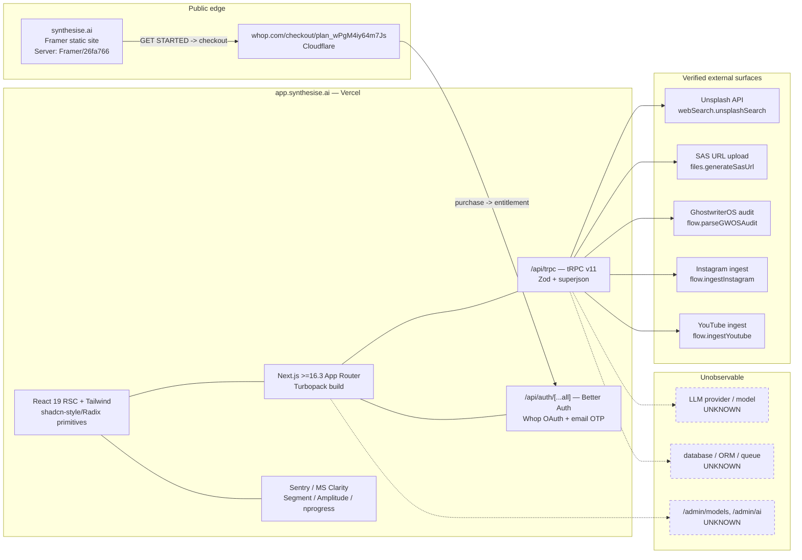
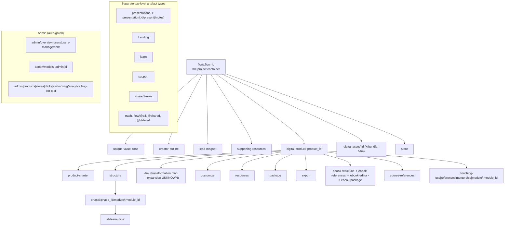

# Deliverable 3 — Technical architecture of Synthesise AI

**Compiled:** 2026-10-11 · **Evidence cut-off:** 2026-10-11 ·
**Deployment observed:** Next.js build `dpl_4U29zfpU2gSrZBJQtA6KJewkTvZt`, app served from `app.synthesise.ai`

Evidence ids: `E*` = `raw/lead_primary_evidence.md` (lead researcher, first-hand);
`T*` = `raw/synthesise_tech_and_prompts.md` + `raw/synthesise_tech_sources.csv`
(delegated technical audit); `M*` = `raw/monetise_ecosystem_sources.csv`.
Classification vocabulary: **VERIFIED** (directly observed, reproducible) ·
**OFFICIAL CLAIM** · **USER-REPORTED** · **INFERENCE** · **UNKNOWN** ·
**CONTRADICTED**. Confidence: high / medium / low.

---

## 0. The one-paragraph answer

Synthesise AI is a **Next.js 16 App-Router application on Vercel**, whose
interface layer is a **tRPC v11 + Zod + superjson** API behind **Better Auth**
with **Whop** as the identity, entitlement and checkout provider, and whose
domain surface is a staged **"flow → product → phase → module"** document
pipeline with **separate sub-pipelines for e-book, course, coaching,
presentation/slides, lead-magnet and digital-asset** deliverables. Its marketing
site is a **Framer template site**. Its **model provider, prompts, agent roster
and server-side compute are entirely unobservable** and no public evidence about
them exists; the one "documentation" site that describes them is contradicted by
the live deployment and is very probably not the operator's. Two things about
the *business* architecture are, however, verified and are more important than
any of the above: the app's users are **Whop buyers of an education bundle**, and
the product's inputs are **ingested creator content** (Instagram/YouTube) plus a
**sibling product's audit artefact**.

---

## 1. Verified system context



---

## 2. Layer-by-layer ledger

### 2.1 Marketing surface — **VERIFIED (high)**

| Fact | Evidence |
|---|---|
| Served by **Framer** (`Server: Framer/26fa766`, `Framer-Site-Id: 0abe48b3…`, `framerusercontent.com` preconnect) | E1, T01 |
| Last published **2026-09-09 19:45 UTC**; policy pages carry `published: "Sep 9, 2026, 7:45 PM UTC"` | E1, T11 |
| `sitemap.xml` contains only `/` and `/404`; the on-page copy — including pricing — is publicly fetchable via Framer's `framer-search-index` JSON | T03, T18 |
| Template provenance visible in unmodified layer names: `"Centralizing all your monthly expenses in one place to control your cash flow…"`, `"Amplify your financial freedom with smart and secure payment solutions."`, `"$29.99 / month"`; one leftover sentence is **visible to users** (`Instant insights, personalized control – your financial dashboard powerhouse.`) | E1a |
| Pricing shown: **$2,999 one-time** | E6 |
| Checkout: every CTA → `https://whop.com/checkout/plan_wPgM4iy64m7Js` | E3 |

**Why this matters technically:** there is **no first-party marketing stack**,
therefore no first-party signup funnel, no first-party attribution, and no
first-party A/B infrastructure. Acquisition, checkout, entitlement and
(per §2.5) the storefront all sit on Whop.

### 2.2 Application front end — **VERIFIED (high)**

| Component | Evidence |
|---|---|
| **Next.js ≥ 16.3**, App Router / RSC (`Vary: rsc, next-router-state-tree, …`, `self.__next_f` flight payload) | T04, T23 |
| **Turbopack** production build (`chunks/turbopack-40twjh2vcbrlg.js`, `react.memo_cache_sentinel`) | T04, T05 |
| **Vercel** hosting (`Server: Vercel`, `X-Vercel-Id`, CNAME → `…vercel-dns-016.com`) | E2, T21 |
| **Tailwind** utility layer + **shadcn/ui-style primitives over Radix** (`data-slot="button"`, `data-variant`, `dismissableLayer`, `DialogOverlay`) | T04, T05 |
| Icons **hugeicons** + **lucide**; toasts **sonner**; animation **framer-motion**; drag/drop **@dnd-kit**-family | T05 |
| Fonts: **DM Sans, Nohemi, Inter, Geist, SF Pro, Fraunces, Schibsted Grotesk**; includes a `/design-system` route | T04 |
| Security headers: `X-Frame-Options: SAMEORIGIN`, `nosniff`, HSTS `max-age=63072000; includeSubDomains; preload` | E2 |

**Note on a claim to discard:** `AdvancedImage`-style props suggest a Cloudinary
integration, but `cloudinary` appears in the bundle **only** inside Next.js's own
`imageConfigDefault` loader enum, and no cloud name or Cloudinary config exists.
Classify **NOT EVIDENCED** (T05). Anyone reading the bundle superficially would
get this wrong.

### 2.3 API, auth, payments — **VERIFIED (high)**

| Component | Evidence |
|---|---|
| **tRPC v11** at `/api/trpc`; live error envelope `{"code":-32004,"httpStatus":404,"path":"health","zodError":null}`; `-32001 UNAUTHORIZED`, `-32005 METHOD_NOT_SUPPORTED` | T06, E10a |
| **superjson** transformer (its exact deserialisation-error string is in the bundle) | E10a, T05 |
| **Zod** input validation (`zod` ×1119 corpus hits; `zodError` slot in the tRPC envelope) | T05, T06 |
| **Better Auth** — `Symbol.for("better-auth:broadcast-channel"|"better-auth:focus-manager"|"better-auth:online-manager")`, `"better-auth.message"`, default `basePath "/api/auth"`, `plugins[].fetchPlugins`; server `X-Matched-Path: /api/auth/[...all]`, `/api/auth/ok → {"ok":true}`, `/api/auth/get-session → null`, `/api/auth/session → 404` | T05, T07, T08 |
| **Whop** OAuth (`signIn.oauth2({providerId:"whop"})`, local `whop_logo_brandmark_orange.svg`) + email-OTP path keyed to *"the email you purchased Monetise with"* | T04, E10c |
| **Sentry** with a live DSN (`o4509693378625536.ingest.us.sentry.io`), **Microsoft Clarity** (`ClarityAnalytics` RSC component), **Segment** (×283), **Amplitude** (×1), **nprogress** (`#db2777`) | T05 |

> **Correction of record.** An earlier inference in this investigation labelled
> the auth layer "NextAuth" on the strength of the generic `/api/auth` prefix and
> a `signIn.oauth2()` call. That is wrong: Better Auth deliberately mirrors the
> next-auth client API, and Better Auth's own internal symbols are present. The
> corrected label is **Better Auth** (VERIFIED, high) — see T05/T07/T08 and the
> correction note in `raw/lead_primary_evidence.md` §E10c.

**Read this as an anti-pattern warning.** The stack is *modern and competent*
(Next 16, tRPC, Zod, Better Auth, Sentry/Clarity/Segment/Amplitude) but every
identity, payment and distribution primitive is rented from **Whop**. A
competitor can copy the stack in a weekend; it cannot copy the *funnel*, and the
product depends on the funnel (see Deliverable 1 §Business model).

### 2.4 The domain model — **VERIFIED (high), reconstructed from the route manifest**

A JavaScript chunk served to anonymous visitors embeds the app's complete client
route table. 74 routes were recovered (full list in `raw/lead_primary_evidence.md`
§E10b; the authoritative enumeration is T04 §A.4). The structure it reveals:



**Interpretation (INFERENCE, medium-high):** the unit of work is a **flow**; each
flow can carry several *typed* deliverables; each typed deliverable has its own
**staged sub-pipeline that terminates in package/export**; a storefront and a
public share link exist as first-class concepts; soft-delete and shared/all
views imply multi-project management; a `vtm` stage is attached to both products
and assets, most plausibly a **transformation map**, which is the mechanism the
product uses to justify a chapter structure.

### 2.5 Verified server-side capabilities (and verified absences)

Recovered by a **procedure-existence oracle** — calling `/api/trpc/<path>` on
registered vs unregistered paths and reading tRPC's own error codes (no
authentication was used or bypassed) (T06):

| Verified **present** | Verified **absent** |
|---|---|
| `flow.createFlow` | `uvz.*` |
| `flow.ingestInstagram`, `flow.ingestYoutube`, `flow.listYoutubeVideos` | `billing.*` |
| `flow.parseGWOSAudit` | `credits.*` |
| `product.createForFlow`, `product.get` | `export.*` |
| `charter.get` (auth-gated) | `analytics.*` |
| `course.get`, `presentation.get`, `presentation.outline.get` | `competitor.*` |
| `resources.{upload,addYoutubeLinks,get}` | `opportunity.*` |
| `files.{generateSasUrl,get}` | `persona.*` |
| `presentation.slides.{create,regenerate,duplicate,group,reorder,bulkDelete,toggleSkipped}` | `admin.models.*` |
| `presentation.blocks.{modify,delete,retryImage}` | `admin.ai.get` |
| `presentation.share.comments.{create,list}` | `store.buyer.*` |
| `webSearch.{unsplashSearch,search}` | |
| `log.clientError`, `admin.users.list` | |

**What the absences mean.** There is **no separately addressable UVZ service**, no
billing/credits service, no export service, no analytics or competitor service
at the observed namespaces. That does not prove the capabilities are absent — a
`/flow/:flow_id/unique-value-zone` route demonstrably exists — but it does prove
they are **not implemented as standalone engines with their own API surface**.
The most economical reading (INFERENCE, medium): UVZ/charter/outline generation
is implemented behind `flow.*`/`charter.*` and/or Next.js server actions rather
than as a named agent service. **A "UVZ engine", "validation protocol" or "agent
marketplace" as separately deployed systems is not evidenceable and should be
treated as marketing language.**

**Only instruction-shaped string in the entire client bundle** (the closest thing
to a public prompt):

> *"Optionally describe what you want, or leave blank to regenerate from the slide's context."* — per-block regenerate dialog (T05)

### 2.6 Ingestion, storage, image sourcing — **VERIFIED, with one INFERENCE**

* **Ingestion is the front door of the pipeline.** `flow.ingestInstagram`,
  `flow.ingestYoutube`, `flow.listYoutubeVideos` mean the creator's *own
  published content* is the raw material for positioning. This is the single
  most copyable and most under-appreciated mechanism in the product (E10c, T06).
* **Cross-product artefact ingestion**: `flow.parseGWOSAudit` consumes an audit
  produced by **Ghostwriter OS** — the sibling product sold in the same bundle
  (E5a, T06). This is a verified *integration*, not co-marketing.
* **File uploads use a two-phase SAS flow** (`files.generateSasUrl` → direct
  upload → `files.get`). "SAS" is Azure Blob terminology and the operator claims
  Microsoft Founders Hub membership, so **Azure Blob is the likely store
  (INFERENCE, medium)**. No blob hostname is observable (T06, T01).
* **Image sourcing is the Unsplash API** (`webSearch.unsplashSearch`, consumed as
  `e.urls.regular` / `e.user.name`, debounced 500 ms) — i.e. the product's
  imagery is third-party stock, not generated (T05, T06).
* **Presentation subsystem is real and unusually granular**: slides can be
  regenerated per block, reordered, grouped, skipped, image-retried, and shared
  with threaded comments — the only *user-visible* quality mechanism the product
  exposes (T05, T06, B.2).

### 2.7 What remains **UNKNOWN** — and must stay UNKNOWN in any honest report

| Unknown | Consequence |
|---|---|
| **LLM provider(s), model(s), versions, routing, temperature, context strategy** — zero provider tokens in 41 client chunks | Cannot compare model quality, cost, or capability. Any statement naming a model is fabrication. |
| **Prompts, agent roster, agent count, orchestration topology** | No public leak, no injection report, no user report of a fixed stage list, no published I/O example. The GitBook's four agent names are rejected (below). |
| **Server compute & runtime** (Vercel functions vs containers vs edge) | Cannot assess scaling behaviour or latency profile. |
| **Database / ORM / queue / vector store** | No ORM placeholders, connection strings, or client keys recoverable. Nothing to infer from. |
| **Server-side SSE/streaming** — `text/event-stream` occurs once, inside Sentry's own instrumentation denylist | The GitBook's "streaming response mode" claim is unsupported by app code. |
| **What `/admin/models` and `/admin/ai` actually do** (both probed → 404 at those namespaces) | Whether an operator can swap models or edit prompts is unknown; the routes' existence is only suggestive. |
| **The expansion of `vtm`** | Plausibly "value transformation map"; the expansion is inferred, not observed. |
| **Any automated fact-check, grounding or quality scoring** | *Not evidenced anywhere* (B.2). The Terms shift AI-accuracy responsibility onto the user (E4/§4 of the ToS). |

---

## 3. The rejected "documentation" — a first-class finding

`synthesise-ai.gitbook.io` presents itself as Synthesise AI's documentation and is
**not linked from `synthesise.ai`** (whose sitemap has two entries) nor referenced
in the app. It claims a Rust core, WASM micro-agents, PostgreSQL + Redis,
Kubernetes, a first-party Stripe webhook processor, four named agents
(`TutorAgent`, `SEOAgent`, `UXAuditAgent`, `MonetizationAgent`), a
cosine-similarity UVZ engine, and a **`$SYNAI` token launching on `pump.fun`
(Solana)** with a **95 % "liquidity pool"** allocation.

Every technological claim is contradicted by the observable deployment, and every
code sample is a decorative stub, e.g.:

```rust
impl Agent for SEOAgent {
    fn act(&self, input: &str) -> String {
        format!("Generating tags for '{}'", input)     // returns a literal
    }
}
```

**Classification: CONTRADICTED / UNVERIFIED; almost certainly AI-generated or
scam-adjacent (high confidence).** It must never be cited as evidence of
Synthesise AI's implementation. The residual risk it represents — a
brand-impersonating or speculative-token documentation site attached to a
premium paid product — is itself a finding worth acting on operationally if one
were a customer (E7, T13–T17, B.3).

---

## 4. What this architecture *is*, in one honest judgement

| Question | Answer | Basis |
|---|---|---|
| Is it technically sophisticated? | The **front end is** (Next 16 App Router + tRPC + Zod + Better Auth + Turbopack + a granular presentation/slide engine). The **product layer is a conventional staged document pipeline.** | VERIFIED via code; INFERENCE for the product layer |
| Is it multi-agent? | **Not evidenceable.** The route table shows *stages of one pipeline*; the only agent names in existence come from a rejected crypto-token page. The honest statement is: **an unknown number of LLM calls behind an unknown orchestration**. | VERIFIED absence of evidence |
| Is the moat technical? | **No.** Every verified technical component is off-the-shelf and replaceable. The verified moat is **distribution**: Whop identity/checkout/storefront + an education bundle's buyer base + the operator's ~6M-subscriber personal brand. | E3, E5a, T04, M4/M6/M32 |
| What is genuinely worth copying? | (1) **Ingestion-first positioning** — read the creator's real Instagram/YouTube corpus instead of asking them to describe themselves. (2) **Typed, staged, resumable project artefacts** (flow → product → charter → structure → phase/module → package → export) with per-format sub-pipelines. (3) **Per-block regeneration with an optional user instruction** as the quality-control surface. (4) **Reading a sibling artefact as input** (`parseGWOSAudit`) — i.e. composing products out of each other. (5) A **storefront/share surface** built in from the start. | E10b, E10c, T04, T05, T06 |
| What must NOT be copied? | The **absence of any evidenced fact-checking**, the **presence-based notion of "done"**, and a marketing stack whose claims outrun the deployment. | B.2, §2.7 |

---

## 5. Method limitations of this technical report

1. **No authentication was used and no account was created.** Everything observed
   is what an anonymous visitor can see; no generation output, no dashboard, no
   admin surface, and no prompt was inspected. Any claim about generated artefact
   *quality* comes from user reports, not from first-hand product output.
2. **Only chunks referenced by anonymous pages were retrievable**, so
   auth-gated feature code is unobserved.
3. **Chunk hashes rotate per deployment**; every observation is tied to
   `dpl_4U29zfpU2gSrZBJQtA6KJewkTvZt` on 2026-10-11. Re-verification requires a
   fresh capture.
4. **GitHub code search is login-gated** — recorded as a limitation, **not** a
   negative result.
5. **Procedure existence ≠ capability.** The oracle proves a path is registered;
   it says nothing about behaviour, quality, or whether the path is exercised.
6. **Cookie/consent banners mean some client-side tags may not execute** for an
   anonymous fetch; the analytics list is what is *shipped*, not necessarily what
   *fires*.
